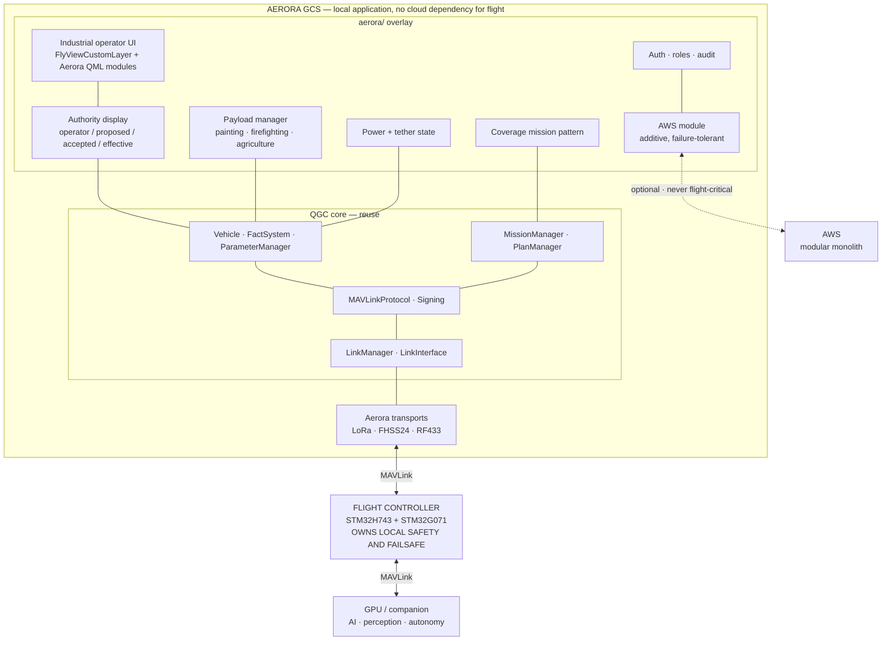
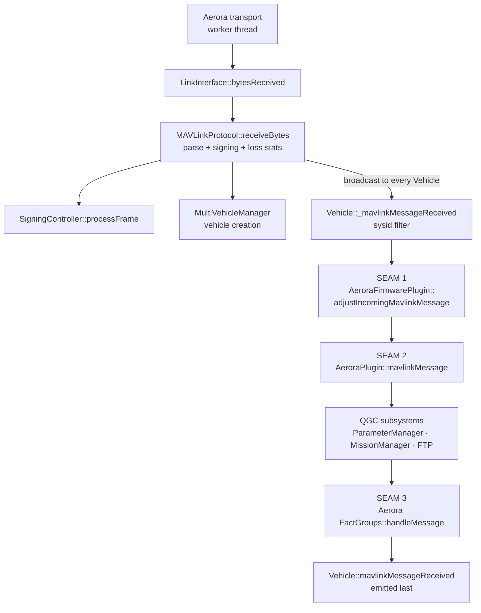
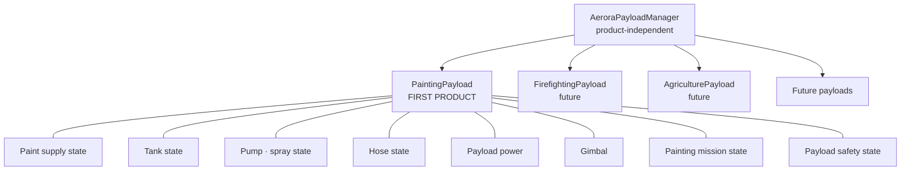
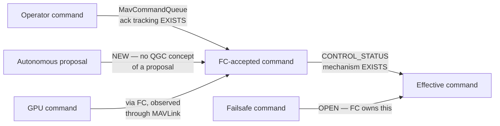
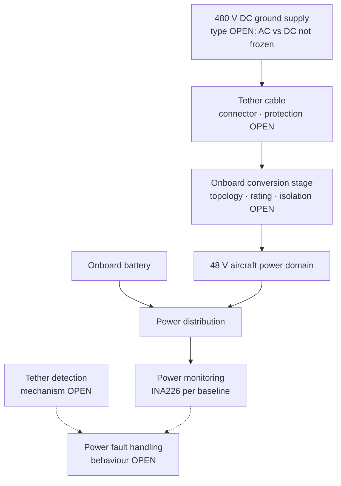
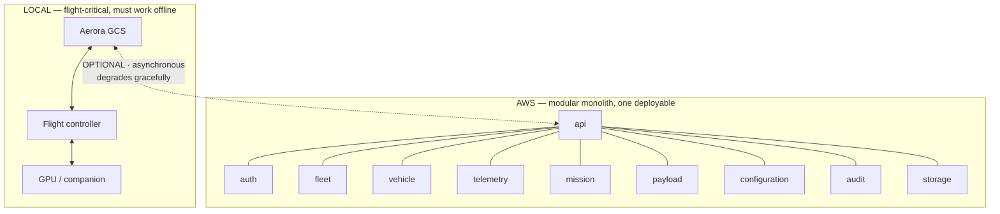

# Aerora Extension Map

Where each Aerora capability attaches to QGroundControl. Every row in this document is `PROPOSED`
unless marked otherwise — this is the output of analysis, not a ratified requirement.

## Source of Aerora capabilities

Capabilities below are drawn from the v4.1 product baseline, specifically its `README.md`,
`PROJECT_STATUS.md`, and the directive that produced this analysis. Nothing has been invented. Where
a capability depends on information the baseline marks as deferred, this document says so and stops
at that boundary rather than guessing.

## Delivery model

**One Aerora overlay directory, activated by `QGC_CUSTOM_DIR`.** This is the single most important
structural conclusion.

```text
AeroraGCS/                              ← fork of mavlink/qgroundcontrol
├── aerora/                             ← QGC_CUSTOM_DIR=aerora
│   ├── CMakeLists.txt                  REQUIRED by the overlay contract
│   ├── cmake/
│   │   └── CustomOverrides.cmake       REQUIRED — branding, dialect pin, factory disables
│   ├── src/
│   │   ├── AeroraPlugin.{h,cc}         CUSTOMCLASS — the root of all Aerora C++
│   │   ├── FirmwarePlugin/             Aerora FC abstraction + self-registering factory
│   │   ├── AutoPilotPlugin/            Aerora setup pages
│   │   ├── FactGroups/                 Payload, power, tether, autonomy telemetry
│   │   ├── MissionManager/             Coverage pattern + plan creator
│   │   ├── Payload/                    Payload manager abstraction
│   │   ├── Settings/                   Aerora settings groups + metadata JSON
│   │   ├── Cloud/                      AWS module — strictly off the command path
│   │   ├── Security/                   Auth, roles, audit
│   │   ├── AppSettings/pages/          Settings page overlay JSON
│   │   ├── PlanView/                   Pattern editor + map visual QML
│   │   └── *.qml                       Core QML overrides via the interceptor
│   └── res/                            Branding, icons, new QML module content
└── src/Comms/                          ← THE ONLY core edits: transport registration
```

Everything except the transport registration lives in `aerora/`. That is the design target, and it
is achievable based on the seams documented in this analysis.

Note that CI proves the overlay works **without renaming** — `.github/workflows/custom-build.yml`
configures with `-DQGC_CUSTOM_DIR=custom-example`. So Aerora can use the directory name `aerora`
and keep `custom-example` intact as a living reference.

## Capability attachment table

| Aerora capability | Attachment point | Core edit? | Status |
| --- | --- | --- | --- |
| Aerora MAVLink dialect | `QGC_MAVLINK_GIT_REPO` / `_TAG` / `_DIALECT` set from `CustomOverrides.cmake`, pointing at an Aerora mavlink fork | No | `PROPOSED` |
| Aerora message handling | `QGCCorePlugin::mavlinkMessage()` | No | `PROPOSED` |
| Payload / power / tether / autonomy telemetry | New FactGroups via `FirmwarePlugin::factGroups()`, each with its own metadata JSON | No | `PROPOSED` |
| Aerora flight controller abstraction | `AeroraFirmwarePlugin : FirmwarePlugin` + self-registering `AeroraFirmwarePluginFactory` | No | `PROPOSED` |
| Aerora vehicle setup pages | `AeroraAutoPilotPlugin : AutoPilotPlugin`, returned from `FirmwarePlugin::autopilotPlugin()` | No | `PROPOSED` |
| Painting coverage mission pattern | `ComplexMissionItem` subclass + `complexMissionItemNames()` + `createComplexMissionItem()` + `planCreators()` | No | `PROPOSED` |
| Pattern swath width and trigger interval | `CameraCalc` in manual-camera mode — the sanctioned non-camera reuse path | No | `PROPOSED` |
| Aerora plan file data | The six `preSave` / `postSave` / `preLoad` / `postLoad` plugin hooks, with a nested `version` key | No | `PROPOSED` |
| Industrial operator UI | `FlyViewCustomLayer.qml` override, plus new QML modules | No | `PROPOSED` |
| Toolbar indicators (tether, paint, GPU) | `QGCCorePlugin::toolBarIndicators()` or `FirmwarePlugin::toolIndicators()` | No | `PROPOSED` |
| Branding | `CustomOverrides.cmake` cache forcing + `/Custom/res` resource aliasing | No | `PROPOSED` |
| Theme | `QGCCorePlugin::paletteOverride()` — all ~50 roles, four variants each | No | `PROPOSED` |
| Aerora settings | `registerCustomSettings()` + `SettingsManager::registerCustomSettingsGroup()` + metadata JSON + `/json` resource | No | `PROPOSED` |
| Settings page placement | `aerora/src/AppSettings/pages/SettingsPages.json` overlay | No | `PROPOSED` |
| Aerora pre-flight checklist | `QGCOptions::preFlightChecklistUrl()` | No | `PROPOSED` |
| Simplified operator mode | `_showAdvancedUI = false` in the plugin constructor, as `custom-example` does | No | `PROPOSED` |
| Link configuration injection at boot | `QGCCorePlugin::linkConfigurationsLoaded(LinkManager*)` | No | `PROPOSED` |
| Aerora map items | `QGCCorePlugin::customMapItems()` | No | `PROPOSED` |
| Aerora Analyze pages | `QGCCorePlugin::analyzePages()` | No | `PROPOSED` |
| MAV_CMD UI metadata overrides | `FirmwarePlugin::missionCommandOverrides()` + override JSON | No | `PROPOSED` |
| **New MAV_CMD entries in the Plan UI** | Base `MavCmdInfoCommon.json`, **or** an unverified resource-alias shadow | **Likely yes** | `OPEN` |
| **LoRa / FHSS24 / RF433 transports** | `LinkInterface` + `LinkConfiguration` subclasses, **plus 1 enum + 4 switches + 1 string list** | **Yes — unavoidable** | `PROPOSED` |
| **Command authority model** | Extend the existing `requestOperatorControl` / `gcsControlStatusFlags` mechanism | Possibly | `PROPOSED` |
| **Mission resume with payload state** | `includedResumeCommands` is a core allow-list | **Yes** | `OPEN` |
| Operator authentication and roles | No foundation exists | New module | `PROPOSED` |
| Audit logging | Extend `LogManager` | New work | `PROPOSED` |
| AWS cloud module | New module, strictly additive, never on the command path | No core edit | `PROPOSED` |
| Fleet management | New module | No core edit | `PROPOSED` |
| **Failsafe behaviour** | **Not an extension point. Belongs to the flight controller** | No | `OPEN` — deferred by the baseline |

## Significant finding — an existing authority mechanism

Not previously identified in the v4.1 baseline, and directly relevant to the Aerora authority
requirement.

`src/Vehicle/Vehicle.h` contains a control-status handler block with these members:

```cpp
Q_INVOKABLE void requestOperatorControl(bool allowOverride, int requestTimeoutSecs = 0);
Q_INVOKABLE void startTimerRevertAllowTakeover();

Q_PROPERTY(uint8_t gcsMain                               ...)
Q_PROPERTY(bool    gcsControlStatusFlags_SystemManager   ...)
Q_PROPERTY(bool    gcsControlStatusFlags_TakeoverAllowed ...)
Q_PROPERTY(bool    firstControlStatusReceived            ...)
Q_PROPERTY(int     operatorControlTakeoverTimeoutMsecs   ...)
Q_PROPERTY(int     requestOperatorControlRemainingMsecs  ...)
Q_PROPERTY(bool    sendControlRequestAllowed             ...)
```

With handlers `_handleControlStatus(const mavlink_message_t&)`,
`_handleCommandRequestOperatorControl(...)`, and
`_requestOperatorControlAckHandler(...)`.

This is a genuine multi-GCS control-authority handshake with timeout and takeover semantics. The
product baseline requires that the GCS distinguish operator command, autonomous proposal, GPU
command, flight-controller-accepted command, effective command, and failsafe command. **This
mechanism is the correct foundation for that model and should be studied before anything new is
designed.**

Combined with the acknowledgement tracking in `MavCommandQueue` — which distinguishes sent from
accepted, handles `MAV_RESULT_IN_PROGRESS`, and reports rejection via `commandResult` — the raw
material for an explicit authority display already exists.

What does **not** exist, and is genuinely new Aerora work: any notion of a *proposed* command that
is not yet an effective command. QGC has no concept of an autonomy proposal awaiting operator or
flight-controller acceptance. Recorded as `PROPOSED` work in the authority model.

## Architecture diagrams

### Aerora GCS target architecture



The dashed line to AWS is the critical constraint. Loss of internet, AWS, cloud API, cloud storage,
or cloud telemetry must not imply loss of aircraft control. This is consistent with the inherited
QGC architecture, which has no cloud dependency on the command path — see
[security-architecture.md](security-architecture.md).

### MAVLink data flow with Aerora seams



Seam ordering matters. `adjustIncomingMavlinkMessage` can rewrite a message in place;
`mavlinkMessage` can veto processing; FactGroups receive the message after QGC subsystems have run.
Aerora telemetry belongs in seam 3 so that values become Facts with units, bounds, and QML binding.

### Payload abstraction



Each leaf state maps to a Fact in an Aerora FactGroup. **Final actuator interfaces are not
assumed** — the v4.1 baseline marks them as unconfirmed, and this map stops at the abstraction
boundary.

### Authority model



Legend for implementation status: acknowledgement tracking and control status exist in QGC and
should be extended; the *proposal* concept is new Aerora work; failsafe is deferred to the flight
controller by the baseline and must not be inferred.

### Power and tether domains

Treated as separate engineering domains per the baseline directive. This diagram records the
**domain boundaries only**. No transition behaviour is implied, because the baseline explicitly
marks source-transition behaviour as a controlled open item.



Dashed edges indicate relationships whose behaviour is undefined. The GCS role here is
**observation and annunciation**: report the configuration and the monitored values, and do not
assume automatic switching exists.

### Cloud architecture



Module names follow the baseline's modular-monolith direction. Internal boundaries are clear; the
whole is one deployable application, with future extraction possible if scale requires it.

## Phasing

Derived from the dependency structure discovered in this analysis, not from a schedule.

| Phase | Work | Gated on |
| --- | --- | --- |
| **2** | Aerora architecture specification | This document set being reviewed |
| **3** | Detailed requirements with stable identifiers | Phase 2, plus the `OPEN` items that block requirement writing |
| **4** | Implementation specifications | Phase 3 |
| **5a** | Overlay scaffold — `aerora/` directory, `CustomOverrides.cmake`, `AeroraPlugin` skeleton, branding | Fork created, Qt licence decision made |
| **5b** | Aerora dialect fork and pin, plus `mavlinkMessage` seam | 5a |
| **5c** | Aerora FactGroups for payload, power, tether, autonomy | 5b, plus confirmed message definitions |
| **5d** | Firmware plugin and setup pages | 5c |
| **5e** | Coverage mission pattern | 5a; independent of the transport work |
| **5f** | Transport layer — the only core edits | 5a, plus the transport-granularity decision |
| **5g** | Security module — auth, roles, audit | 5a; independent |
| **5h** | Cloud module | 5g |
| **6** | Testing | Continuous from 5a |
| **7** | Integration | 5f complete |
| **8** | Flight and operational validation | Hardware availability; failsafe definition frozen |

Phases 5e, 5f, and 5g are mutually independent and can proceed in parallel once 5a exists. The
scaffold is therefore the critical first deliverable of any implementation phase.

## What Aerora must not do

Derived from the architecture, and non-negotiable given the baseline's stated principles.

| Prohibition | Reason |
| --- | --- |
| Do not move flight-controller safety logic into the GCS | The baseline requires the aircraft retain local control and safety capability. QGC's comm-loss handling is annunciation, not control — preserve that boundary |
| Do not invent failsafe behaviour | Explicitly deferred to a future Simulink implementation. Do not populate `FirmwarePlugin` named flight-mode accessors with guessed Aerora mode names |
| Do not create custom parameter storage | The Fact system is mandatory. Golden rule, and enforced by convention |
| Do not put AWS on the command path | Loss of cloud must never imply loss of control |
| Do not represent a proposal as an effective command | Core baseline principle; QGC has no such concept, so Aerora must build it explicitly |
| Do not assume seamless tether-to-battery power transition | The baseline marks transition behaviour as unverified |
| Do not fork core QML files wholesale | The URL interceptor provides per-file override; wholesale forking creates an unmaintainable merge burden |
| Do not store per-vehicle state on a `FirmwarePlugin` | Plugins are shared singletons per firmware class; use `FirmwarePluginInstanceData` |
| Do not extend the `Vehicle` class | Already 3573 lines in the implementation. Attach via FactGroups and plugin seams |
| Do not insert a `LinkType` enum value anywhere but immediately before `TypeLast` | Integer values are persisted in `QSettings` |
| Do not commit to `origin` | It points at upstream `mavlink/qgroundcontrol`. A fork and remote reconfiguration is required first |
