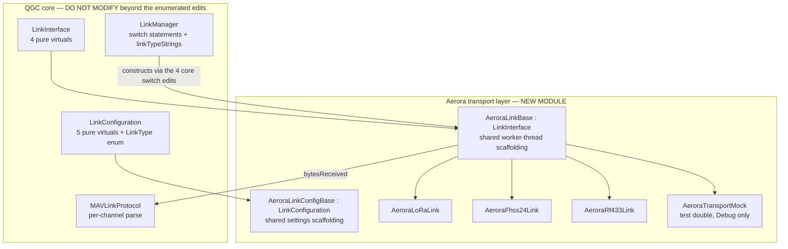

# Communication Architecture

The link layer, its threading model, lifecycle, reconnect behaviour, and — critically for Aerora —
exactly how extensible it is.

## Headline finding

**Transports are not pluggable.** Adding a new transport type requires editing one enum, four
switch statements, and one order-coupled string list across three core files. There is no
registration API, no factory map, and no `QPluginLoader` seam. This is the single most consequential
architectural constraint discovered in this analysis for Aerora's multi-link requirement, and it is
escalated in [risk-register.md](risk-register.md).

## LinkInterface

`src/Comms/LinkInterface.h`, class at line 21. Derives from `QObject`, registered to QML via
`QML_ELEMENT` and `QML_UNCREATABLE`, and declares `friend class LinkManager` at line 25.

It is not an abstract interface in the thin sense — it carries substantial shared state: the
MAVLink channel, the signing controller, a vehicle reference count, and v1/v2 traffic tracking.

### Pure virtuals — exactly four

| Member | Line | Access | Note |
| --- | --- | --- | --- |
| `Q_INVOKABLE virtual void disconnect() = 0` | 30 | public | Comment requires idempotency |
| `virtual bool isConnected() const = 0` | 32 | public | |
| `virtual void _writeBytes(const QByteArray&) = 0` | 97 | **private slots** | Not thread-safe by contract |
| `virtual bool _connect() = 0` | 101 | **private** | Private so links can only be started by `LinkManager` |

Because `_connect()` and `_writeBytes()` are private or private-slot in the base, and
`LinkManager` is the only friend, a subclass must re-declare them. The constructor is `protected`
with a comment stating links are only created by `LinkManager`. **An out-of-tree subclass could
not be started without touching `LinkManager`.** That is a deliberate lockdown, not an oversight.

### Optional virtuals

| Member | Line | Default |
| --- | --- | --- |
| `isLogReplay()` | 33 | `false` |
| `isSecureConnection()` | 34 | `false` — true for USB, wired ethernet |
| `isRadioLink()` | 37 | `_radioStatusSeen` — auto-detected from RADIO_STATUS traffic |
| `_allocateMavlinkChannel()` | 85 | Allocates one channel; `MockLink` overrides to take two |
| `_freeMavlinkChannel()` | 87 | |

`isRadioLink()` is documented as detecting SiK and RFD telemetry radios with their roughly
252-byte air frame. Detection via RADIO_STATUS means it works even through UDP or TCP bridges.
`SerialLink` overrides it (`SerialLink.h:177`) to also return true when VID/PID identified a SiK
radio.

### Signals

```cpp
void bytesReceived(LinkInterface *link, const QByteArray &data);
void bytesSent(LinkInterface *link, const QByteArray &data);
void connected();
void disconnected();
void communicationError(const QString &title, const QString &error);
```

`LinkInterface.h:70-75`.

### Shared services provided by the base

| Service | Location |
| --- | --- |
| `writeBytesThreadSafe(const char*, int)` — wraps bytes and posts `_writeBytes` via `QMetaObject::invokeMethod` | `LinkInterface.cc:142-146` |
| `sendMessageThreadSafe(mavlink_message_t&)` — the single outbound chokepoint: re-sign, serialise, write | `LinkInterface.cc:148-161` |
| MAVLink channel ownership plus `SigningController` creation | `LinkInterface.cc:91-120` |
| Vehicle reference counting — `addVehicleReference()`, `removeVehicleReference()`, `_connectionRemoved()`; the link self-disconnects when the last reference goes | `LinkInterface.cc:163-180` |
| MAVLink v1 deprecation warning with a grace period, `kMavlinkV1TrafficGraceMsecsDefault = 10000` ms | `LinkInterface.h:60`, logic `.cc:191-215` |
| `_shutdownWorkerThread(QThread*, const QLoggingCategory&, bool allowTerminate)` | `LinkInterface.h:89`, impl `.cc:33-62` |

The v1 grace period exists because ArduPilot starts links in v1 and upgrades to v2 on the first v2
message from QGC; the warning only fires if a link never produces v2 within the window.

Typedefs at the bottom of the header: `SharedLinkInterfacePtr = std::shared_ptr<LinkInterface>`
and `WeakLinkInterfacePtr`.

## LinkConfiguration

`src/Comms/LinkConfiguration.h`, class at line 13. The persistable, QML-editable settings object
for a link, plus the runtime holder of reconnect state and a weak back-pointer to the live link.

### Properties

`name`, `link` (`LinkInterface*`), `linkActive`, `linkType` (CONSTANT), `dynamic`, `autoConnect`,
`settingsURL`, `settingsTitle`, `highLatency`.

`linkActive()` deliberately reports `(link() != nullptr) || (_autoConnect && _autoConnectStarted
&& !_suppressAutoReconnect)` so the UI does not flicker between reconnect attempts.

### Pure virtuals — exactly five

| Member | Line |
| --- | --- |
| `virtual LinkType type() const = 0` | 119 |
| `virtual void loadSettings(QSettings&, const QString &root) = 0` | 124 |
| `virtual void saveSettings(QSettings&, const QString &root) const = 0` | 129 |
| `virtual QString settingsURL() const = 0` | 132 |
| `virtual QString settingsTitle() const = 0` | 135 |

Plus `virtual void copyFrom(const LinkConfiguration *source)` (line 104, default at
`.cc:41-50`), which subclasses override to copy their own fields.

### The LinkType enum

`LinkConfiguration.h:108-121`, carrying an explicit in-source warning at lines 106-107 that any
change here must be reflected in `LinkManager::linkTypeStrings()`:

```cpp
enum LinkType {
#ifndef QGC_NO_SERIAL_LINK
    TypeSerial,
#endif
    TypeUdp,
    TypeTcp,
    TypeBluetooth,
#ifdef QT_DEBUG
    TypeMock,
#endif
    TypeLogReplay,
    TypeLast        // type >= TypeLast == invalid
};
```

Two hazards here, both relevant to Aerora:

- The enum values are **build-configuration dependent**, conditional on `QGC_NO_SERIAL_LINK` and
  `QT_DEBUG`.
- The integer value is what gets **written to `QSettings`**, and is also used as the QML combo-box
  index. Inserting a value anywhere other than immediately before `TypeLast` silently invalidates
  users' saved link configurations.

### Static factories — both switch statements

- `LinkConfiguration::createSettings(int type, const QString &name)` — `.cc:52-86`
- `LinkConfiguration::duplicateSettings(const LinkConfiguration *source)` — `.cc:88-120`
- `settingsRoot()` returns `"LinkConfigurations"` (header line 143)

### Settings serialisation

Split between the manager and the configuration.
`LinkManager::saveLinkConfigurationList()` (`.cc:345-372`) writes the generic keys `name`, `type`,
`auto`, `high_latency` under `LinkConfigurations/Link<N>/`, then calls
`linkConfig->saveSettings(settings, root)` for type-specific fields, then
`LinkConfigurations/count`. Configurations with `isDynamic() == true` are skipped on save
(lines 356-358). `loadLinkConfigurationList()` (`.cc:374-444`) reverses it.

### Reconnect state

Lives on the configuration (header lines 66-88, 170-179):

| Constant | Value |
| --- | --- |
| `_reconnectBaseMs` | 1000 |
| `_reconnectMaxMs` | 5000 |
| `_reconnectStableMs` | 2000 — minimum connected duration to count as a working link |

`noteReconnectAttempt()` computes `exp = qMin(_reconnectAttempts, 16)`, caps attempts at 17, and
sets `_nextReconnect = QDeadlineTimer(qMin(_reconnectBaseMs << exp, _reconnectMaxMs))`. So backoff
runs 1 s, 2 s, 4 s, then pins at 5 s. `noteDisconnected()` only resets the backoff if the link
stayed up for at least `_reconnectStableMs`, so a link that flaps instantly keeps escalating.

## Concrete transports

Six exist in this checkout.

| Transport | Link class | Config class | File |
| --- | --- | --- | --- |
| Serial | `SerialLink` + `SerialWorker` | `SerialConfiguration` | `src/Comms/Serial/SerialLink.{h,cc}` |
| UDP | `UDPLink` + `UDPWorker` | `UDPConfiguration` | `src/Comms/UDPLink.{h,cc}` |
| TCP | `TCPLink` + `TCPWorker` | `TCPConfiguration` | `src/Comms/TCPLink.{h,cc}` |
| Bluetooth | `BluetoothLink` + `BluetoothWorker` | `BluetoothConfiguration` | `src/Comms/Bluetooth/BluetoothLink.{h,cc}` |
| Log replay | `LogReplayLink` + `LogReplayWorker` | `LogReplayConfiguration` | `src/Comms/LogReplayLink.{h,cc}` |
| Mock (Debug only) | `MockLink` + `MockLinkWorker` | `MockConfiguration` | `src/Comms/MockLink/` |

`src/Comms/` contains only `Bluetooth/`, `MockLink/`, and `Serial/` subdirectories, and
`src/Comms/CMakeLists.txt` adds exactly those three.

### AirLink has been removed

**There is no AirLink in this checkout.** The only repository-wide matches are stale translation
catalogue entries referencing `../src/Comms/AirLink/AirLinkLink.h` and `AirLinkSettings.qml`,
paths that no longer exist, plus two unrelated hardware-name matches ("PX4 FMU SmartAP AIRLink" in
`src/Comms/Serial/USBBoardInfo.json`, and `sky-drones_smartap-airlink_default` in
`FirmwareUpgradeController.cc`). Any Aerora design that assumed an existing cloud-relay transport
must be revised.

## Threading

Every real transport runs its I/O on its own dedicated `QThread`, using a uniform worker-object
pattern. The `LinkInterface` subclass lives on the main thread; a separate `*Worker` QObject is
moved onto a per-link thread that the **link** owns.

Confirmed `moveToThread` sites and thread names:

| File | Line | Thread name |
| --- | --- | --- |
| `src/Comms/UDPLink.cc` | 499 | `UDP_<configName>` |
| `src/Comms/TCPLink.cc` | 260 | `TCP_<name>` |
| `src/Comms/Serial/SerialLink.cc` | 376 | `Serial_<name>` |
| `src/Comms/Bluetooth/BluetoothLink.cc` | 32 | |
| `src/Comms/LogReplayLink.cc` | 431 | `LogReplay_<name>` |
| `src/Comms/MockLink/MockLink.cc` | 240 | `Mock_<name>` |

The thread is a QObject child of the link — `_workerThread(new QThread(this))`.

### Canonical wiring

`UDPLink::UDPLink` (`UDPLink.cc:488-510`):

```cpp
_workerThread->setObjectName(QStringLiteral("UDP_%1").arg(_udpConfig->name()));
_worker->moveToThread(_workerThread);
connect(_workerThread, &QThread::started,  _worker, &UDPWorker::setupSocket);
connect(_workerThread, &QThread::finished, _worker, &QObject::deleteLater);
connect(_worker, &UDPWorker::connected,     this, &UDPLink::_onConnected,     Qt::QueuedConnection);
connect(_worker, &UDPWorker::disconnected,  this, &UDPLink::_onDisconnected,  Qt::QueuedConnection);
connect(_worker, &UDPWorker::errorOccurred, this, &UDPLink::_onErrorOccurred, Qt::QueuedConnection);
connect(_worker, &UDPWorker::dataReceived,  this, &UDPLink::_onDataReceived,  Qt::QueuedConnection);
connect(_worker, &UDPWorker::dataSent,      this, &UDPLink::_onDataSent,      Qt::QueuedConnection);
_workerThread->start();
```

### Inbound data crossing threads

1. Worker thread: `UDPWorker::_onSocketReadyRead()` reads datagrams and coalesces them, emitting
   `dataReceived(buffer)` when the buffer exceeds a trigger size or a time limit elapses
   (`UDPLink.cc:440-468`).
2. `Qt::QueuedConnection` hop to the main-thread slot `UDPLink::_onDataReceived`
   (`.cc:560-563`), which re-emits `bytesReceived(this, data)`.
3. `LinkManager::createConnectedLink` wired that to the protocol singleton at
   `LinkManager.cc:196`. `MAVLinkProtocol` is a main-thread `Q_APPLICATION_STATIC` and
   `receiveBytes` is a public slot, so **parsing happens on the main thread**.
4. `receiveBytes` re-resolves the link through
   `LinkManager::sharedLinkInterfacePointerForLink(link)` and bails with a debug log if the link
   has already been removed — the guard for in-flight queued data after disconnect.

Control calls are queued, never blocking. `UDPLink::_connect()` is literally
`return QMetaObject::invokeMethod(_worker, "connectLink", Qt::QueuedConnection);`
(`UDPLink.cc:534-537`).

### Thread shutdown is deliberately defensive

`LinkInterface.cc:33-77`, with `WORKER_SHUTDOWN_TIMEOUT_MS = 3000` at line 16:

| Case | Behaviour |
| --- | --- |
| Called from the worker thread itself | `quit()` then orphan — `wait()` would fail and `terminate()` would kill the calling thread mid-destructor |
| Normal | `quit()` + `wait(3000)` |
| Timeout, `allowTerminate` true | `terminate()` + another `wait(3000)` |
| Last resort | `_orphanWorkerThread()` |

`_orphanWorkerThread()` does `setParent(nullptr)` so the `QThread` destructor in `deleteChildren()`
cannot abort, keeps the `SharedLinkConfigurationPtr` alive via a lambda capture on
`QThread::finished` so a resumed worker cannot dereference a destroyed configuration, and
`deleteLater`s the thread if it ever finishes. The code is explicit that at application exit both
leak intentionally. `UDPLink::~UDPLink` passes `allowTerminate = false` because the worker can hold
a mutex.

`LinkManager::_rgLinks` is guarded by `QMutex _linksMutex` (`LinkManager.h:141-142`) because links
are touched from multiple threads.

## Lifecycle

`LinkManager` is a `Q_APPLICATION_STATIC` singleton (`LinkManager.cc:39`), QML-exposed via
`QML_ELEMENT`/`QML_UNCREATABLE`.

### Initialisation

`LinkManager::init()` (`.cc:65-88`) grabs `AutoConnectSettings`, constructs `SerialAutoConnect`
with a callback that creates connected links, and — unless `QGC::runningUnitTests()` — starts
`_portListTimer` at `_autoconnectUpdateTimerMSecs = 1000` ms (`LinkManager.h:154`) wired to
`_updateAutoConnectLinks()`.

### Connect — the single construction point

`bool LinkManager::createConnectedLink(SharedLinkConfigurationPtr &config)` (`.cc:135-220`):

1. `config->setSuppressAutoReconnect(false)`.
2. **A switch on `config->type()`** constructs the concrete link via `std::make_shared<...>`
   (lines 141-176). Serial additionally goes through
   `SerialPortManager::instance()->reservePort(portName)` and fails early if the port is already
   reserved.
3. `link->_allocateMavlinkChannel()` — bail with a warning on failure.
4. Wire five signals **before** adding to the list (lines 195-199): `communicationError`,
   `bytesReceived` to `MAVLinkProtocol::receiveBytes`, `bytesSent` to
   `MAVLinkProtocol::logSentBytes`, `connected`, `disconnected`.
5. `MAVLinkProtocol::instance()->resetMetadataForLink(link.get())`.
6. `link->_connect()`. On failure, disconnect all five signals, free the channel, null the
   configuration's link pointer, return false (lines 204-213).
7. On success, lock `_linksMutex`, append to `_rgLinks`, then `config->setLink(link)`.

### Disconnect and deletion

`disconnectLink(LinkInterface*)` (`.cc:110-121`) sets `suppressAutoReconnect(true)` then calls
`link->disconnect()`. `disconnectLinkConfiguration()` (`.cc:123-133`) does the same but works
even when no live link exists.

`LinkManager::_linkDisconnected()` (`.cc:278-329`) resolves `sender()`, erases the entry from
`_rgLinks` under the mutex while holding a local `SharedLinkInterfacePtr linkToCleanup` so the
object survives the rest of the function, calls `config->noteDisconnected()` and
`config->setLink(nullptr)`, disconnects all five signals, then frees the MAVLink channel. Actual
destruction happens when the last `shared_ptr` reference drops — `Vehicle` holds references via
`addVehicleReference()`.

### Application shutdown

`LinkManager::shutdown()` (`.cc:556-565`) suspends connections, disconnects all, then spins
`QCoreApplication::processEvents(QEventLoop::ExcludeUserInputEvents)` until the vehicle count
reaches zero.

### Auto-connect

`startAutoConnectedLinks()` (`.cc:689-697`) iterates configurations and starts those flagged
`isAutoConnect()`.

The running mechanism is the 1 Hz `_portListTimer` to `_updateAutoConnectLinks()` (`.cc:532-554`),
which snapshots serial ports **before** the suspension check (existing links still need unplug
checks while new connections are suspended), returns early if suspended, then:

| Helper | Line | Creates |
| --- | --- | --- |
| `_addUDPAutoConnectLink()` | 446-471 | `"UDP Link (AutoConnect)"`, dynamic, gated on `autoConnectUDP()` |
| `_addMAVLinkForwardingLink()` | 473-490 | `"MAVLink Forwarding Link"`, dynamic + forwarding, gated on `forwardMavlink()` |
| `_reconnectAutoConnectLinks()` | 492-514 | See below |
| `_serialAutoConnect->update(...)` | 550-554 | Serial discovery |

`createMavlinkForwardingSupportLink()` (`.cc:626-632`) creates
`"MAVLink Support Forwarding Link"` on demand. Both forwarding links go through
`_createDynamicForwardLink()` (`.cc:744-756`), which sets `setDynamic(true)` and
`setForwarding(true)`.

**Which types support auto-connect:** only UDP (the generic listener plus the forwarding links) and
Serial (via `SerialAutoConnect`, restricted to USB-identified boards). Separately, **any**
persisted configuration of **any** type can carry the `autoConnect` flag and be started at boot by
`startAutoConnectedLinks()`.

`SerialAutoConnect::Options` (`SerialAutoConnect.h:18-23`) has exactly three flags: `pixhawk`,
`sikRadio`, `openPilot`. Configurations are named `"%1 on %2 (AutoConnect)"`, with baud 57600 for
SiK and 115200 otherwise (`SerialAutoConnect.cc:77-83`). A connect delay of
`kConnectDelayMs` applies before opening a port — **6000 ms on Windows, 1000 ms elsewhere**
(`SerialAutoConnect.h:45-50`) — to let a bootloader finish.

## Link loss and reconnect

Note the distinction from [vehicle-architecture.md](vehicle-architecture.md): that document covers
per-**vehicle** heartbeat-based comm loss. This section covers per-**link** transport failure.

### On drop

The worker detects socket or port failure and emits `errorOccurred` and/or `disconnected`. The
link's `_onDisconnected()` uses an atomic latch so `disconnected()` fires exactly once
(`UDPLink.cc:550-555`). That drives `LinkManager::_linkDisconnected()`.

### Error suppression

`LinkManager::_communicationError()` (`.cc:231-243`): if the configuration is auto-connect and the
user has not suppressed reconnect, it only logs, rather than showing a popup per failed attempt.
Otherwise it calls `QGC::showAppMessage`.

### Automatic reconnect

**Yes, but only for configurations with `autoConnect == true`.** `_reconnectAutoConnectLinks()`
(`.cc:492-514`), called every 1000 ms:

```cpp
for (SharedLinkConfigurationPtr &config : _rgLinkConfigs) {
    if (!config || config->isDynamic() || !config->isAutoConnect())           continue;
    if (config->link() || config->suppressAutoReconnect()
                       || !config->autoConnectStarted())                      continue;
    if (!config->reconnectReady())                                           continue;
    config->noteReconnectAttempt();
    createConnectedLink(config);
}
```

Note `isDynamic()` is excluded, so the auto-created UDP link and the forwarding links are **not**
retried by this path. Instead `_addUDPAutoConnectLink()` and `_addMAVLinkForwardingLink()`
re-create them from scratch on the next 1 Hz tick because their name and type are no longer
present in `_rgLinks`.

User intent is respected: `_suppressAutoReconnect` is set by `disconnectLink` and
`disconnectLinkConfiguration`, and cleared only by `createConnectedLink`. A manual connect resets
the backoff outright.

### All timeout constants in the comms layer

| Constant | Value | Location |
| --- | --- | --- |
| `_reconnectBaseMs` | 1000 | `LinkConfiguration.h:176` |
| `_reconnectMaxMs` | 5000 | `LinkConfiguration.h:177` |
| `_reconnectStableMs` | 2000 | `LinkConfiguration.h:178` |
| `WORKER_SHUTDOWN_TIMEOUT_MS` | 3000 | `LinkInterface.cc:16` |
| `kMavlinkV1TrafficGraceMsecsDefault` | 10000 | `LinkInterface.h:60` |
| `_autoconnectUpdateTimerMSecs` | 1000 | `LinkManager.h:154` |
| `kConnectDelayMs` | 6000 Windows / 1000 other | `SerialAutoConnect.h:46,49` |
| `kTimer1HzIntervalMs` | 1000 | `MockLinkWorker.h:22` |
| `kTimer10HzIntervalMs` | 100 | `MockLinkWorker.h:23` |
| `kTimer500HzIntervalMs` | 2 | `MockLinkWorker.h:24` |
| `kStatusTextDelayMs` | 10000 | `MockLinkWorker.h:25` |

## Transport extensibility — the exhaustive edit list

There is **no** plugin or registry-based factory for link types. Searched for and not found:
`registerLinkType`, any factory map, any type-to-creator table. Creation is exclusively:

- a compile-time `enum LinkType` in `LinkConfiguration.h`
- `switch (static_cast<LinkType>(type))` in `LinkConfiguration::createSettings`
- `switch (source->type())` in `LinkConfiguration::duplicateSettings`
- `switch (config->type())` in `LinkManager::createConnectedLink`
- `switch (type)` in `LinkManager::loadLinkConfigurationList`
- an index-ordered `QStringList` in `LinkManager::linkTypeStrings()`

### Mandatory edits

| # | File | What |
| --- | --- | --- |
| 1 | `src/Comms/LinkConfiguration.h` | Add a value to `enum LinkType`, **immediately before `TypeLast`** |
| 2 | `src/Comms/LinkConfiguration.cc` | Add the `#include` |
| 3 | `src/Comms/LinkConfiguration.cc` | `createSettings` switch, lines 56-80 |
| 4 | `src/Comms/LinkConfiguration.cc` | `duplicateSettings` switch, lines 92-116 |
| 5 | `src/Comms/LinkManager.cc` | Add the `#include` |
| 6 | `src/Comms/LinkManager.cc` | `createConnectedLink` switch, lines 141-176 |
| 7 | `src/Comms/LinkManager.cc` | `loadLinkConfigurationList` switch, lines 417-440 |
| 8 | `src/Comms/LinkManager.cc` | `linkTypeStrings()`, lines 567-573 — **order must match the enum**; the function self-checks the count against `TypeLast` and logs an internal error on mismatch |
| 9 | `src/Comms/CMakeLists.txt` | Add sources, or `add_subdirectory()` for a new folder |
| 10 | New files | `XConfiguration : LinkConfiguration` implementing the five pure virtuals plus `copyFrom()` |
| 11 | New files | `XLink : LinkInterface` implementing the four pure virtuals, optionally the channel and radio-link overrides |
| 12 | New QML | A settings page matching `settingsURL()`. **No QML switch needs editing** — `src/AppSettings/LinkConfigurationManager.qml:176` loads it dynamically via a `Loader`, and the type list at line 163 comes from `linkTypeStrings`. The QML side is genuinely data-driven |

### Conditional edits

Needed only for parity with existing transports:

| File | When |
| --- | --- |
| `src/Comms/LinkManager.h` | Only if adding type-specific public API; there is an existing `#ifndef QGC_NO_SERIAL_LINK` precedent block at lines 155-179 |
| `src/Settings/AutoConnectSettings.h` + `src/AppSettings/pages/CommLinks.SettingsUI.json` + `src/Toolbar/MainStatusIndicatorOfflinePage.qml` | Only if the transport should participate in auto-connect. Note the toolbar page has a hand-maintained parallel `model:`/`names:` array pair at lines 81-88 |
| `LinkManager::_updateAutoConnectLinks()` or a discovery helper | Only if device discovery is needed |
| `LinkManager::isLinkUSBDirect()` (`.cc:758-780`) | Currently serial-only; extend if relevant |

Translation `.ts` files regenerate automatically.

### Summary for the Aerora decision

The irreducible footprint is **1 enum + 4 switch statements + 1 order-coupled string list + 1 CMake
entry + 2 new C++ classes + 1 QML page**, spread over `LinkConfiguration.h`,
`LinkConfiguration.cc`, `LinkManager.cc`, and `src/Comms/CMakeLists.txt`. This is a core-tree
modification, not a plugin.

The enum and string-list ordering coupling is a genuine hazard: the enum is already conditionally
compiled on two macros, and its integer values are persisted in `QSettings`.

## LoRa, FHSS24, RF433 — definitive negative result

A repository-wide, case-insensitive search for `LoRa|FHSS|RF433|433\s*MHz|LORA` was performed.

**None of the three has any native support in this checkout.** There is no transport, no
`LinkType` enum value, no configuration class, no QML settings page, and no source file in `src/`
for any of them.

Every genuine match is in the Aerora specification tree, not in QGC source:

- `Aerora_.../docs/46_PRODUCT_BASELINE_ANALYSIS.md:38-40` — describes an `E22-900M22S` SX1262
  868/915 MHz module and a Simulink model with LoRa, FHSS24, and RF433 paths, and explicitly
  states FHSS24 and RF433 must be confirmed separately before being called onboard hardware.
- `Aerora_.../docs/49_POWER_AND_LINK_REDUNDANCY.md:38-43`,
  `03_SYSTEM_ARCHITECTURE.md:70-74`, `27_RELIABILITY_AVAILABILITY.md:31-33`,
  `40_PRODUCT_ROADMAP.md:53-55`, `48_OPERATIONAL_CONTROL_ARCHITECTURE.md:37-41`,
  `50_HARDWARE_SOFTWARE_INTERFACE_BASELINE.md:23-25`, plus the baseline `README.md:12`,
  `PROJECT_STATUS.md:20`, `.kiro/specs/01-aerora-product-baseline/requirements.md:22-23`, and
  `.kiro/steering/project.md:23`.

These are requirements documents describing desired future capability, not implementations. The
only other matches are incidental: `tools/uv.lock` (the strings `colorama`/`colorlog` contain the
`lora` substring) and `ColorAnimation` in two QmlControls files.

**Conclusion for Aerora.** All three transports must be treated as new work, and the Aerora
transport abstraction is a design problem, not an integration problem.

### What SiK radio support actually exists

Relevant because it is the closest existing analogue to an Aerora radio link, and it is instructive
that QGC does **not** model it as a transport.

| Capability | Mechanism | Location |
| --- | --- | --- |
| Identification | `BoardType_t` enum including `BoardTypeSiKRadio`; VID/PID table | `src/Comms/Serial/QGCSerialPortInfo.h:26-31`, `.cc:181-185`, `src/Comms/Serial/USBBoardInfo.json:68-70` |
| Auto-connect behaviour | `setSikRadio(true)` and forced 57600 baud | `SerialAutoConnect.cc:79-80` |
| Air-frame sizing hint | `isRadioLink()` on `LinkInterface` and `SerialLink` | `LinkInterface.h:37`, `SerialLink.h:177` |
| Firmware flashing | `AutoPilotStackType_t::SiKRadio`, board IDs 78 and 80 mapped to ArduPilot SiK firmware URLs | `FirmwareUpgradeController.h:33`, `.cc:276-284`, `338-349` |

SiK radios are carried over the existing **SerialLink** transport because they present as
USB-serial. There is **no `TypeSiKRadio` link type**. Also note: no SiK radio *parameter
configuration* UI was found — no file in the repository has "Sik" in its name, and the
`APMRadioComponent`/`PX4RadioComponent` hits are RC transmitter calibration, which is unrelated.

This is a useful precedent. If an Aerora radio presents as a serial device, it may need only
identification and configuration work rather than a new transport.

## MockLink

Build-gated: `src/Comms/MockLink/CMakeLists.txt:1-3` returns early unless the build type is Debug,
and `LinkConfiguration::TypeMock` is inside `#ifdef QT_DEBUG`. **MockLink exists only in Debug
builds.**

`MockLink : LinkInterface` (`MockLink.h:31`) is a full simulated MAVLink vehicle inside the
process. It implements the same four pure virtuals and additionally overrides the channel
allocation because it needs **two** channels: `_incomingMavlinkChannel` for parsing
QGC-to-vehicle bytes and `_outgoingMavlinkChannel` for encoding vehicle-to-QGC, where the mock's
own signing state lives.

| Direction | Path |
| --- | --- |
| QGC to mock | `_writeBytes` to `_writeBytesQueued` to `_handleIncomingMavlinkBytes()` to `_handleIncomingMavlinkMsg()`, dispatching to per-message handlers |
| Mock to QGC | `respondWithMavlinkMessage()` / `sendStatusTextMessage()` encode on the outgoing channel and emit `bytesReceived`, so the normal `MAVLinkProtocol::receiveBytes` path runs unchanged |

Telemetry generation is driven by `MockLinkWorker` on a dedicated thread with three timers (1 Hz,
10 Hz, 500 Hz). Cross-thread state is explicitly mutex-guarded, with comments naming which thread
writes and which reads. Sub-simulators are separate collaborators: `MockLinkFTP`,
`MockLinkCamera`, `MockLinkGimbal`, `MockLinkPX4Calibration`, `MockLinkMissionItemHandler`, plus
`MockVideoStreamServer`.

Fault injection is the point of the design. Available controls include `setCommLost(bool)`,
`simulateConnectionRemoved()`, `setRequestMessageFailureMode()`, `setParamSetFailureMode()`
(including `FailParamSetFirstAttemptNoAck`), `setParamRequestReadFailureMode()`,
`setHashCheckNoResponse()`, `setMissionItemFailureMode()`, `sendUnexpectedMissionAck/Item/Request()`,
`setDuplicateResponses(bool)`, `_stayMavlinkV1`, and APM calibration failure modes. Verification
counters include `receivedMavCommandCount()`, `receivedMavlinkMessageCount()`, and
`paramRequestReadIndexLog()`. Custom test commands are mapped onto `MAV_CMD_USER_1..5`.

Static factories: `startPX4MockLink`, `startPX4MockLinkWithMission`, `startGenericMockLink`,
`startNoInitialConnectMockLink`, `startAPMArduCopterMockLink`, `startAPMArduPlaneMockLink`,
`startAPMArduSubMockLink`, `startAPMArduRoverMockLink`, and `startMockLink(MockConfiguration*)`.
These funnel through the normal `LinkManager` path, so a MockLink is just another link.

### Value to Aerora

MockLink is the canonical worked example of a `LinkInterface` subclass that is **not** a socket —
no `QIODevice` at all — and it demonstrates the worker-thread pattern, dual-channel allocation, and
a configuration implementing all five pure virtuals. It is the right template for an Aerora
transport **test double**.

One caveat: it is a simulated **vehicle**, not a simulated **pipe**. It synthesises MAVLink rather
than carrying someone else's bytes, and it is Debug-only, so it cannot ship as a production
transport. For a real Aerora transport the closer structural template is `UDPLink`, `TCPLink`, or
`SerialLink`.

## Proposed Aerora transport abstraction insertion point

`PROPOSED`, pending ratification.



The rationale for a shared `AeroraLinkBase` is that the four mandatory core switch edits are paid
**once** regardless of how many Aerora transports exist, provided each Aerora transport is a
distinct `LinkType`. If instead Aerora models all its radios as a *single* `LinkType` with a
sub-type discriminator inside the configuration, the core edit is paid exactly once in total — at
the cost of a less idiomatic settings UI.

That trade-off is a genuine design decision and is recorded as `OPEN` in
[open-questions.md](open-questions.md) rather than settled here.
