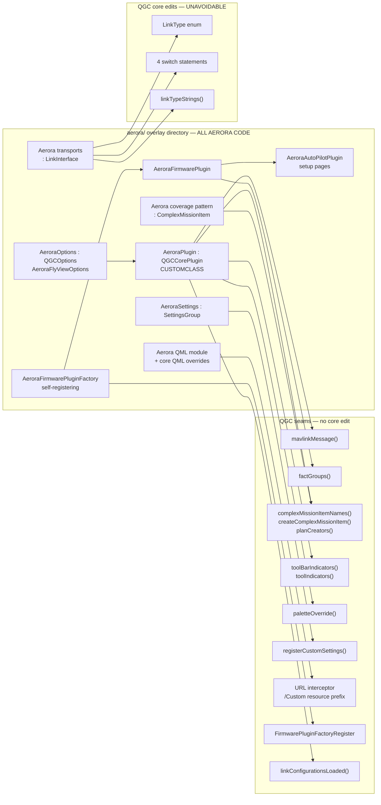

# Plugin Architecture

The extension surfaces through which a vendor customises QGroundControl, and the overlay build
mechanism that activates them. This is the document that defines how Aerora attaches to QGC.

## Governing constraint

**There is no runtime plugin system anywhere in QGroundControl.** Every extension seam is one of:

- compile-time virtual dispatch through a subclass selected by preprocessor substitution
- constructor self-registration into a global list at static-initialisation time
- resource-alias override resolved by a QML URL interceptor
- declarative JSON consumed by a configure-time generator

A search for `QPluginLoader` and equivalent dynamic-loading mechanisms found nothing. One custom
plugin per binary, chosen at compile time. An Aerora build is therefore a **fork-by-overlay**, not
a loadable add-on, and Aerora must plan to maintain a long-lived overlay directory against an
upstream that moves.

## QGCCorePlugin

`src/API/QGCCorePlugin.{h,cc}`, plus `src/API/QGCOptions.{h,cc}` and
`src/API/QmlComponentInfo.{h,cc}`. Module CMake: `src/API/CMakeLists.txt`.

A `QObject` exposed to QML as `QML_UNCREATABLE`, accessed as a process-wide singleton. The header
documentation states its purpose explicitly: it is the extension point for *non-firmware-specific*
customisation; firmware-specific behaviour belongs in `FirmwarePlugin`.

### QML properties

`showAdvancedUI`, `showTouchAreas`, `showInitialSetupVehiclePreferences`,
`showInitialSetupMeasurementUnits`, `defaultSettings`, `initialSetupPromptId`, `options`,
`customMapItems`, `showAdvancedUIMessage`, `stableDownloadUrl`, `analyzePages`,
`toolBarIndicators`.

### Every virtual

#### Lifecycle

| Virtual | Default | Customises |
| --- | --- | --- |
| `init()` | empty | Custom startup |
| `cleanup()` | empty | Custom shutdown |
| `linkConfigurationsLoaded(LinkManager*)` | no-op | Called after saved link configurations load, **before** auto-connect links start |

The call sites of `init()`, `cleanup()`, and `linkConfigurationsLoaded()` inside `QGCApplication`
were **not** traced; `QGCApplication.cc` was not read. Treat the invocation points as unverified.

`linkConfigurationsLoaded` is notable for Aerora: it is the sanctioned hook for injecting or
adjusting link configurations at boot before anything connects.

#### UI surface

| Virtual | Base behaviour |
| --- | --- |
| `analyzePages()` | Returns Log Viewer (desktop only — excluded on Android and iOS because parsing very large ULog files exhausts the mobile heap), Onboard Logs, GeoTag Images, MAVLink Console, MAVLink Inspector, Vibration |
| `toolBarIndicators()` | Returns a one-element list containing `RTKGPSIndicator.qml` |
| `defaultSettings()` | `0` — index of the settings panel shown first |
| `customMapItems()` | Empty `QmlObjectListModel`; objects should derive from `QmlComponentInfo` and set `url` |
| `createQmlApplicationEngine(QObject*)` | Creates the engine, adds `qrc:/qml` import path, sets the `joystickManager` context property |
| `destroyQmlApplicationEngine(...)` | Symmetric release point — where custom builds detach URL interceptors |
| `createRootWindow(QQmlApplicationEngine*)` | Loads `qrc:/qml/QGroundControl/MainWindow.qml` |
| `paletteOverride(colorName, PaletteColorInfo_t&)` | No-op — every palette colour routes through here |
| `factValueGridCreateDefaultSettings(FactValueGrid*)` | Default instrument-value layout, with fixed-wing variants |
| `showAdvancedUIMessage()` | Confirmation text for enabling advanced UI |
| `showInitialSetupVehiclePreferences()` | `!FirmwarePluginManager::instance()->singleVehicleSupport()` |
| `showInitialSetupMeasurementUnits()` | `true` |
| `firstRunPromptStdIds()` | Standard prompt ids |
| `firstRunPromptCustomIds()` | Empty |
| `firstRunPromptResource(int)` | Resource for a prompt id |

Non-virtual `Q_INVOKABLE firstRunPromptsToShow()` subtracts already-shown ids from
`AppSettings::firstRunPromptIdsShown`. Constants: `kInitialSetupPromptId = 3`,
`kFirstRunPromptIdsFirstCustomId = 10000`.

#### Settings

| Virtual | Purpose |
| --- | --- |
| `options()` | Return a custom `QGCOptions` |
| `overrideSettingsGroupVisibility(name)` | Hide a whole settings group |
| `adjustSettingMetaData(group, FactMetaData&, bool &userVisible)` | Mutate metadata or visibility before Fact creation |
| `registerCustomSettings(SettingsManager*)` | Called at the end of `SettingsManager::init` |

The base `adjustSettingMetaData` implementation is instructive about what the hook is for: it hides
`Viewer3DSettings::enabled` on Android, flips the `AppSettings::indoorPalette` default per
platform, hides `androidDontSaveToSDCard` off-Android, and gates `androidUsePosixSerial` on
`AndroidSerial::hasPosixSerialPorts()`.

#### Vehicle and protocol

| Virtual | Contract |
| --- | --- |
| `mavlinkMessage(Vehicle*, LinkInterface*, const mavlink_message_t&)` | See all traffic; returning `false` suppresses normal processing. **The primary Aerora message seam** |
| `createPositionSource(QObject*)` | Alternate `QGeoPositionInfoSource`, default `nullptr` |
| `joystickActions()` | Extra joystick actions — `struct JoystickAction { QString name; bool canRepeat; }` |
| `getOfflineCameraDefinitionFile(cameraName, QFile&)` | Serve camera definition XML from resources, default `false` |

#### Video

`createVideoReceiver(QObject*)`, `createVideoSink(QQuickItem*, QObject*)`,
`releaseVideoSink(void*)`. The base delegates to the free functions in
`src/VideoManager/VideoReceiver/VideoBackend.h` (`createReceiver`, `createSink`, `releaseSink`).

#### Plan and mission

| Virtual | Base behaviour |
| --- | --- |
| `complexMissionItemNames(Vehicle*)` | Survey, CorridorScan, and StructureScan (the last multirotor and VTOL only) |
| `createComplexMissionItem(type, PlanMasterController*, flyView, kmlOrShpFile)` | Handles Survey, CorridorScan, StructureScan, FixedWingLanding, VTOLLanding; warns and returns `nullptr` otherwise |
| `planCreators(PlanMasterController*)` | Survey, CorridorScan, StructureScan, Blank creators |
| `preSaveToJson` / `postSaveToJson` | Plan file hooks |
| `preSaveToMissionJson` / `postSaveToMissionJson` | Mission section hooks |
| `preLoadFromJson` / `postLoadFromJson` | Load hooks |

#### Version and update

| Virtual | Behaviour |
| --- | --- |
| `stableVersionCheckFileUrl()` | **Compiled two ways.** Under `QGC_CUSTOM_BUILD` returns `QString()`, disabling the check. Otherwise returns the QGC S3 version file URL |
| `stableDownloadUrl()` | Base returns the QGroundControl site; custom builds must override |

That conditional compilation is a useful precedent: `QGC_CUSTOM_BUILD` changes behaviour inside
base code, not only in the subclass.

### Instantiation and substitution

`src/API/QGCCorePlugin.cc`:

```cpp
#ifdef QGC_CUSTOM_BUILD
#include CUSTOMHEADER                                        // line 36
#endif

#ifndef QGC_CUSTOM_BUILD
Q_APPLICATION_STATIC(QGCCorePlugin, _qgcCorePluginInstance);  // line 48
#endif

QGCCorePlugin *QGCCorePlugin::instance()                      // lines 64-71
{
#ifndef QGC_CUSTOM_BUILD
    return _qgcCorePluginInstance();
#else
    return CUSTOMCLASS::instance();
#endif
}
```

Substitution is purely preprocessor-based. The overlay sets three compile definitions on the
application target (`custom-example/CMakeLists.txt:236-241`):

```cmake
set(CUSTOM_DEFINITIONS
    QGC_CUSTOM_BUILD
    CUSTOMHEADER="CustomPlugin.h"
    CUSTOMCLASS=CustomPlugin
    PARENT_SCOPE)
```

`src/CMakeLists.txt` (custom block, roughly lines 188-220) applies `CUSTOM_SOURCES`,
`CUSTOM_LIBRARIES`, `CUSTOM_INCLUDE_DIRECTORIES`, `CUSTOM_DEFINITIONS`, and
`find_package(Qt6 COMPONENTS ${CUSTOM_QT_COMPONENTS})`.

**The custom subclass must provide its own `static instance()`.** `CustomPlugin` does so via
`Q_APPLICATION_STATIC(CustomPlugin, _customPluginInstance)` in `CustomPlugin.cc`.

## QGCOptions

`src/API/QGCOptions.h`. Pure UI gating, read from QML as
`QGroundControl.corePlugin.options.*`.

### QGCFlyViewOptions

Nested, `QML_ELEMENT` + `QML_UNCREATABLE`. All default `true`:

`showMultiVehicleList`, `showInstrumentPanel`, `showMapScale`, `guidedBarShowEmergencyStop`,
`guidedBarShowOrbit`, `guidedBarShowROI`.

### QGCOptions virtuals and defaults

| Virtual | Default |
| --- | --- |
| `combineSettingsAndSetup()` | `false` |
| `toolbarHeightMultiplier()` | `1.0` |
| `showMissionStatus()` | `true` |
| `preFlightChecklistUrl()` | `qrc:/qml/QGroundControl/FlyView/PreFlightCheckList.qml` |
| `toolbarBackgroundLight()` | white |
| `toolbarBackgroundDark()` | black |
| `showSensorCalibrationAccel/Airspeed/Compass/Gyro/Level()` | all `true` |
| `allowJoystickSelection()` | `true` |
| `checkFirmwareVersion()` | `true` |
| `guidedActionsRequireRCRSSI()` | `false` |
| `missionWaypointsOnly()` | `false` |
| `multiVehicleEnabled()` | `true` |
| `sensorsHaveFixedOrientation()` | `false` |
| `showFirmwareUpgrade()` | `true` |
| `showMissionAbsoluteAltitude()` | `true` |
| `showOfflineMapExport()` / `showOfflineMapImport()` | `true` |
| `showPX4LogTransferOptions()` | `true` |
| `showSimpleMissionStart()` | `false` |
| `enableSaveMainWindowPosition()` | `true` |
| `surveyBuiltInPresetNames()` | empty — built-in presets cannot be deleted |
| `useMobileFileDialog()` | `true` on Android and iOS, `false` elsewhere (compile-time) |
| `firmwareUpgradeSingleURL()` | empty — non-empty switches firmware upgrade into single-file mode |
| `devicePixelRatio()` / `devicePixelDensity()` | `0.0f` — zero means let Qt decide |
| `flyViewOptions()` | `_defaultFlyViewOptions` |

Several of these map directly onto Aerora requirements. `preFlightChecklistUrl()` is the hook for
an Aerora pre-flight checklist covering tether, paint supply, and power configuration.
`guidedActionsRequireRCRSSI()` and the `guidedBar*` gates control which guided actions an operator
can reach. `missionWaypointsOnly()` can constrain the Plan UI.

## The custom-example reference

This is the Aerora template, so it is worth a file-by-file record.

| Path | Contents |
| --- | --- |
| `README.md` | Rename `custom-example` to `custom`, clean build directory, build. Points at the dev-guide custom-build page. Lists what the example demonstrates |
| `README.jpg` | Screenshot |
| `cmake/CustomOverrides.cmake` | Forces `QGC_APP_NAME=Custom-QGroundControl`, `QGC_ANDROID_PACKAGE_NAME`, redirects macOS `.icns` / AppImage `.svg` / Windows installer header / Windows `.ico` when overlay files exist, and forces `QGC_DISABLE_APM_PLUGIN_FACTORY=ON` and `QGC_DISABLE_PX4_PLUGIN_FACTORY=ON` |
| `CMakeLists.txt` | Android package overlay, five `qt_add_resources` sets, two QML modules, and the five `CUSTOM_*` `PARENT_SCOPE` exports |
| `src/CustomPlugin.{h,cc}` | `CustomFlyViewOptions`, `CustomOptions`, `CustomPlugin`, `CustomOverrideInterceptor` |
| `src/AutoPilotPlugin/CustomAutoPilotPlugin.{h,cc}` | Setup-page customisation, gated on `showAdvancedUI` |
| `src/FirmwarePlugin/CustomFirmwarePlugin.{h,cc}` | Derives from `PX4FirmwarePlugin` |
| `src/FirmwarePlugin/CustomFirmwarePluginFactory.{h,cc}` | Self-registering factory with the `extern` anchor |
| `src/MissionManager/PerimeterScanComplexItem.{h,cc}` | A complete new complex mission pattern |
| `src/MissionManager/PerimeterScanPlanCreator.{h,cc}` | Plan template tile |
| `src/Settings/CustomSettings.{h,cc}` + `Custom.SettingsGroup.json` | Custom settings group |
| `src/AppSettings/pages/` | JSON page definitions consumed by the settings generator |
| `src/PlanView/*.qml` | `PerimeterScanMapVisual.qml`, `PerimeterScanEditor.qml` |
| `src/*.qml` | `FlyViewCustomLayer.qml`, `FlyViewToolStripActionList.qml`, `CustomGuidedActionsController.qml` |
| `res/` | Images, icons, widget QML (`Custom/Widgets/`), JSON |
| `android/`, `deploy/` | Platform overlays |

### What CustomPlugin overrides

`options`, `adjustSettingMetaData`, `paletteOverride`, `createQmlApplicationEngine`,
`destroyQmlApplicationEngine`, `complexMissionItemNames`, `createComplexMissionItem`,
`planCreators`, `registerCustomSettings`, plus `static instance()`.

Its constructor sets `_showAdvancedUI = false` so the application starts in simplified mode, and
connects `showAdvancedUIChanged` to re-emit `showFirmwareUpgradeChanged` so the Firmware Upgrade
page appears only in advanced mode. That pattern — a simplified default operator UI with an
advanced mode behind a confirmation — is directly applicable to Aerora's operator-versus-engineer
distinction.

### The resource-override interceptor

Reproduced in [ui-qml-architecture.md](ui-qml-architecture.md). The essential rule:
`qrc:/<path>` is redirected to `qrc:/Custom/<path>` if and only if `:/Custom/<path>` exists. Per
file, opt-in by presence, no allow-list.

## Overlay build mechanism

Activation is **directory-presence based**, driven by one cache variable.

| Step | Location | Detail |
| --- | --- | --- |
| Option definition | `cmake/CustomOptions.cmake:11-14` | `QGC_CUSTOM_DIR`, default `"custom"`, relative to source root |
| Path validation | `CMakeLists.txt:47-54` | Rejects empty, absolute, or `..`-containing values with `FATAL_ERROR`. Tested at `cmake/tests/CMakeLists.txt:45-50` |
| Contract enforcement | `CMakeLists.txt:64-78` | Requires **both** `CMakeLists.txt` and `cmake/CustomOverrides.cmake`, else `FATAL_ERROR`. Sets `QGC_CUSTOM_BUILD ON`, appends overlay `cmake/` to `CMAKE_MODULE_PATH`, includes `CustomOverrides.cmake` |
| Subdirectory | `CMakeLists.txt:402-405` | Added before platform deployment so Android overlays exist in time |
| Variable consumption | `src/CMakeLists.txt:188-215` | `CUSTOM_SOURCES`, `CUSTOM_LIBRARIES`, `CUSTOM_INCLUDE_DIRECTORIES`, `CUSTOM_DEFINITIONS`, `CUSTOM_QT_COMPONENTS` |
| Compile policy | `CMakeLists.txt:483-486` | `qgc_configure_directory_targets` on the custom tree |
| Deployment | `cmake/install/Install.cmake:44-47` | Adds `-qmldir=<custom>` |
| Autogen | `CMakeLists.txt` | The `AUTOGEN_ORIGIN_DEPENDS OFF` optimisation is **skipped** for custom builds, because an overlay may introduce additional generators |

Everything before `project()` is what makes branding variables take effect on the project name and
version.

### File-layout contract

Required:

```text
<custom>/
├── CMakeLists.txt                  REQUIRED
└── cmake/
    └── CustomOverrides.cmake       REQUIRED
```

By convention, and exercised by the example:

```text
<custom>/
├── src/
│   ├── CustomPlugin.{h,cc}
│   ├── AutoPilotPlugin/
│   ├── FirmwarePlugin/
│   ├── MissionManager/
│   ├── Settings/           *.SettingsGroup.json lives here
│   ├── AppSettings/pages/  *.json page definitions
│   ├── PlanView/
│   └── *.qml               core QML overrides
├── res/
│   ├── Images/
│   ├── icons/
│   ├── json/
│   └── Custom/Widgets/     new QML module content
├── android/
└── deploy/windows/
```

### Override channels

| Channel | Mechanism |
| --- | --- |
| Application name, identifiers, branding | `set(... CACHE ... FORCE)` in `CustomOverrides.cmake` |
| Resources and QML | Overlay `qt_add_resources` with `QT_RESOURCE_ALIAS` to the stock path, plus the URL interceptor |
| Settings pages and metadata | `--custom-pages-dir` / `--custom-settings-dir` passed to the generator (`src/AppSettings/CMakeLists.txt:28-37`) |
| Deployment | `-qmldir=${QGC_CUSTOM_DIR}` |
| Firmware factories | `QGC_DISABLE_APM_PLUGIN_FACTORY`, `QGC_DISABLE_PX4_PLUGIN_FACTORY` |
| Android package | Merge of stock `android/` and overlay `android/` into the build tree |

The Android merge (`custom-example/CMakeLists.txt:11-44`) does `file(REMOVE_RECURSE ...)` first so
deleted source files cannot linger, then copies stock over overlay, and repoints
`QGC_ANDROID_PACKAGE_SOURCE_DIR`.

### Documentation and CI

Repository documentation exists: `docs/en/qgc-dev-guide/custom_build/custom_build.md`, with `ko`,
`tr`, and `zh` translations, plus `custom-example/README.md`. Licensing guidance is at
`docs/en/qgc-dev-guide/contribute/licences.md`.

CI proof-builds the overlay: `.github/workflows/custom-build.yml:100-102` configures with
`-DQGC_CUSTOM_DIR=custom-example`, asserted by
`.github/scripts/tests/test_custom_build_workflow.py:32`. **The overlay is exercised without
renaming the directory**, which means Aerora can keep its overlay in a differently named directory
and point `QGC_CUSTOM_DIR` at it — useful for keeping `custom-example` intact as a reference.

Per `.github/ci-overview.md`, the Custom Build workflow uses one shared matrix job. Relevant pull
requests build only Debug and run the custom-plugin unit and integration suites, excluding stock-UI
integration tests. Master pushes, merge-queue runs, and manual dispatches also build Release
without test hooks and verify the AppImage.

## Other plugin seams

| Seam | Location | Extensible? |
| --- | --- | --- |
| **Firmware plugin factory** | `src/FirmwarePlugin/FirmwarePluginFactory.h` — `FirmwarePluginFactory` base and `FirmwarePluginFactoryRegister` singleton | **Yes** — constructor self-registration into an append-only `Q_GLOBAL_STATIC` list. No core edit. Full detail in [vehicle-architecture.md](vehicle-architecture.md) |
| **AutoPilot plugin** | `src/AutoPilotPlugins/`, returned from `FirmwarePlugin::autopilotPlugin()` | **Yes** — subclass and override `vehicleComponents()` |
| **Video and camera** | `src/VideoManager/VideoReceiver/VideoBackend.h` free functions, reachable via the three `QGCCorePlugin` video virtuals; GStreamer source construction centralised in `GstSourceFactory.cc` | **Yes** |
| **Camera definitions** | `getOfflineCameraDefinitionFile()` | **Yes** — serve XML from resources |
| **Settings** | `registerCustomSettings` + `SettingsManager::registerCustomSettingsGroup`, plus `adjustSettingMetaData` and `overrideSettingsGroupVisibility` | **Yes** |
| **Map and tile** | `UrlFactory` in `src/QtLocationPlugin/QGCMapUrlEngine.h`. QGC ships its own QtLocation plugin and excludes Qt's geoservices plugins via `qt_import_plugins ... EXCLUDE_BY_TYPE geoservices` | Core edit likely |
| **Plan** | `PlanCreator` list plus `ComplexMissionItem` factory | **Yes** |
| **Position source** | `createPositionSource` | **Yes** |
| **Link types** | `LinkManager` / `LinkConfiguration` | **No** — see [communication-architecture.md](communication-architecture.md) |

### Factory classes inventory

Concrete factories observed: `PX4FirmwarePluginFactory`
(`src/FirmwarePlugin/PX4/PX4FirmwarePluginFactory.{h,cc}`), `APMFirmwarePluginFactory`
(`src/FirmwarePlugin/APM/APMFirmwarePluginFactory.{h,cc}`), and `CustomFirmwarePluginFactory` in
the example. `FirmwarePluginManager` (`src/FirmwarePlugin/FirmwarePluginManager.h`) resolves
plugins per `MAV_AUTOPILOT`.

Note the comment in `custom-example/cmake/CustomOverrides.cmake`: all firmware plugin code is
always compiled; the UI adapts at runtime via `FirmwarePluginManager::supportedFirmwareClasses()`.
Disabling a factory removes it from the registry, not from the binary.

## Aerora attachment summary

`PROPOSED`. The complete set of seams Aerora should use, with no core-file edits required except
where the transport layer is concerned.



The transport layer is the only part of Aerora that cannot live entirely in the overlay. Everything
else attaches through a sanctioned seam.
