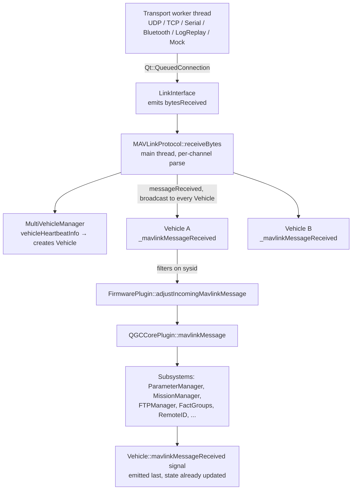

# Repository Architecture

QGroundControl 5.2.0-dev at commit `9459a4b57986f40df8bdc193d5453c0596fbb416`.

## Environment inventory (STEP 1)

All values below were observed directly, not inferred.

| Item | Value | How established |
| --- | --- | --- |
| Remote `origin` | `https://github.com/mavlink/qgroundcontrol.git` | `git remote -v` |
| Branch | `master` | `git rev-parse --abbrev-ref HEAD` |
| HEAD commit | `9459a4b57986f40df8bdc193d5453c0596fbb416` | `git rev-parse HEAD` |
| `git describe` | `v5.2.0-dev-102-g9459a4b57` | `git describe --tags` |
| HEAD author/date | Don Gagne, Fri Oct 2 13:19:28 2026 -0700 | `git log -1` |
| HEAD subject | `fix(LogViewer): start PX4 log charts at logging start` | `git log -1` |
| Tracked files modified | **None** | `git diff --stat HEAD` returned empty |
| Untracked content | `Aerora_Universal_GCS_Product_Baseline_Specification_v4.1/` only | `git status --porcelain` |
| Git submodules | **None** — no `.gitmodules` file exists | `Test-Path .gitmodules` |
| Host OS | Windows, PowerShell shell | Session environment |

Two findings here carry programme consequences and are escalated in
[risk-register.md](risk-register.md):

- `origin` points at **upstream mavlink/qgroundcontrol**, not an Aerora fork. Committing Aerora
  work from this checkout would target upstream.
- The host **cannot currently build QGC**: `cmake`, `ninja`, `cl`, `qmake`, and `just` are all
  absent from `PATH`; there is no `build/` directory and no `CMakeUserPresets.json`. This does
  not impede read-only analysis but blocks the definition-of-done gates for any later phase.

## Top-level layout

```text
qgroundcontrol/
├── .github/            CI workflows, composite actions, build-config.json (version source of truth)
├── .clusterfuzzlite/   Fuzzing harness build
├── .devcontainer/      Dev container definition
├── .vscode/            Editor workspace templates
├── android/            Android package template (Gradle, manifest, Java glue)
├── cmake/              Build modules, presets, platform logic, GStreamer subsystem, test harness
├── custom-example/     Worked reference for the vendor overlay mechanism — the Aerora template
├── deploy/             Platform packaging (macOS plist/entitlements, Windows installer, Linux)
├── docs/               VitePress user + developer guide, multi-locale
├── resources/          Application-level assets (icons, fonts, audio, qtquickcontrols2.conf)
├── src/                Application source — 32 subdirectories
├── test/               Test suite, mirrors src/ structure
├── tools/              Python tooling, generators, analyzers, simulation, translations
├── translations/       Qt .ts catalogues (Crowdin-managed)
├── AGENTS.md           QGC's own AI-agent guide (currently the active one)
├── CMakeLists.txt      Root build definition
├── CMakePresets.json   Preset aggregator
└── justfile            Canonical developer workflow recipes
```

Also present, untracked: `Aerora_Universal_GCS_Product_Baseline_Specification_v4.1/` — the
Aerora v4.1 baseline, and `.kiro/` — this document set.

## Source module inventory

The 32 directories under `src/`, enumerated directly and grouped by concern. Note that
`AGENTS.md` says "~33"; the observed count is 32.

### Protocol and transport

| Directory | Responsibility |
| --- | --- |
| `MAVLink/` | Dialect acquisition (CPM), enum generation, `LibEvents/`, `Signing/` |
| `Comms/` | `LinkInterface`, `LinkConfiguration`, `LinkManager`, `MAVLinkProtocol`, six transports |
| `GPS/` | RTK/NTRIP correction handling, GPS driver protocols |

### Vehicle model and configuration

| Directory | Responsibility |
| --- | --- |
| `Vehicle/` | `Vehicle`, `MultiVehicleManager`, `VehicleLinkManager`, FactGroups, `VehicleSetup/`, `ComponentInformation/` |
| `FactSystem/` | `Fact`, `FactMetaData`, `FactGroup`, `ParameterManager`, `FactControls/` |
| `FirmwarePlugin/` | Firmware abstraction, factory registry, `PX4/`, `APM/` |
| `AutoPilotPlugins/` | Setup UI model — `Common/`, `PX4/`, `APM/`, `VehicleComponent` |
| `Settings/` | `SettingsGroup`/`SettingsFact` C++ classes plus `*.SettingsGroup.json` metadata |

### Mission and planning

| Directory | Responsibility |
| --- | --- |
| `MissionManager/` | Plan controllers, visual item model, `PlanManager` transfer protocol, command metadata JSON |
| `Terrain/` | Terrain tile query and caching |
| `FollowMe/` | Follow-me mode |

### Presentation

| Directory | Responsibility |
| --- | --- |
| `MainWindow/` | `MainWindow.qml` — the root window. Note: there is no `src/UI/` |
| `FlyView/` | In-flight view, including the purpose-built `FlyViewCustomLayer.qml` vendor seam |
| `PlanView/` | Mission planning view |
| `Toolbar/` | Toolbar and indicator components |
| `QmlControls/` | Reusable controls, `QGCPalette`, `ScreenTools`, `QGroundControlQmlGlobal` |
| `AppSettings/` | Settings page QML plus `pages/*.SettingsUI.json` and the page generator wiring |
| `FlightMap/`, `GeoMap/` | Two map engines — QtLocation-based and the newer GeoMap |
| `Viewer3D/` | 3D viewer, OSM providers |
| `FirstRunPromptDialogs/` | First-run prompt dialogs |
| `AnalyzeView/` | Log viewer, onboard logs, GeoTag, MAVLink console/inspector, vibration |

### Peripherals and services

| Directory | Responsibility |
| --- | --- |
| `API/` | `QGCCorePlugin`, `QGCOptions`, `QmlComponentInfo` — the primary vendor extension surface |
| `Camera/` | Camera protocol v2, camera metadata |
| `Gimbal/` | Gimbal manager protocol |
| `VideoManager/` | Video pipeline, GStreamer integration, `VideoReceiver/` |
| `Joystick/` | Joystick/gamepad input via SDL3 |
| `ADSB/` | ADSB traffic |
| `LogManager/` | Application log management with rate limiting |
| `QtLocationPlugin/` | QGC's own QtLocation geoservices plugin, map tile URL engine |
| `Utilities/` | Compression, geo formats, parsing, SDL, network, audio, filesystem, sensors |
| `Android/` | Android platform glue, including vendored `qtandroidserialport/` |

## Application startup path

Traced through the files named below.

```text
src/main.cc
  └── QGCApplication (src/QGCApplication.cc)
        └── QGCCorePlugin::instance()                        src/API/QGCCorePlugin.cc:64
              │  returns CUSTOMCLASS::instance() under QGC_CUSTOM_BUILD
              ├── createQmlApplicationEngine()               adds qrc:/qml import path
              │                                              custom builds attach a URL interceptor here
              └── createRootWindow()
                    └── loads qrc:/qml/QGroundControl/MainWindow.qml
                          ├── FlyView   (always instantiated, visibility-switched)
                          ├── PlanView  (always instantiated, visibility-switched)
                          └── toolDrawer Loader → Analyze / VehicleConfig / AppSettings
```

Singletons are `Q_APPLICATION_STATIC`, not classic lazy singletons. Confirmed instances include
`MAVLinkProtocol` (`src/Comms/MAVLinkProtocol.cc:29`), `LinkManager`
(`src/Comms/LinkManager.cc:39`), `MultiVehicleManager` (`src/Vehicle/MultiVehicleManager.cc:30`),
`MissionCommandTree` (`src/MissionManager/MissionCommandTree.cc:12`), and `QGCCorePlugin`
(`src/API/QGCCorePlugin.cc:48`, compiled out in custom builds).

## Data flow spine

The single most important structural fact for Aerora: inbound MAVLink is a **fan-out-and-filter**
design, not a router.



Every `Vehicle` is connected to the single `MAVLinkProtocol::messageReceived` signal
(`src/Vehicle/Vehicle.cc:123`) and self-filters on system id as the first statement of
`Vehicle::_mavlinkMessageReceived` (`src/Vehicle/Vehicle.cc:525`). Component id is **not** used
for ownership filtering; subsystems perform their own component-id checks.

Outbound traffic is the opposite — a single chokepoint. All `mavlink_message_t` sends route
through `LinkInterface::sendMessageThreadSafe` (`src/Comms/LinkInterface.cc:148`) so that message
signing cannot be bypassed. The conventional caller path is
`Vehicle::sendMessageOnLinkThreadSafe` (`src/Vehicle/Vehicle.cc:1392`), which first gives
`FirmwarePlugin::adjustOutgoingMavlinkMessageThreadSafe` a chance to mutate the message.

## Observations relevant to Aerora

- `Vehicle` is a god-object: `Vehicle.h` is 1327 lines, `Vehicle.cc` is 3573 lines, and the class
  itself derives from `VehicleFactGroup`. Aerora telemetry should attach as new FactGroups or via
  the plugin seams rather than by extending this class.
- The three inbound extension seams (`FirmwarePlugin::adjustIncomingMavlinkMessage`,
  `QGCCorePlugin::mavlinkMessage`, and the `Vehicle::mavlinkMessageReceived` signal) are ordered
  and documented in [mavlink-architecture.md](mavlink-architecture.md). All three are reachable
  without editing core files.
- There is **no runtime plugin loading anywhere in the product**. Every extension seam is
  compile-time virtual dispatch plus resource-override. This shapes the entire Aerora delivery
  model and is treated as a first-class constraint in [plugin-architecture.md](plugin-architecture.md).
