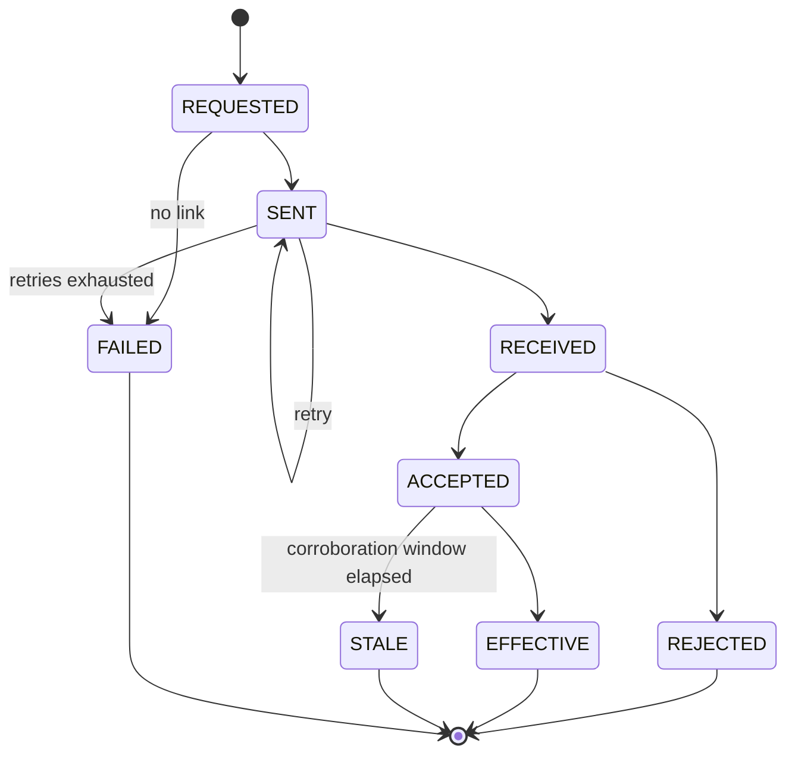

# Authority Model

Who may command the aircraft, how a command's progress is represented, and where the failsafe
boundary sits.

Three distinct things are often collapsed into one word. This document separates them and keeps
them separate:

| Concept | Question it answers | Lives where |
| --- | --- | --- |
| Vehicle authority mode | Which source may command the aircraft right now | Flight controller |
| Command state | What happened to one specific command | Ground station, observing |
| Operator authorisation | Which human may use which ground-station function | Ground station, deciding |

The first is the aircraft's. The third is the ground station's. The second is the ground station's
honest account of the first.

## Vehicle authority

### The GCS role

The flight controller owns authority mode. The GCS **requests** a change and **displays** the
effective mode. It does not decide, arbitrate, or infer.

```text
Operator selects a mode  →  request  →  FC evaluates  →  FC reports effective mode  →  GCS displays
```

There is no step in which the GCS concludes that a mode change took effect. The displayed mode is
always the reported mode. If a request is made and no mode change is reported, the GCS shows the
old mode and surfaces the unresolved request — it does not show the requested mode optimistically.

### What the baseline establishes

The firmware model carries authority modes as explicit sentinel values, with a documented dominance
relationship:

| Property | Baseline statement |
| --- | --- |
| Manual is structurally dominant | When manual is selected, it wins. Not by policy — by structure |
| Semi-automatic supervised requires explicit pilot confirmation | An autonomy proposal is not followed without a human act |
| Proposals can be rejected | Rejection routes to a safe or default mode |
| The safe or default mode's identity is flagged as requiring confirmation | It is recorded in the baseline as needing confirmation, and is not treated here as settled |

The architecture mirrors these without reinterpreting them. In particular it does not assume the
dominance relationship is something the GCS participates in. Manual dominance is a property of the
flight controller; a GCS that tried to enforce it would be adding a second, weaker copy of a
safety property that already exists in the right place.

### Authority mode is not flight mode

QGroundControl's flight mode is "what is the aircraft doing". Aerora authority mode is "who may
command it". They are different axes and the architecture keeps them in different Facts.

Whether they happen to map one-to-one in the Aerora firmware is part of Q-007 and is unresolved.
Treating them as the same thing before that is answered would hard-code an assumption into the
display, the log schema and the audit trail simultaneously. See
[vehicle-integration.md](vehicle-integration.md) for the flight-mode accessor treatment.

### Representation

| Element | Representation |
| --- | --- |
| Effective authority mode | A Fact in `aeroraSystem`, enumerated from metadata |
| Requested authority mode | Separate, with its command state |
| Authority source | The source the vehicle reports as currently commanding |
| Confirmation pending | A distinct Fact — a proposal awaiting pilot confirmation is a visible state |
| Freshness | Receive time, as for all Aerora values |

"Confirmation pending" earns its own Fact because it is the one authority state where the system is
waiting on the human. An operator who does not know a confirmation is pending is the failure mode
that makes semi-automatic supervised operation unsafe.

## Command state model

### The eight states

| State | Meaning | Determined by |
| --- | --- | --- |
| `REQUESTED` | An operator or module has asked for the command; nothing is on the wire yet | GCS |
| `SENT` | The command has been written to a link | GCS |
| `RECEIVED` | The vehicle has indicated receipt | Vehicle |
| `ACCEPTED` | The vehicle reports it will act on the command | Vehicle |
| `REJECTED` | The vehicle reports it will not act on the command, with a reason | Vehicle |
| `EFFECTIVE` | Vehicle state corroborates that the command took effect | Vehicle, by corroboration |
| `STALE` | The command is no longer current enough to be meaningful | GCS, by elapsed time |
| `FAILED` | The command did not complete and will not be retried | GCS |

### What is new here

Six of the eight correspond to something QGroundControl already distinguishes. Two do not:

| State | Why Aerora adds it |
| --- | --- |
| `EFFECTIVE` | QGroundControl treats an acceptance as the end of the story. An acceptance means the vehicle received and agreed to a command, not that the result occurred |
| `STALE` | A command whose moment has passed must stop being presented as in-flight. Without this, a lost acknowledgement leaves a command pending forever |

`EFFECTIVE` is the second architectural principle made operational. For a payload command it means
a reported payload state change, not an acknowledgement — see
[payload-architecture.md](payload-architecture.md). For an authority mode change it means a
reported effective mode.

**A command that reaches `ACCEPTED` and never reaches `EFFECTIVE` is surfaced to the operator.**
That transition gap is where a command is accepted by the vehicle and then quietly does nothing,
and it is the single most valuable thing this model detects.

### Transitions



`RECEIVED` is reachable only where the Aerora interface reports receipt separately from acceptance.
Where it does not, a command moves from `SENT` directly to `ACCEPTED` or `REJECTED`, and the model
records that `RECEIVED` was not observable rather than pretending it was.

### Mapping onto QGroundControl's mechanism

`MavCommandQueue` owns the command send, retry and acknowledgement pipeline per vehicle. The
observable facts it provides:

| Aerora state | QGC observable |
| --- | --- |
| `REQUESTED` | The entry exists in the queue with `tryCount` zero |
| `SENT` | `tryCount` greater than zero |
| `RECEIVED` | Not distinguished by QGC; Aerora-interface specific |
| `ACCEPTED` | A terminal acknowledgement with an accepting result code |
| `REJECTED` | A terminal acknowledgement with a rejecting result code |
| `EFFECTIVE` | Not available from QGC — Aerora corroborates against telemetry |
| `STALE` | Not available from QGC — Aerora elapsed-time rule |
| `FAILED` | `MavCmdResultFailureNoResponseToCommand` or `MavCmdResultFailureDuplicateCommand` |

Concrete parameters of the upstream mechanism, confirmed in source:

| Parameter | Value |
| --- | --- |
| Maximum retries | 3 |
| Acknowledgement timeout, default | 1200 ms |
| Acknowledgement timeout, high-latency links | 120000 ms |
| In-progress result | Refreshes the timer rather than completing the entry |
| Failure codes | Three: result-only, no response, duplicate |

### The correlation problem

Acknowledgements are matched to pending entries by the pair **(component id, command)**. There is
no unique request identifier.

| Consequence | Detail |
| --- | --- |
| Two concurrent commands of the same type to the same component cannot be distinguished | QGC guards this by refusing duplicates, reported as the duplicate failure code |
| An acknowledgement cannot be attributed to a specific operator action | Two sequential identical commands produce acknowledgements the mechanism cannot tell apart |

For display this is tolerable. For an **audit trail** it is not: a record stating that an operator
command was accepted must be attributable to that command and no other.

The architecture therefore assigns an Aerora request identity on the GCS side, carried in the
Aerora log and audit record alongside the command, independent of the MAVLink correlation. It does
not require a protocol change, because the identity is needed for the record rather than for the
wire. Where the Aerora dialect does carry a request identifier, the GCS uses it and records both.

This is recorded in [data-model.md](data-model.md) and [logging-architecture.md](logging-architecture.md).

### Staleness

A command's corroboration window is per command class, not global. The architecture commits to the
shape:

| Element | Commitment |
| --- | --- |
| Every Aerora command class declares a corroboration window | Yes |
| A command past its window with no corroboration becomes `STALE` | Yes |
| `STALE` is visible, not silent | Yes |
| The window values | `OPEN` — per command class, with the dialect |

A stale command is never retried automatically. Retrying an operator action whose moment has passed
would be the GCS deciding to command the aircraft, which it does not do.

## The failsafe boundary

### What the architecture provides

Five interfaces, defined by shape:

| Interface | Shape | Example of what it is not |
| --- | --- | --- |
| Failsafe state | An enumerated Fact, values from metadata | Not a boolean |
| Failsafe reason | An enumerated Fact identifying the triggering condition | Not a free-text string |
| Failsafe source | Which subsystem raised it | Not assumed to be the flight controller |
| Failsafe severity | An ordered scale | Not conflated with the reason |
| Failsafe action | What the vehicle reports it is doing or will do | Not what the GCS thinks should happen |

### What the architecture deliberately does not provide

**The architecture does not prescribe the failsafe action.** Not its values, not its policy, not
its thresholds, not its precedence when two conditions coincide.

This is a decision, not an omission, and it rests on two things.

The baseline distributes safety across flight-controller-local, payload-local, communications,
GCS-supervisory and operator-procedural layers, and explicitly excludes the GCS from being the
safety controller for high-voltage isolation, converter protection, grounding, connector interlock
and tether electrical fault. A GCS document that specified failsafe actions would be writing policy
for a layer it has been excluded from.

And the firmware model's failsafe paths are substantially placeholders. The watchdog fault path is
real and observable; geofence, velocity and acceleration proposal-rejection paths are skeletons;
boot-state and parameter-validation paths are marked pending. Specifying actions against skeletons
would produce a specification that looks authoritative and is not.

Q-007 covers the failsafe definition and is routed to the firmware and safety teams. It is ranked
eleventh in [phase-2-open-question-resolution.md](phase-2-open-question-resolution.md) — not
because it is unimportant, but because the architecture does not block on it: the five interfaces
above are the same whatever the answer.

Recorded as ADR-010.

### What the GCS does with a failsafe

| GCS behaviour | Permitted |
| --- | --- |
| Display state, reason, source, severity and reported action | Yes |
| Alert the operator, scaled by severity | Yes |
| Log the full record with freshness and source | Yes |
| Offer operator actions that the vehicle reports as available | Yes |
| Decide a failsafe action | No |
| Initiate a failsafe response autonomously | No |
| Infer a failsafe condition from telemetry the vehicle has not flagged | No |
| Suppress or de-escalate a reported failsafe | No |
| Clear a failsafe state locally | No |

The last row covers the tempting case: a failsafe reported once and then not reported again. The
GCS marks the value stale. It does not conclude the condition cleared.

### The watchdog path is observed, not mediated

The baseline describes a watchdog fault acting directly: disarm, and independently a payload
emergency stop. Both happen without GCS involvement and must continue to.

The GCS obligation is representational: show that the watchdog fired, show that disarm followed,
and show the payload emergency stop as a **separate** event rather than as a consequence the GCS
inferred. The two effects are independent in the aircraft and are presented independently.

## Operator authorisation

Operator authorisation is a ground-station concern and is the one place in this document where the
GCS does decide. It decides what the person in front of it may do; it never decides what the
aircraft does.

| Property | Statement |
| --- | --- |
| Authorisation gates GCS functions | Not vehicle behaviour |
| An authorised operator's command is still subject to vehicle authority | Authorisation is necessary, not sufficient |
| An unauthorised operator's command is never sent | The gate is before the wire, not after |
| The advanced-UI toggle is not authorisation | It is disclosure — see [ui-architecture.md](ui-architecture.md) |

The role set is Q-029 and the mechanism is in
[security-architecture.md](security-architecture.md). The architectural point here is the
separation: vehicle authority and operator authorisation are independent gates, and a command must
pass both.

## Core edits required

**None.** Authority state is Aerora telemetry in an Aerora FactGroup. Command state is an Aerora
wrapper over the existing command queue's observable results, using the existing acknowledgement
handler interface. The failsafe interfaces are Facts.

## Open questions

| Question | Subject | Impact |
| --- | --- | --- |
| Q-007 | Failsafe definition, and whether authority mode maps to flight mode | `ARCH-SHAPING` |
| Q-008 | Whether proposal acceptance is explicitly reported | `ARCH-SHAPING` |
| Q-029 | Operator role set | `ARCH-SHAPING` |
| Q-009 | Payload emergency-stop behaviour | `ARCH-SHAPING` |
| Q-036 | Per-command-class corroboration windows | `DEFERRABLE` |

## Requirements derived

| Identifier | Statement |
| --- | --- |
| `AERORA-SAFE-REQ-006` | The GCS shall display the vehicle-reported effective authority mode and shall not display a requested mode as effective |
| `AERORA-SAFE-REQ-007` | A pending authority confirmation shall be represented as a distinct visible state |
| `AERORA-SAFE-REQ-008` | The GCS shall not decide or autonomously initiate a failsafe action |
| `AERORA-SAFE-REQ-009` | The GCS shall not infer a failsafe condition the vehicle has not reported, and shall not clear a reported failsafe state locally |
| `AERORA-SAFE-REQ-010` | Failsafe state, reason, source, severity and reported action shall each be represented separately |
| `AERORA-SAFE-REQ-011` | The watchdog-initiated disarm and the payload emergency stop shall be presented as independent events |
| `AERORA-GCS-REQ-015` | Every Aerora command shall be tracked through the eight-state command model |
| `AERORA-GCS-REQ-016` | A command that reaches accepted and does not become effective within its corroboration window shall be marked stale and surfaced to the operator |
| `AERORA-GCS-REQ-017` | A stale command shall not be retried automatically |
| `AERORA-GCS-REQ-018` | Each Aerora command shall carry a GCS-assigned request identity in the log and audit record, independent of MAVLink acknowledgement correlation |
| `AERORA-GCS-REQ-019` | An operator command shall pass both the operator authorisation gate and the vehicle authority gate; authorisation alone shall not be sufficient |

Full records in [requirements.md](requirements.md).
