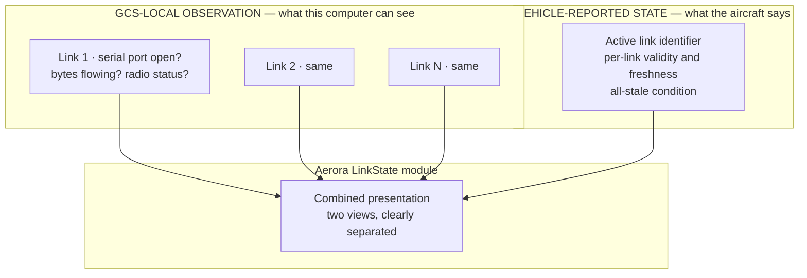

# Communication Architecture

The link model, the transport strategy that Q-014 made possible, and how the GCS mirrors
vehicle-reported link arbitration without claiming authority over it.

## Transport strategy

**Serial-first.** Each Aerora radio presenting a standard serial port becomes a QGroundControl
serial link. No new transport type, no core edit.

Recorded as ADR-002 and ADR-003. The evidence is in
[phase-2-open-question-resolution.md](phase-2-open-question-resolution.md) under Q-014; the
exhaustive edit list that is now avoided is in the Phase 1
[communication-architecture.md](../00-qgc-baseline-analysis/communication-architecture.md).

### What this buys

| Benefit | Consequence |
| --- | --- |
| Zero core edits for transport | The overlay is pure addition; upstream merge risk drops materially |
| Arbitrary baud supported | A radio at a non-standard rate needs no code |
| Radio-link treatment is automatic | Latches on the first radio-status frame, so air-frame sizing is handled |
| Link-quality telemetry is free | A radio emitting standard radio-status populates the existing fact group and indicator |
| Multiple radios work today | Each is an independent serial link with its own worker thread |

### What it does not buy

| Limitation | Consequence |
| --- | --- |
| No auto-connect for an unrecognised device | Operator creates each link once; configuration persists |
| No radio configuration channel | Frequency, power and network identifier are set by the vendor tool, not the GCS |
| No firmware flashing for the radio | Vendor tooling |
| iOS excluded | Serial links are disabled on iOS by build configuration |

## Known frictions

Three, all identified in Phase 2 and none of them blockers. They are recorded here because each has
an operational consequence that bring-up must plan for.

### Misidentification as a SiK radio

QGroundControl's board-identification database maps the **stock Silicon Labs CP2102 identifier** to
a SiK radio, and carries description-based fallbacks for a common FTDI part plus a broad
Android-only pattern.

Consequence for an Aerora radio built on a stock bridge chip: it is identified as a SiK radio, it
becomes auto-connect eligible, it is opened at 57600 baud, and **it takes the port reservation** —
so the operator's manually configured link then fails to connect because the port is already held.

| Mitigation | Cost | Recommendation |
| --- | --- | --- |
| Use a distinct vendor and product identifier | Hardware and firmware | **Preferred.** Also enables correct auto-connect later |
| Disable SiK auto-connect in Aerora settings defaults | Settings metadata adjustment, no core edit | **Adopt as a safety net regardless** |
| Create the manual link before the auto-connect timer fires | Operator procedure | Fragile; not recommended |

`PROPOSED`: do both of the first two. The identifier is a hardware decision that must be taken
early; the settings default is free.

### Android enumeration

The default Android backend enumerates through a USB probe table. A radio with a custom identifier
may not appear at all. Mainstream bridge chips are covered by the upstream table.

Adding an identifier to the prober **would be a core edit** — the one place where the custom
identifier recommendation above has a cost. The alternative backend is gated on the device
exposing serial nodes, which is typically industrial or rooted hardware only.

This is one input to the platform-scope decision, Q-032.

### macOS node filtering

Certain serial node naming conventions are filtered from the port list; the alternate node is used
instead. Operationally invisible once known.

## Link model

Aerora adds a link-state model on top of QGC's link management. The two represent different things
and must not be conflated.

### Why the separation is mandatory

The baseline is explicit that the GCS must expose each link separately and expose the authoritative
active link **reported by the vehicle**, and that the GCS must not falsely claim a link is
authoritative.

The two views genuinely differ. The GCS can observe that its serial port is open and that bytes are
arriving. Only the vehicle can say which link it is currently using for command reception, because
the vehicle performs the arbitration. A port can be open while the vehicle has already failed over
to a different radio.

Presenting a GCS-local observation as the active link would be exactly the class of error the
authority model exists to prevent.

### State represented

Per the baseline's requirement, for each link:

| Field | Source | Notes |
| --- | --- | --- |
| Link identifier | Configuration | Stable across sessions |
| Transport | QGC | Serial port, or other |
| Port open | GCS observation | |
| Bytes flowing | GCS observation | |
| Last message received | GCS observation | Timestamp |
| Signal quality | Vehicle, via radio status | Where the radio provides it |
| Validity | Vehicle-reported | |
| Freshness | Vehicle-reported | |
| Vehicle-reported active | Vehicle | **The authoritative view** |
| All-stale condition | Vehicle | Distinct from GCS-observed loss |
| Command acknowledgement state | Authority module | Per the baseline's requirement |

### Vehicle-side arbitration

The firmware contains arbitration across three paths with a documented priority order — LoRa first,
then a 2.4 GHz frequency-hopping path, then a 433 MHz path — plus an all-stale condition, with
numeric identifiers for the active link.

Aerora mirrors this as **reported state**. The mapping from the vehicle's numeric link identifier to
an Aerora link is part of the interface control document and is `OPEN` until the message set is
frozen.

Note the asymmetry worth designing for: the GCS may hold a serial link to one radio while the
vehicle reports a different radio as active, because the vehicle arbitrates over its own receivers
independently of which radios the GCS happens to be connected to. The presentation must not imply
these are the same thing.

## Communication loss

Two distinct loss concepts, deliberately kept separate.

| Concept | Detected by | Meaning |
| --- | --- | --- |
| Per-vehicle communication loss | QGC: 1000 ms poll against a 3500 ms heartbeat window | The GCS is not hearing this vehicle |
| Vehicle-reported all-stale | Vehicle arbitration | The vehicle is not hearing any ground link |

These can occur independently. The GCS can lose its own link while the vehicle still has a healthy
link to another ground station, and conversely the vehicle can report all-stale while the GCS
believes its port is fine.

### What the GCS does

Annunciate, timestamp, log. Nothing else.

The baseline is explicit: exact vehicle behaviour on link loss is a flight-controller requirement,
and the GCS must not invent an emergency manoeuvre merely because the user interface lost its own
network connection. Phase 1 confirmed QGC's existing behaviour already respects this — its only
vehicle-directed traffic on loss is a high-latency control toggle during link failover.

Aerora preserves that boundary exactly. Recorded as ADR-010.

## Channel budget

Fifteen MAVLink channels are allocatable per GCS instance, one per link, with one additional
channel consumed if the ArduPilot firmware plugin is active.

Worst-case modelling is required: links per vehicle, multiplied by vehicles per GCS instance.
`OPEN` as Q-015.

Serial-first does not change the budget, because each serial link still consumes one channel. If
Aerora needs more than fifteen concurrent links, raising the limit is a core edit with memory
implications, because the protocol layer holds a per-channel sequence array indexed by system and
component identifier.

## Future transports

The architecture keeps the option open without paying for it now.

| Trigger | Response |
| --- | --- |
| A radio that cannot present as a serial port | Incur the six enumerated core edits |
| A network radio, Ethernet or cellular link | QGC's existing UDP and TCP links may suffice; evaluate first |
| A cloud relay transport | Would be a new transport **and** would need the command-path exclusion reviewed |
| Multiple Aerora transports needing distinct settings pages | Decide granularity — one link type per radio, or one with a sub-type discriminator |

The last row is Q-012, which Phase 2 downgraded to deferrable precisely because serial-first makes
it moot for the first product.

The third row carries a constraint worth stating now: a cloud-relayed command path would conflict
with the principle that no cloud service sits on the command path. If that transport is ever
proposed, the principle must be revisited explicitly rather than quietly eroded.

## Simulation

| Need | Mechanism |
| --- | --- |
| Synthetic vehicle | QGC's existing mock link — a full synthetic autopilot with fault injection, debug builds only |
| Aerora dialect responses | An Aerora mock responder following the same pattern |
| Multi-link arbitration | Multiple mock links, with the mock reporting an arbitration state |
| Link loss and recovery | The mock's existing communication-loss and connection-removal controls |
| Software-in-the-loop | QGC's existing UDP link to a simulator |

Detail in [testing-architecture.md](testing-architecture.md).

## Requirements derived

| Identifier | Statement |
| --- | --- |
| `AERORA-COMM-REQ-006` | Each Aerora radio shall connect as a QGroundControl serial link requiring no core modification |
| `AERORA-COMM-REQ-007` | The GCS shall present GCS-local link observation separately from vehicle-reported link state |
| `AERORA-COMM-REQ-008` | The GCS shall display the vehicle-reported active link and shall not present a GCS-local observation as the active link |
| `AERORA-COMM-REQ-009` | The GCS shall display the vehicle-reported all-stale condition distinctly from GCS-observed communication loss |
| `AERORA-COMM-REQ-010` | The GCS shall take no vehicle-directed action on communication loss beyond what QGroundControl already performs for link failover |
| `AERORA-COMM-REQ-011` | Aerora radio hardware shall use a vendor and product identifier that does not collide with QGroundControl's existing board-identification entries |
| `AERORA-COMM-REQ-012` | Aerora settings defaults shall disable SiK radio auto-connect |

Full records in [requirements.md](requirements.md).
