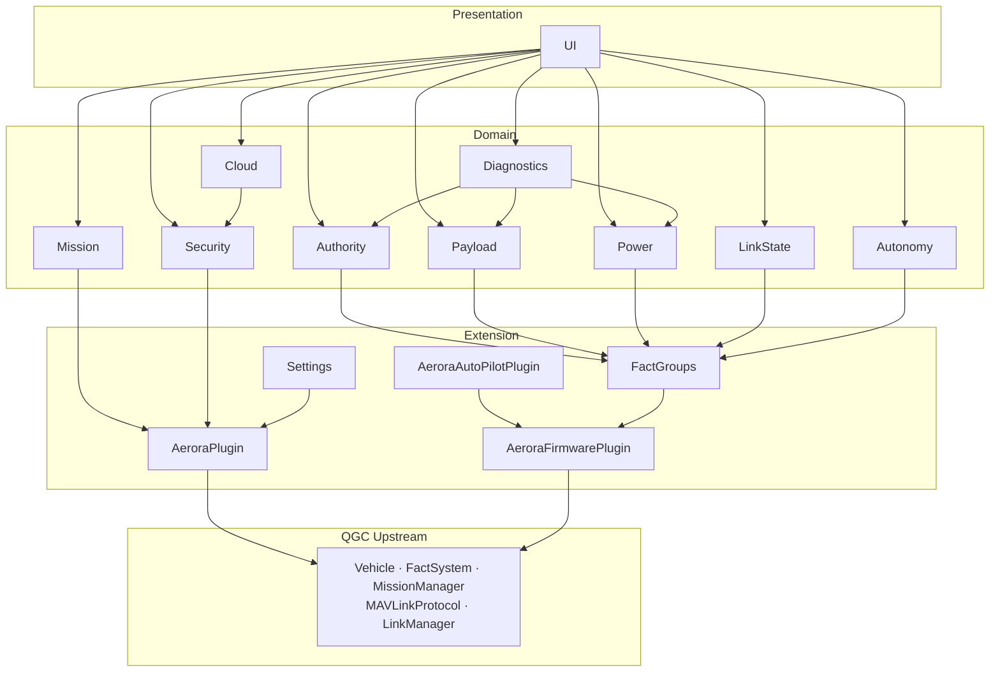
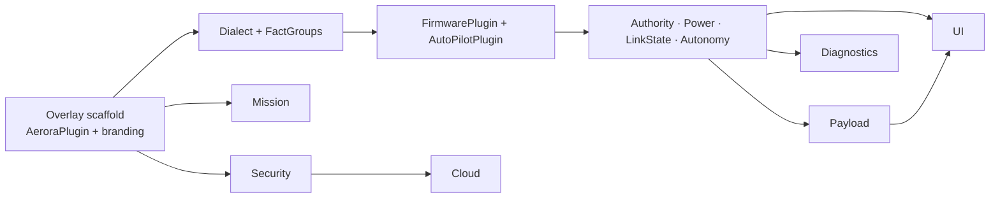

# Component Architecture

The Aerora modules, their responsibilities, their dependencies, and the seams through which each
attaches to QGroundControl.

## Overlay structure

All Aerora code lives in one overlay directory activated by `QGC_CUSTOM_DIR`. Phase 1 confirmed
that CI exercises the overlay mechanism without renaming the reference directory, so Aerora can use
its own directory name and leave `custom-example` intact as a living reference.

```text
aerora/                                 QGC_CUSTOM_DIR=aerora
├── CMakeLists.txt                      REQUIRED by the overlay contract
├── cmake/
│   └── CustomOverrides.cmake           REQUIRED — included before project()
├── src/
│   ├── AeroraPlugin.{h,cc}             CUSTOMCLASS — the single entry point
│   ├── AeroraOptions.{h,cc}            QGCOptions + QGCFlyViewOptions subclasses
│   ├── Authority/                       command lifecycle, authority state
│   ├── Payload/                         payload manager + painting payload
│   ├── Power/                           power and tether configuration state
│   ├── LinkState/                       link arbitration mirroring
│   ├── Autonomy/                        companion observability
│   ├── Mission/                         coverage pattern + plan creator
│   ├── Security/                        identity, authorisation, audit
│   ├── Cloud/                           AWS client — off the command path
│   ├── FirmwarePlugin/                  AeroraFirmwarePlugin + self-registering factory
│   ├── AutoPilotPlugin/                 Aerora setup pages
│   ├── FactGroups/                      Aerora telemetry fact groups
│   ├── Settings/                        settings groups + metadata JSON
│   ├── AppSettings/pages/               settings page overlay JSON
│   ├── PlanView/                        pattern editor + map visual QML
│   └── *.qml                            core QML overrides
└── res/                                 branding, icons, QML module content
```

## Module inventory

Fifteen Aerora modules. Each row states what the module owns, what it depends on, and how it
attaches.

| Module | Owns | Attaches via |
| --- | --- | --- |
| **AeroraPlugin** | Overlay entry point, lifecycle, registration of everything else | `CUSTOMCLASS` substitution of `QGCCorePlugin` |
| **Authority** | Command lifecycle state, authority source attribution, failsafe state presentation | Observes the command queue and control-status reporting; owns no transport |
| **Payload** | Payload abstraction, capability model, painting payload, configuration states | Fact groups for telemetry; command path through the firmware plugin |
| **Power** | Power source and tether configuration state, energy presentation | Fact groups; no control |
| **LinkState** | Mirror of vehicle-reported link arbitration, per-link GCS observations | Reads QGC link state; reads vehicle-reported arbitration from telemetry |
| **Autonomy** | Companion computer observability, proposal presentation, freshness | Telemetry only. **No command path** |
| **Mission** | Coverage pattern, plan creator, pattern presets | `complexMissionItemNames()`, `createComplexMissionItem()`, `planCreators()` |
| **Security** | Identity, authentication, authorisation, audit trail, key custody | New module; wraps QGC's signing key store |
| **Cloud** | AWS client, synchronisation queue, degradation state | New module. **Never on the command path** |
| **AeroraFirmwarePlugin** | Firmware abstraction for the Aerora flight controller | Self-registering factory — no core edit |
| **AeroraAutoPilotPlugin** | Vehicle setup page composition | Returned from the firmware plugin |
| **FactGroups** | Aerora telemetry as Facts with metadata, units and bounds | `FirmwarePlugin::factGroups()` |
| **Settings** | Aerora settings groups and their metadata | `registerCustomSettings()` |
| **UI** | Operator views, indicators, overlays, branding | QML modules plus the resource-override interceptor |
| **Diagnostics** | Version and capability inventory, health rollup, evidence capture | Reads from all modules; writes to logging |

## Dependency graph



### Dependency rules

Four rules, enforced by review:

1. **Presentation depends on domain; domain never depends on presentation.** No Aerora module holds
   a reference to a QML object.
2. **Domain modules reach QGC only through the extension layer.** No domain module includes a QGC
   header directly except for value types.
3. **Payload does not depend on Mission, and Mission does not depend on Payload.** They meet only
   through the pattern's emitted mission items and through reported payload state. This is what
   keeps painting out of the mission engine.
4. **Cloud depends on Security, never the reverse.** Identity must work offline.

### The one deliberate asymmetry

`Autonomy` has no outbound command path at all. It is a read-only module. This is structural
enforcement of the baseline rule that the companion computer is non-authoritative and that the GCS
must not promote a proposal to a command. A module that cannot send cannot violate it.

## Module detail

### AeroraPlugin

The single overlay entry point. Phase 1 confirmed substitution is preprocessor-based: the overlay
sets three compile definitions and `QGCCorePlugin::instance()` returns the Aerora subclass.

Responsibilities:

- Construct and own every other Aerora module.
- Override the `QGCCorePlugin` virtuals Aerora needs: message inspection, toolbar indicators,
  analyze pages, custom map items, palette override, settings registration, settings metadata
  adjustment, mission pattern registration, plan creators, engine creation and teardown, first-run
  prompts.
- Return an `AeroraOptions` instance gating UI surfaces.
- Install the resource-override interceptor.
- Perform the startup self-check that R-019 requires.

It must **not** contain domain logic. It is a registration and wiring component.

### Authority

The module that realises the baseline's central requirement. Detail in
[authority-model.md](authority-model.md).

Owns the per-command lifecycle state machine, the authority source attribution, the staleness
assessment, and the failsafe state presentation. Consumes acknowledgement results and control-status
reporting. Produces state for the UI.

It is a **presentation and attribution** module, not a control module. It does not decide whether a
command is permitted — the flight controller does that, and Authority reports the answer.

### Payload

Detail in [payload-architecture.md](payload-architecture.md).

Owns the product-independent payload abstraction and the painting payload as its first
implementation. The abstraction follows the baseline's generic interface: identity, version,
capabilities, health, telemetry, configuration, commands, calibration, safety state, diagnostics.

Critically, per ADR-005, Payload **displays reported payload state** and does not maintain a
GCS-side model of what the payload's configuration ought to be.

### Power

Owns the power source and configuration state the baseline enumerates: tether connected or
disconnected, battery present or absent, active source, source transition, battery state of charge,
voltage, current, power, power-system fault, estimated remaining energy where validated, and a
degraded or limited-power mode.

Also owns the **configuration consistency check** — comparing a sensed configuration against an
operator-declared one and surfacing a mismatch. The baseline requires that configuration-specific
controls not be presented as available when the required hardware is not detected or declared.

No control. The baseline is explicit that the GCS is not the safety controller for the high-voltage
domain.

### LinkState

Owns the mirror of vehicle-reported link arbitration and the separation between vehicle-reported
state and GCS-local observation. Detail in
[communication-architecture.md](communication-architecture.md).

The separation is the point. The GCS can observe that its own serial port is open; only the vehicle
can say which link it is actually using.

### Autonomy

Owns companion computer observability: connection state, message freshness, autonomy health,
command authority, rejection state, current effective command or mode, and degraded state. Detail
in [gpu-integration.md](gpu-integration.md).

Read-only by construction.

### Mission

Owns the Aerora coverage pattern, its editor and map visual, its plan creator tile, and its preset
set. Detail in [mission-architecture.md](mission-architecture.md).

Phase 1 confirmed a new pattern requires zero core edits, with a complete worked reference in the
QGC tree.

### Security

Owns identity, authentication, authorisation, the audit trail, and key custody. Detail in
[security-architecture.md](security-architecture.md).

Entirely new — Phase 1 found no foundation to extend. The one thing it wraps rather than replaces
is QGC's signing implementation, whose logic is sound and whose storage is not.

### Cloud

Owns the AWS client, the synchronisation queue, and the degradation state. Detail in
[cloud-architecture.md](cloud-architecture.md).

Structurally isolated from the command path. It has no reference to the vehicle command interface,
which is enforcement rather than policy.

### AeroraFirmwarePlugin and factory

Phase 1 confirmed firmware plugins self-register through a constructor into a global list, so this
needs no core edit. Detail in [vehicle-integration.md](vehicle-integration.md).

Two constraints Phase 1 established:

- Plugins are **shared singletons per firmware class**, so per-vehicle state must go in the
  instance-data companion object, not on the plugin.
- The named flight-mode accessors must **not** be populated with guessed Aerora mode names,
  because QGC uses them to decide what to command. This is a `G-ARCH` constraint arising from
  Q-007.

### FactGroups

Owns Aerora telemetry as Facts. Phase 1 established this is the correct insertion point: a fact
group with its own metadata JSON gives Aerora telemetry units, bounds, translation, QML binding and
rate limiting, satisfying the Fact System rule without bespoke storage.

Proposed groups, one per domain, each with metadata:

| Group | Contents |
| --- | --- |
| `aeroraSystem` | Authority mode, arming state, watchdog state, boot state, version inventory |
| `aeroraPayload` | Payload identity, capabilities, health, safety state |
| `aeroraPaint` | Tank level, pump, pressure, flow, nozzle, spray state |
| `aeroraPower` | Source, tether state, converter state, battery state, energy |
| `aeroraLink` | Per-link validity, freshness, quality, vehicle-reported active link |
| `aeroraAutonomy` | Companion connection, freshness, health, proposal and rejection state |

Names and contents are `PROPOSED`; the message definitions they decode are `OPEN` pending the
interface control document.

### Diagnostics

Owns the version and capability inventory, the health rollup, and evidence capture for verification.
The baseline requires a compatibility matrix across GCS version, flight controller firmware, payload
firmware and dialect version; Diagnostics owns the GCS side of that.

## Attachment summary

Every module and its seam, with the core-edit count.

| Module | Seam | Core edit |
| --- | --- | --- |
| AeroraPlugin | `CUSTOMCLASS` + `CUSTOMHEADER` compile definitions | No |
| Authority | Command acknowledgement results, control-status telemetry | No |
| Payload | Fact groups, firmware plugin command path | No |
| Power | Fact groups | No |
| LinkState | QGC link state, telemetry | No |
| Autonomy | Fact groups | No |
| Mission | Three `QGCCorePlugin` virtuals | No |
| Security | New module, wraps the signing key store | No |
| Cloud | New module | No |
| AeroraFirmwarePlugin | Self-registering factory | No |
| AeroraAutoPilotPlugin | Returned from the firmware plugin | No |
| FactGroups | `FirmwarePlugin::factGroups()` | No |
| Settings | `registerCustomSettings()` + settings page overlay JSON | No |
| UI | QML modules + resource-override interceptor + indicator lists | No |
| Diagnostics | Reads other modules | No |
| **Total** | | **Zero** |

Deferred: six transport registration edits, required only if a future transport cannot be expressed
as a serial port. See [communication-architecture.md](communication-architecture.md).

## Build-order dependencies

The order in which modules can be implemented, derived from the dependency graph rather than from a
schedule.



Three chains are independent after the scaffold: the telemetry chain, the mission pattern, and the
security and cloud chain. They can proceed in parallel.

The scaffold is therefore the critical first deliverable, and it depends on Q-003 being answered.
