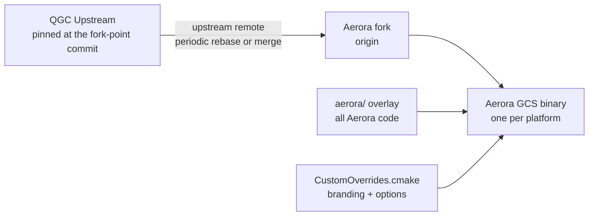

# Deployment Architecture

Build topology, platform scope, packaging, signing, and the engineering infrastructure.

## Build topology



One binary per platform, built from the fork with the overlay active. Phase 1 confirmed the overlay
mechanism: a required `CMakeLists.txt` and `cmake/CustomOverrides.cmake`, path-validated, with the
overrides file included before the project declaration so it can force branding variables.

### Activation

```text
cmake -B build -DQGC_CUSTOM_DIR=aerora ...
```

The overlay directory need not be named `custom`. Phase 1 confirmed CI builds the reference overlay
by pointing the variable at it, which means Aerora can keep its own directory name and leave the
reference intact.

### What CustomOverrides.cmake sets

| Variable | Purpose |
| --- | --- |
| `QGC_APP_NAME` | Aerora product name |
| `QGC_ORG_NAME`, `QGC_ORG_DOMAIN` | Aerora organisation identity |
| `QGC_PACKAGE_NAME`, `QGC_ANDROID_PACKAGE_NAME` | Package identifiers |
| `QGC_APP_COPYRIGHT`, `QGC_APP_DESCRIPTION` | Metadata |
| Platform icon and installer-art paths | Branding assets from the overlay |
| `QGC_MAVLINK_GIT_REPO`, `_TAG`, `_DIALECT` | Aerora dialect selection |
| `QGC_DISABLE_PX4_PLUGIN_FACTORY`, `QGC_DISABLE_APM_PLUGIN_FACTORY` | Single-stack configuration, if Q-017 resolves that way |
| `QGC_ENABLE_GST_VIDEOSTREAMING` | Video retention, if Q-031 resolves to disable |
| `QGC_SETTINGS_VERSION` | Incremented when Aerora changes persisted settings shape |

All of these are `CACHE ... FORCE` overrides of existing QGC options. None requires a core edit.

## Platform scope

`OPEN` as Q-032. The architecture enumerates what each platform costs so the decision is informed.

| Platform | Build | Signing available | Notes |
| --- | --- | --- | --- |
| Windows | Supported upstream | **Not implemented** — only a planning document exists | Likely the primary operator platform |
| Linux | Supported upstream | No package signing found | AppImage, DEB and RPM packaging exist |
| macOS | Supported upstream | **Implemented** — signing plus notarisation | Full hardened-runtime flow |
| Android | Supported upstream | Off by default; needs an external keystore | Serial enumeration caveat applies, see below |
| iOS | Supported upstream | **Implemented** | Serial links are disabled on iOS by build configuration |

### Platform-specific findings that bear on the decision

**iOS disables serial links.** The build forces the no-serial option on iOS. Given the serial-first
transport decision, iOS cannot connect to an Aerora radio over serial. It would be limited to
network transports, which do not currently exist for Aerora. iOS is therefore a poor fit for the
first product unless a network transport is added.

**Android serial enumeration is conditional.** The default Android backend requires the device to
appear in a USB probe table. A radio with a custom vendor and product identifier may not enumerate
without an addition to QGC's prober, which would be a core edit. Mainstream bridge chips are
covered by the upstream table. An alternative POSIX backend exists but is gated on the device
actually exposing serial nodes, which is typically only industrial or rooted hardware.

**macOS filters certain serial node names.** A USB-serial bridge appearing under one node naming
convention is hidden; the alternate node is used. Operationally invisible, but worth knowing during
bring-up.

**Windows is the only platform with both full serial support and no signing implementation.** If
Windows is the primary operator platform — which the serial-first decision suggests — then signing
is the single largest deployment gap.

### Recommendation

`PROPOSED`: Windows and Linux for the first product, with macOS if an operator requires it. Android
deferred pending the enumeration question. iOS excluded while transport is serial-only.

This is a product decision; the architecture supports any subset.

## Packaging

Inherited from QGC, parameterised by the overlay.

| Platform | Artefact | Branding source |
| --- | --- | --- |
| Windows | Installer | Overlay icon and installer header |
| Linux | AppImage, optionally DEB or RPM | Overlay scalable icon, desktop entry, metadata |
| macOS | Disk image | Overlay icon set and property list |
| Android | Package | Overlay Android directory, merged over the stock template |
| iOS | Application bundle | Overlay assets |

The Android merge recreates the merged directory on each configure so that a deleted overlay file
cannot linger — a property worth preserving.

## Signing and integrity

This is where the largest deployment work sits. Phase 1 found macOS and iOS properly implemented
and the other three absent.

| Requirement | Current state | Aerora work |
| --- | --- | --- |
| Artefact signing, macOS and iOS | Implemented, including notarisation | Supply Aerora credentials |
| Artefact signing, Windows | **Absent** | New build work |
| Artefact signing, Android | Off by default | Supply keystore, enable |
| Package signing, Linux | **Absent** | New build work |
| Software bill of materials | Generated in CI | Retain |
| Build provenance attestation | Present upstream | Retain |
| Update integrity | **Absent** | New module — see [security-architecture.md](security-architecture.md) |

The macOS implementation is a good structural model for the others: it signs libraries, then
frameworks, then the bundle, verifies, then submits for notarisation, and it hard-fails on missing
credentials rather than silently producing an unsigned artefact. That fail-closed property should be
replicated.

One inherited benefit: the version check is compiled to return nothing in a custom build, so an
Aerora build does not inherit QGC's unsigned update check. Aerora builds its own or has none.

## Build reproducibility

Three constraints, two of them inherited problems.

| Constraint | State |
| --- | --- |
| Dependencies fetched at configure time | Inherent to the dependency manager; a clean build needs network unless the source cache is pre-populated |
| Two dependencies use floating references | One tracks a branch, one a mutable tag. Becomes relevant only if those dependencies are retained |
| Aerora dialect must be pinned to a commit | **Architectural requirement**, not optional |

The dialect pin is the one Aerora must get right from the start. A dialect tracked by branch would
mean two builds of the same Aerora commit could embed different message definitions, which would
make the compatibility matrix the baseline requires meaningless.

If reproducibility is a compliance requirement — `OPEN` as Q-033 — then the source cache strategy
and the floating references both become mandatory work rather than advisable.

## Engineering infrastructure

The baseline directs that AWS be evaluated for engineering infrastructure while real-time control
stays local. The architecture accepts this with one qualification.

| Function | Platform | Qualification |
| --- | --- | --- |
| Source control | Aerora fork | Hosting is a product decision |
| Continuous integration and delivery | AWS or the fork host | QGC's existing workflow structure is reusable |
| Artefact storage | AWS object storage | — |
| Software bill of materials and attestation | CI | Already generated upstream |
| Release metadata | AWS | Feeds the update module |
| Log aggregation | AWS | **Engineering telemetry only**; flight records are local first |
| Observability dashboards | AWS | — |
| Backup and disaster recovery | AWS | — |
| Configuration distribution | AWS | Must degrade to cached configuration |
| Fleet records | AWS | Keyed on Aerora vehicle identity, not system id |
| Authentication | AWS, with offline capability | Identity must work offline |

### The qualification

Two rows carry a constraint that is easy to lose: **log aggregation and authentication must both
work without the cloud.**

Flight records are evidence. If the only durable copy is in the cloud, then a cloud outage during a
flight destroys evidence, and the baseline requires local logging sufficient for flight records.
Logs are therefore written locally first and aggregated opportunistically.

Authentication that requires the cloud would make the cloud a flight-safety dependency through the
back door — the operator could not log in to fly. The identity module must therefore support
offline operation with cached credentials, which is an architectural requirement rather than a
feature. Detail in [security-architecture.md](security-architecture.md).

## Development environment

Phase 1 found this host cannot build QGC: the compiler toolchain, build generator, Qt tooling and
task runner are all absent, and there is no build directory. R-009 gates this at implementation.

Required to satisfy the definition of done:

| Component | Requirement |
| --- | --- |
| Qt | 6.11.1, with the module set the project declares |
| CMake | 3.25 minimum |
| Compiler | C++20 capable; platform toolchain |
| Build generator | Ninja |
| Task runner | `just`, for the canonical recipes |
| Python environment | The locked tooling environment, for generators and linters |
| Disk | Substantially more than currently available |

The definition of done inherited from the project is a successful build, a clean lint pass, and
relevant tests passing. None of those can run until this is provisioned.

## Versioning

| Artefact | Scheme |
| --- | --- |
| Aerora GCS | Semantic version, derived from git describe as upstream does |
| Aerora dialect | Pinned commit, with a dialect version in the message set |
| Plan file | Nested Aerora version key inside the existing envelope; the envelope version is not changed |
| Settings | `QGC_SETTINGS_VERSION`, incremented on incompatible change |
| Configuration manifest | Aerora-defined, recorded by Diagnostics |

The baseline requires a compatibility matrix across GCS version, flight controller firmware,
payload firmware and dialect version. Diagnostics records the GCS side; the matrix itself is an
interface control document deliverable.
