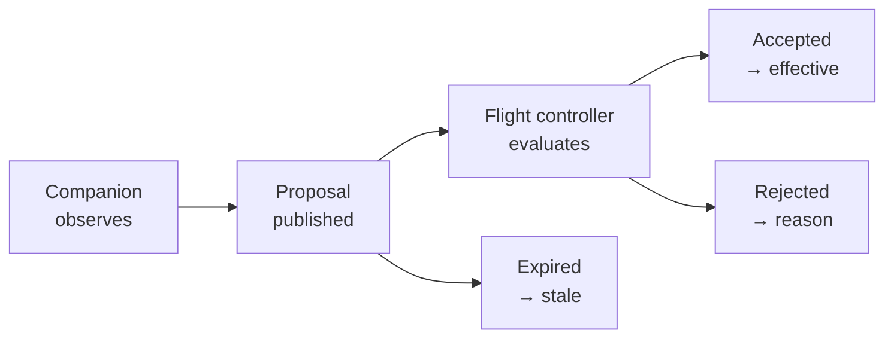

# GPU Integration

How the Aerora GCS observes the companion computer: what reaches the ground station, how proposals
are represented, and why the integration is read-only by construction.

"GPU" here means the Aerora companion computer running perception and autonomy workloads on the
aircraft. It does not mean graphics acceleration on the ground-station host, which is a rendering
concern and is out of scope for this document.

## The governing constraint

The Aerora baseline is explicit that the companion computer is **not authoritative**. It proposes;
the flight controller decides. The GCS observes both.

Architecture does not enforce that constraint by writing it down. It enforces it by not building
the path that would violate it:

| Property | How it is enforced |
| --- | --- |
| The GCS cannot command the companion | The Autonomy module has no outbound command path at all |
| The GCS cannot accept a proposal on the companion's behalf | Acceptance is a flight-controller decision reported as telemetry |
| The GCS cannot present a proposal as vehicle state | Proposals and effective state are separate Facts with separate names |
| The GCS cannot emit companion-interface messages | Interface B is not implemented GCS-side |

The Autonomy module is the only Aerora domain module with no command path. That asymmetry is
deliberate and is recorded in [component-architecture.md](component-architecture.md). A module with
a command path plus a policy rule saying "do not use it" was considered and rejected: a policy rule
is a code review away from being violated, a missing function is not.

## How companion data reaches the GCS

### The verified path

No new transport, no second vehicle, no core edit. The mechanism follows from two filters in
existing code:

```text
companion message (sysid = vehicle sysid, compid = onboard computer)
        │
        ▼
MultiVehicleManager::_vehicleHeartbeatInfo                      MultiVehicleManager.cc:70
        │   componentId != MAV_COMP_ID_AUTOPILOT1  →  ignored
        │   no second Vehicle is created                        ← desired
        │
        ▼
Vehicle::_mavlinkMessageReceived                                Vehicle.cc:525
        │   filters on sysid only; compid is not filtered
        │   message is accepted                                 ← desired
        │
        ▼
for each FactGroup: handleMessage(...)                          Vehicle.cc:587-590
        │
        ▼
aeroraAutonomy FactGroup
```

The two filters pull in opposite directions and the combination is exactly what is wanted: the
companion's heartbeat does not manufacture a phantom vehicle in the vehicle list, while its
telemetry still lands on the real vehicle's model. Packet-loss accounting is scoped to the
first-heard component id (`Vehicle.cc:541-543`), so companion traffic does not distort the
flight-controller link statistics.

### What this requires of the hardware and firmware

The path above only works if the companion addresses itself correctly. Three requirements follow,
and they are requirements on the vehicle side, not on the GCS:

| Requirement | Failure mode if violated |
| --- | --- |
| The companion shares the flight controller's MAVLink system id | A different system id means the GCS discards every companion message at `Vehicle.cc:525` |
| The companion uses a component id other than `MAV_COMP_ID_AUTOPILOT1` | An autopilot component id would create a second phantom vehicle |
| The companion does not impersonate the autopilot in any message | Component-scoped handling across QGroundControl assumes component 1 is the autopilot |

`MAV_COMP_ID_ONBOARD_COMPUTER` is the natural choice and QGroundControl already carries a display
name for it (`QGCMAVLink.cc:11`). That is the extent of upstream's companion-computer support: a
label. Everything else is Aerora's.

These three items are the first thing to confirm with the firmware team, because a companion that
uses its own system id turns a zero-cost integration into a transport problem.

## The proposal model

### Lifecycle

A proposal has a lifecycle, and the GCS observes it rather than driving it:



Every transition in that diagram happens on the aircraft. The GCS contributes nothing to it. What
the GCS does is make the distinction legible to an operator, which is harder than it sounds and is
the real work of this integration.

### Proposal is not effective state

This is the second architectural principle — effective over requested — applied to autonomy, and it
is where an operator is most likely to be misled. A proposal rendered with the same visual weight
as vehicle state invites the reading that the aircraft is doing what the companion suggested.

| Concept | Source | Fact naming | Presentation |
| --- | --- | --- | --- |
| Proposal | Companion | Proposal-prefixed in `aeroraAutonomy` | Visually subordinate, explicitly labelled as proposed |
| Effective state | Flight controller | The relevant authority or mission Fact | Primary |
| Acceptance outcome | Flight controller | A distinct outcome Fact with a reason | Shown with the proposal it resolves |

Whether the flight controller reports proposal acceptance explicitly, or whether the GCS must infer
it by comparing a proposal against subsequent effective state, is Q-008 — ranked sixth in
[phase-2-open-question-resolution.md](phase-2-open-question-resolution.md).

The architecture takes a position on the answer: **explicit reporting is required.** Inference is
unacceptable here, not because it is difficult but because it is unfalsifiable. An inferred
acceptance cannot be distinguished from a coincidence, and the audit trail would record a
correlation as a decision. If the flight controller does not report the outcome, the GCS shows the
proposal and the effective state side by side and asserts no causal link between them.

### Freshness is mandatory, not optional

Autonomy proposals age faster than almost anything else the GCS displays. A perception result that
was true four seconds ago may be actively misleading.

| Element | Treatment |
| --- | --- |
| Receive time | Stamped at parse time, as for all Aerora values |
| Staleness threshold | Per proposal class, from the vehicle-reported interface definition |
| Stale presentation | The value is marked stale and is never silently retained as current |
| Absent companion | Distinguished from a companion reporting nothing |

That last row matters. "The companion is not talking to us" and "the companion has no proposal" are
different situations with different operator responses, and collapsing them into one blank field is
the kind of ambiguity that gets rationalised in a debrief.

## What the Autonomy module contains

| Element | Responsibility |
| --- | --- |
| `aeroraAutonomy` FactGroup | Parse companion messages, stamp freshness, expose Facts |
| Proposal state | The current proposal set with per-proposal freshness and outcome |
| Companion health | Companion presence, reported load, reported perception status |
| Staleness evaluation | Marking proposals stale against their class threshold |

And what it does not contain:

| Absent element | Reason |
| --- | --- |
| Any outbound message construction | Read-only by construction |
| Any proposal acceptance logic | Acceptance is a flight-controller decision |
| Any inference of effective state from a proposal | Would present a guess as vehicle state |
| Any autonomy policy or decision logic | Policy lives on the aircraft |

## Boundaries

### Video

The companion is a plausible video source, but video is QGroundControl's `VideoManager` and
GStreamer pipeline, not part of this integration. The only overlap is that a perception overlay
drawn on a video frame needs both the frame and the proposal, and the proposal comes from here.
Whether video is retained at all in the Aerora build is Q-031, treated in
[deployment-architecture.md](deployment-architecture.md).

### Model and workload management

Deploying models to the companion, managing its workloads, and updating its software are not GCS
functions in this architecture. If they become product requirements they are a separate subsystem
with its own authority analysis, not an extension of a read-only observability module. Recorded so
that the read-only property is not eroded by a later feature arriving through this door.

### Ground-station compute

The Aerora GCS performs no perception or inference on the ground-station host. Nothing in the
architecture precludes it, but it is not in scope, and introducing it would raise a question this
document has deliberately settled — whether a ground-side result could ever become authoritative.

## Degraded operation

| Loss | GCS behaviour |
| --- | --- |
| Companion stops reporting | Proposals marked stale, then absent; companion presence shows lost; no vehicle-directed action |
| Companion reports but the flight controller reports no outcomes | Proposals shown with outcome unknown; no inference |
| Companion reports implausible values | Displayed as received, within metadata bounds, and logged; the GCS does not sanitise telemetry into plausibility |
| Flight controller link lost but companion reachable | Not possible in this topology — the companion is reached through the flight controller |

The last row is a consequence of interface separation in
[mavlink-architecture.md](mavlink-architecture.md). The GCS never has a direct path to the
companion, which is also why the GCS cannot command it even if someone later wanted it to.

## Verification

| Property | How it is tested |
| --- | --- |
| A companion heartbeat does not create a second vehicle | Mock link emitting a non-autopilot component heartbeat; assert vehicle count |
| Companion messages reach the Aerora FactGroup | Mock link injection; assert Fact values |
| Companion traffic does not distort link statistics | Inject companion traffic; assert the loss counter is unchanged |
| Proposals go stale | Inject a proposal, advance time past the threshold, assert the stale marking |
| Absent and silent are distinguishable | Two scenarios, assert different presented states |
| The Autonomy module has no command path | Static check that the module emits no MAVLink |

The last one is the most valuable test in this document. It is the only one that verifies an
architectural property rather than a behaviour, and it is what keeps the read-only guarantee true
twelve months from now. Detail in [testing-architecture.md](testing-architecture.md).

## Open questions

| Question | Subject | Impact |
| --- | --- | --- |
| Q-008 | Whether proposal acceptance is explicitly reported or must be inferred | `ARCH-SHAPING` |
| Q-031 | Whether video is retained in the Aerora build | `DEFERRABLE` |

Both are listed with their resolution route in
[phase-2-open-question-resolution.md](phase-2-open-question-resolution.md).

## Requirements derived

| Identifier | Statement |
| --- | --- |
| `AERORA-GPU-REQ-001` | The companion computer shall share the flight controller's MAVLink system id and use a distinct component id |
| `AERORA-GPU-REQ-002` | The companion computer shall not emit messages using the autopilot component id |
| `AERORA-GPU-REQ-003` | The Aerora Autonomy module shall have no outbound command path |
| `AERORA-GPU-REQ-004` | The GCS shall present companion proposals as subordinate to effective vehicle state and shall label them as proposed |
| `AERORA-GPU-REQ-005` | The GCS shall not infer proposal acceptance from subsequent vehicle state |
| `AERORA-GPU-REQ-006` | Every companion-sourced value shall carry a receive time and shall be marked stale past its class threshold |
| `AERORA-GPU-REQ-007` | The GCS shall distinguish an absent companion from a companion reporting no proposal |
| `AERORA-GPU-REQ-008` | The GCS shall not perform perception or autonomy inference on the ground-station host |

Full records in [requirements.md](requirements.md).
