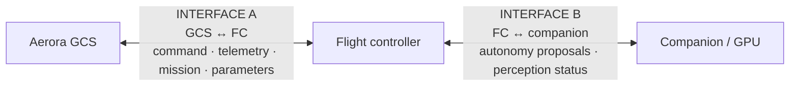
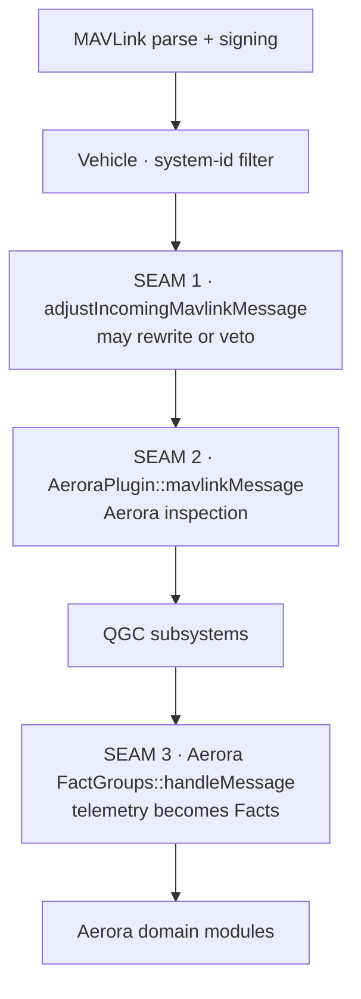

# MAVLink Architecture

Dialect strategy, message families, the extension seams Aerora uses, and the interface separation
the baseline requires.

## Dialect strategy

Aerora maintains its own fork of the MAVLink definitions repository, pinned to a commit, selected
through existing CMake variables from the overlay's override file.

```text
CustomOverrides.cmake
  ├── QGC_MAVLINK_GIT_REPO   = <Aerora mavlink fork>
  ├── QGC_MAVLINK_GIT_TAG    = <pinned commit, never a branch>
  └── QGC_MAVLINK_DIALECT    = aerora
```

Phase 1 established why this works: QGroundControl has no checked-in message headers. The entire C
library is generated at configure time by the upstream generator running inside a fetched copy of
the definitions repository, and both of QGC's own generator passes plus the include path follow the
dialect variable. Aerora messages, enums and their QML bindings therefore all come through
automatically.

Recorded as ADR-004. **No core edit.**

### Pinning is an architectural requirement

A dialect tracked by branch would mean two builds of the same Aerora commit could embed different
message definitions. That would make the compatibility matrix the baseline requires — GCS version
by flight-controller firmware by payload firmware by dialect version — meaningless.

This is also the lesson from R-011, where two upstream dependencies use floating references.

### Dialect composition

| Element | Source |
| --- | --- |
| Standard messages | Upstream common definitions, unmodified |
| ArduPilot and other dialects | Retained or dropped per Q-017 |
| Aerora messages | Aerora-defined, in an Aerora dialect file |
| Dialect version | An explicit field in the Aerora system status message |

The baseline's principle governs: use standard messages when semantically sufficient, add Aerora
messages only where standard semantics are inadequate.

## Interface separation

The baseline requires that the flight-controller-to-companion interface and the
GCS-to-flight-controller interface be **explicitly separated in the interface control document even
if they share the dialect**. This is a real constraint, not a documentation nicety.



### Why separation matters

| Reason | Consequence |
| --- | --- |
| Different trust levels | Interface B carries non-authoritative proposals; interface A carries operator commands |
| Different change cadence | The companion stack will iterate faster than the ground protocol |
| Different security posture | Interface B is an internal wired link; interface A crosses a radio |
| The GCS must not emit interface B messages | Structurally prevents the GCS from impersonating the companion computer |

The last row is the important one. If both interfaces share a dialect and no separation is
maintained, nothing stops a GCS implementation from sending an autonomy proposal message — which
would directly violate the non-authoritative-companion principle. The separation makes that a
documented violation rather than an accident.

**Aerora GCS implements interface A only.** It *observes* interface B state where the flight
controller reports it. This is enforced structurally by the Autonomy module being read-only.

## Message families

Candidate families from the baseline. All `PROPOSED`; the message set is `OPEN` until the interface
control document is frozen.

| Family | Direction | Carries |
| --- | --- | --- |
| `AERORA_SYSTEM_STATUS` | FC to GCS | Authority mode, arming state, watchdog state, boot state, dialect version |
| `AERORA_VEHICLE_CAPABILITIES` | FC to GCS | Capability inventory, so the GCS adapts rather than assumes |
| `AERORA_PAYLOAD_STATUS` | FC to GCS | Payload identity, capabilities, health, safety state |
| `AERORA_PAINT_STATUS` | FC to GCS | Tank, pressure, flow, nozzle, spray state |
| `AERORA_PUMP_STATUS` | FC to GCS | Pump state |
| `AERORA_GIMBAL_STATUS` | FC to GCS | Gimbal state, if not covered by standard messages |
| `AERORA_AI_STATUS` | FC to GCS | Companion connection, freshness, autonomy health, proposal and rejection state |
| `AERORA_MISSION_STATUS` | FC to GCS | Aerora mission state beyond standard mission progress |
| `AERORA_DIAGNOSTICS` | FC to GCS | Version inventory, fault detail |

Two families the baseline's required-domains list implies but does not name, and which the
architecture needs:

| Family | Direction | Carries | Rationale |
| --- | --- | --- | --- |
| `AERORA_POWER_STATUS` | FC to GCS | Source, tether state, converter state, battery state, energy | The baseline's power state list has no home in the families above |
| `AERORA_LINK_STATUS` | FC to GCS | Per-link validity and freshness, active link identifier, all-stale | Required to mirror arbitration; standard radio status is per-link and does not carry the arbitration result |

Both are `PROPOSED` additions to the baseline's candidate list and are recorded as such in
[open-questions.md](open-questions.md).

### Observation about direction

Every family above is **vehicle to GCS**. That is not an oversight: the baseline's required MAVLink
domains are predominantly observability. Aerora command traffic should use standard MAVLink commands
wherever the semantics fit, and Aerora-specific commands only for payload actions that have no
standard equivalent.

This asymmetry is deliberate and worth preserving. A protocol where the vehicle reports richly and
the GCS commands minimally is easier to reason about for authority, and it keeps the GCS honest
about the difference between what it asked for and what is true.

## Command definition requirements

The baseline mandates a template for each command. The architecture adopts it as a mandatory
checklist, with one addition.

| Field | Required by |
| --- | --- |
| Identifier | Baseline |
| Sender | Baseline |
| Receiver | Baseline |
| Parameters | Baseline |
| Units | Baseline |
| Valid range | Baseline |
| Preconditions | Baseline |
| Acknowledgement semantics | Baseline |
| Timeout | Baseline |
| Retry policy | Baseline |
| Failure behaviour | Baseline |
| Operator feedback | Baseline |
| Safety classification | Baseline |
| **Resume behaviour** | **Added by this architecture** |

The addition follows from R-002. Any Aerora command that sets persistent state must declare what
happens to that state when a mission is resumed, because Phase 2 established that a command
positioned before the resume point is silently dropped from the regenerated mission unless it is on
a core allow-list. Declaring resume behaviour per command makes that consideration explicit rather
than discovered in the field.

Detail in [mission-architecture.md](mission-architecture.md).

## Extension seams

Phase 1 enumerated these. Aerora uses four, all without core edits.

| Seam | Used for | Position in the inbound path |
| --- | --- | --- |
| `FirmwarePlugin::adjustIncomingMavlinkMessage()` | Only if a message needs rewriting before QGC sees it | First |
| `QGCCorePlugin::mavlinkMessage()` | Aerora message inspection and routing to domain modules | Second |
| `FirmwarePlugin::factGroups()` | Aerora telemetry as Facts | Per message, after QGC subsystems |
| `FirmwarePlugin::adjustOutgoingMavlinkMessageThreadSafe()` | Only if an outbound message needs adjustment | Outbound |



### Seam usage policy

| Policy | Rationale |
| --- | --- |
| Prefer seam 3 for telemetry | A Fact gets units, bounds, translation, QML binding and rate limiting |
| Use seam 2 only for messages that are not telemetry | For example a proposal event that must reach the Authority module directly |
| Avoid seam 1 unless genuinely necessary | Rewriting inbound messages makes the wire protocol and the internal model diverge |
| Never veto a message in seam 1 or 2 without logging | A silently dropped message is undiagnosable — this is the R-002 lesson generalised |

## Signing

Aerora retains QGC's MAVLink 2 signing implementation. Phase 1 found it well engineered: a per-link
state machine, auto-detection, burst alerting, and a wall-clock timestamp refresh that addresses a
real interoperability problem.

Two Aerora changes, both outside the signing logic:

| Change | Reason |
| --- | --- |
| Replace the key storage backend | Keys are currently persisted in plaintext application settings — R-005 |
| Set the signing default policy | Signing is opt-in upstream; the Aerora default is `OPEN` as Q-010 |

Detail in [security-architecture.md](security-architecture.md).

Note the hardware opportunity the baseline records: the flight controller carries a secure element.
That is a vehicle-side asset for device identity and key custody. It does not address GCS-side key
storage, but it is directly relevant to how keys are provisioned across a fleet.

## Compatibility

The baseline requires a matrix across GCS version, flight-controller firmware, payload firmware and
dialect version.

| Element | Where it comes from |
| --- | --- |
| GCS version | Build, from the version-control description |
| Dialect version | A field in the Aerora system status message, and the pinned commit in the build |
| FC firmware version | Reported by the vehicle |
| Payload firmware version | Reported through the payload status family |
| Capability inventory | The vehicle capabilities family |

The Diagnostics module records all five and surfaces a mismatch. The **capability inventory** is
what makes this more than a version check: the baseline requires the GCS represent hardware as
capabilities rather than hard-coded assumptions, so that future Aerora products reuse the platform.

A GCS that adapts to a reported capability set does not need to know which product it is talking to.
That is the mechanism by which the multi-product goal is actually achieved, and it is why the
capabilities family is not optional.

## Requirements derived

| Identifier | Statement |
| --- | --- |
| `AERORA-MAV-REQ-005` | The Aerora dialect shall be maintained in an Aerora-controlled fork pinned to an immutable commit |
| `AERORA-MAV-REQ-006` | The GCS-to-FC interface and the FC-to-companion interface shall be separately specified in the interface control document |
| `AERORA-MAV-REQ-007` | The Aerora GCS shall implement the GCS-to-FC interface only and shall not emit FC-to-companion interface messages |
| `AERORA-MAV-REQ-008` | Every Aerora command that sets persistent state shall declare its resume behaviour |
| `AERORA-MAV-REQ-009` | The vehicle shall report a capability inventory, and the GCS shall adapt its presented capabilities to it |
| `AERORA-MAV-REQ-010` | A message vetoed at an Aerora extension seam shall be logged |

Full records in [requirements.md](requirements.md).
