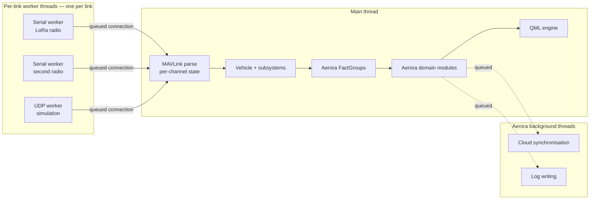
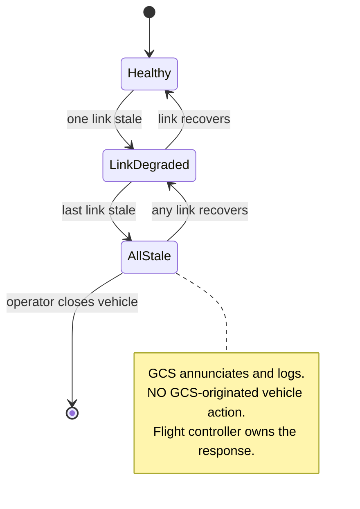

# Runtime Architecture

Threading, startup, data flow timing, and degraded-operation behaviour at run time.

## Threading model

Aerora inherits QGroundControl's threading model unchanged. Phase 1 established it precisely, and
Aerora's constraint is to **not** introduce a competing model.



### Rules

| Rule | Rationale |
| --- | --- |
| Link I/O runs on a dedicated worker thread per link | QGC's existing pattern; each link owns its thread |
| MAVLink parsing is main-thread | QGC's parser singleton is main-thread; per-channel state is keyed by channel index |
| Aerora domain modules are main-thread | They consume Facts, which are main-thread objects with rate-limited notification |
| Cloud and log writing are background | They must never block the telemetry or command path |
| No Aerora module blocks the main thread | Any operation that can block goes to a background thread with a queued result |

The third rule deserves emphasis. Aerora domain modules are main-thread **by design**, not by
accident. Facts provide rate-limited change notification precisely so high-rate telemetry does not
flood the UI. Moving domain state off the main thread would discard that mechanism and add
synchronisation for no benefit.

### Where Aerora adds threads

Only two, both strictly off the critical path:

| Thread | Purpose | Failure behaviour |
| --- | --- | --- |
| Cloud synchronisation | Outbound record and telemetry synchronisation, inbound configuration | Queues on failure; never blocks; surfaces degraded state |
| Log writer | Durable evidence capture | Bounded queue; drops with an accounted counter rather than blocking |

The log writer's drop behaviour is deliberate: losing a log line is preferable to stalling the
command path, and an accounted drop is auditable where a stall is not.

## Startup sequence

```text
QGC application start
  └── AeroraPlugin::instance()                     CUSTOMCLASS substitution
        ├── construct AeroraOptions
        ├── construct domain modules (no I/O yet)
        └── init()
              ├── startup self-check                asserts override resources exist  [R-019]
              ├── Security: load identity state      offline-capable
              ├── Settings registration
              └── Diagnostics: record version inventory

  └── SettingsManager::init()
        └── AeroraPlugin::registerCustomSettings()

  └── createQmlApplicationEngine()
        ├── install resource-override interceptor
        └── add Aerora QML import paths

  └── createRootWindow()

  └── LinkManager: load saved link configurations
        └── AeroraPlugin::linkConfigurationsLoaded()   Aerora link inspection point
  └── LinkManager: start auto-connect links

  └── First vehicle heartbeat
        └── Vehicle created
              ├── AeroraFirmwarePlugin selected by factory
              ├── AeroraAutoPilotPlugin created
              ├── Aerora FactGroups attached
              └── parameter download begins

  └── parametersReady
        └── Aerora domain modules bind to vehicle state
```

Three Aerora-specific points in this sequence matter.

**The startup self-check runs before anything else.** R-019 identified that a mistyped resource
alias silently yields stock behaviour with no error. The check asserts that every expected override
resource exists and fails loudly if not.

**Security loads before any network activity** and must succeed offline. An identity module that
requires the cloud to start would violate the offline-first principle.

**Domain modules bind only after `parametersReady`.** Phase 1 identified accessing Facts before
that signal as a common pitfall. Aerora modules must respect it.

## Data flow timing

### Telemetry path

| Stage | Thread | Timing property |
| --- | --- | --- |
| Byte receive | Link worker | Coalesced by buffer size or elapsed time |
| Queued hand-off | Worker to main | Qt queued connection |
| Parse | Main | Byte-at-a-time, per-channel state |
| Signing check | Main | Per frame, when enabled |
| Vehicle filter | Main | System-id comparison, first statement |
| Fact group decode | Main | Per message |
| Fact notification | Main | **Rate-limited** by the group's update interval |
| UI binding | Main | Qt property binding |

The rate limit is the mechanism that makes high-rate telemetry safe for the UI. Aerora fact groups
must set an appropriate interval per group rather than notifying on every message.

### Freshness attribution

Freshness is attached at parse time and carried through, because the authority model depends on it
and because reconstructing it later is unreliable.

```text
parse → timestamp attached → fact group → domain module → staleness assessment → UI
```

Each Aerora domain value therefore carries three things: the value, the time it was received, and
the source that reported it. Detail in [data-model.md](data-model.md).

Staleness thresholds are per-domain and `OPEN`. The baseline records that the firmware has
companion-message freshness wiring but that the timeout is an engineering decision.

### Command path

| Stage | Thread | State transition |
| --- | --- | --- |
| Operator intent | Main | `REQUESTED` |
| Aerora validation | Main | Rejected locally, or proceeds |
| Authority check | Main | Rejected locally, or proceeds |
| Queue and transmit | Main to worker | `SENT` |
| Acknowledgement received | Main | `ACCEPTED` or `REJECTED` |
| Vehicle state confirms | Main | `EFFECTIVE` |
| Acknowledgement timeout | Main | `FAILED` after retries |
| Freshness lapse | Main | `STALE` |

Phase 1 established QGC's acknowledgement timing: a 1200 ms default window, 120000 ms on a
high-latency link, up to three retries for commands on a retry allow-list. Aerora inherits these
and does not duplicate the retry logic.

The `EFFECTIVE` transition is the one Aerora adds. QGC distinguishes sent from acknowledged;
Aerora additionally requires corroborating vehicle state before presenting a command as effective.
Detail in [authority-model.md](authority-model.md).

## Degraded operation

Each loss is handled independently. The architecture requires that no single loss produce undefined
behaviour.

### Link loss



QGC detects per-vehicle communication loss by polling at 1000 ms against a 3500 ms heartbeat
window, announces it, attempts link failover, and optionally removes the vehicle. Aerora adds
presentation and logging, and **adds no control action**.

The vehicle separately arbitrates across its own links with a documented priority order and an
all-stale condition. Aerora mirrors that reported state. The two views are displayed separately.

### Companion computer loss

Autonomy state degrades. Proposals are marked stale and are **not** displayed as effective. The
baseline states explicitly that the GCS shall not transform a stale companion command into a
current command, and the read-only construction of the Autonomy module enforces it.

### Cloud loss

Synchronisation queues. The cloud indicator degrades. The baseline requires cloud connectivity be
shown **separately** from vehicle link connectivity, so a cloud outage cannot be mistaken for a
link problem.

No flight capability is affected, because no cloud service is on the command path.

### Payload controller loss

Payload state is marked unknown. Payload controls are disabled rather than showing a stale value as
current. The flight controller and payload owner handle the physical response, including the
watchdog path to payload emergency stop that the baseline records in the firmware.

### GCS process loss

Nothing happens to the aircraft. This is a design property: no authoritative state lives only in
the GCS, so the aircraft does not depend on it.

On restart, the GCS re-derives state from the vehicle rather than from its own last-known values.
Persisted GCS state is limited to configuration, plans, logs and cached records.

## Resource budgets

Three budgets are architecturally constrained.

| Resource | Constraint | Source |
| --- | --- | --- |
| MAVLink channels | 15 allocatable; one per link, plus one if the ArduPilot plugin is active | QGC's channel bitmask reserves channel 0 |
| Main-thread budget | Fact notification must be rate-limited per group | Avoids UI flooding |
| Log queue | Bounded, with accounted drops | Must not stall the command path |

The channel budget interacts with the link count. Worst-case concurrent links across a fleet in one
GCS instance must be modelled; this is `OPEN` as Q-015.

## Simulation and test runtime

Aerora inherits QGC's mock link, which is a full synthetic autopilot with extensive fault injection
but exists only in debug builds. It provides communication loss, acknowledgement failure modes,
parameter failure modes, mission item failure modes, and duplicate responses.

For Aerora the relevant additions are an Aerora dialect mock responder and a payload state
simulator, both following the same pattern. Detail in
[testing-architecture.md](testing-architecture.md).

The architectural constraint: a mock must exercise the **same** runtime path as a real link. Phase 1
confirmed QGC's mock link goes through the normal link manager path, so it is just another link.
Aerora test doubles must preserve that property.
