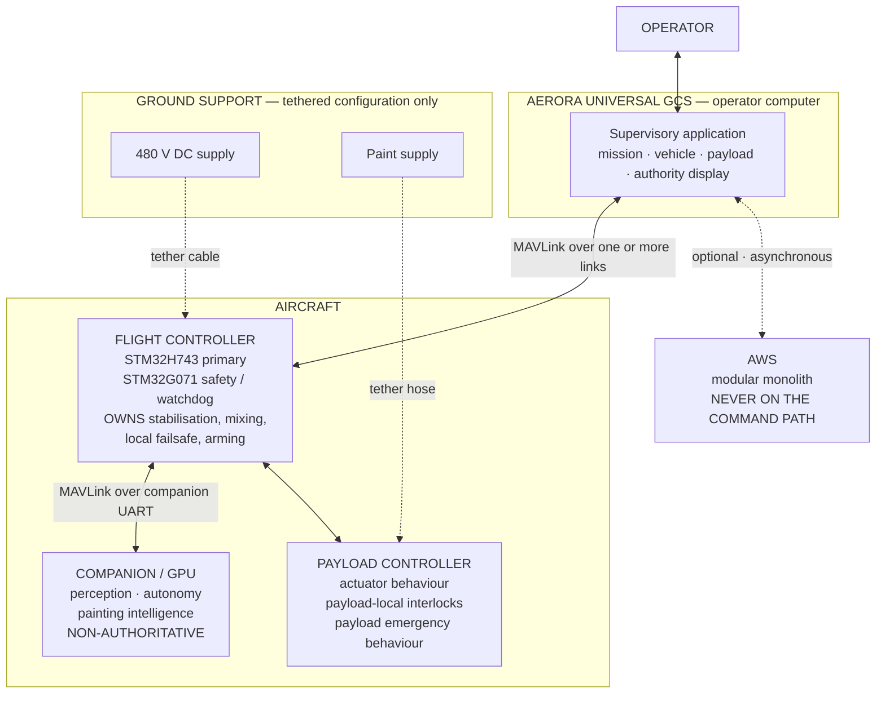
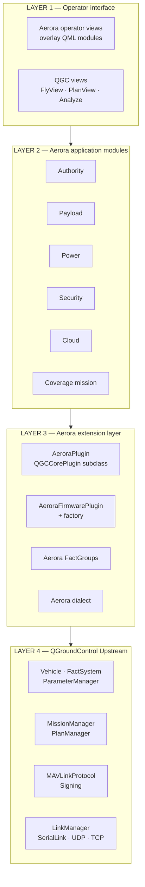
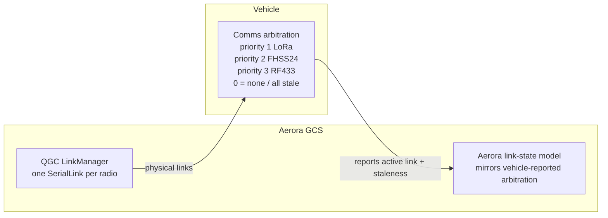
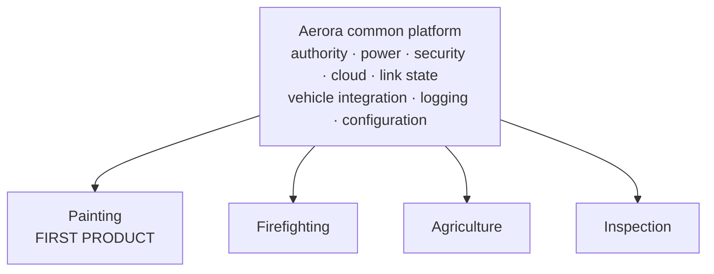

# System Architecture

The Aerora Universal GCS in its system context, the layering that realises it, and the ownership
boundaries that constrain it.

## System context

The GCS is one component of a distributed system. The v4.1 baseline is explicit that it must be
designed around authority, redundancy, observability, degraded operation and traceability rather
than map and waypoint functionality.



Two properties of this diagram are load-bearing.

**The GCS has no direct interface to the companion computer or the payload controller.** Everything
reaches them through the flight controller. The GCS observes the companion computer; it does not
command it. This follows the baseline's statement that MAVLink is an explicit flight-controller to
companion interface in the current product, not merely a future GCS protocol.

**The cloud connection is dashed and bidirectional-optional.** It carries synchronisation, records
and configuration metadata. It carries no command.

## Layering

The v4.1 baseline defines a four-layer stack. Phase 1 evidence refines what each layer actually is
in the delivered artefact.



### What each layer may do

| Layer | May | May not |
| --- | --- | --- |
| 1 Operator interface | Display state, collect operator intent, gate navigation | Touch transport, construct MAVLink, hold authoritative state |
| 2 Aerora modules | Hold Aerora domain state, validate, orchestrate | Bypass layer 3 to reach QGC internals |
| 3 Extension layer | Attach to QGC seams, translate between Aerora and QGC models | Contain product logic that belongs in layer 2 |
| 4 QGC Upstream | Everything it already does | Be modified — zero core edits planned, one candidate recorded in ADR-008 |

The layer 2 to layer 3 split matters for the multi-product goal. Painting-specific logic belongs in
layer 2 as a payload module. Layer 3 must stay product-independent so a firefighting or agriculture
payload reuses it unchanged.

## Ownership boundaries

From the v4.1 baseline, restated as hard constraints because several Phase 1 findings depend on
them.

| Component | Owns | Consequence for the GCS |
| --- | --- | --- |
| **Flight controller** | Stabilisation, low-level control, actuator control, vehicle-local failsafe, estimator and control-loop authority, arming | The GCS requests; the flight controller decides. The GCS displays the decision |
| **Payload controller** | Actuator-level payload behaviour, payload-local interlocks, payload emergency behaviour | **Payload configuration state is the payload controller's to hold.** This resolves R-002 |
| **Companion / GPU** | Perception, inference, defined high-level robotics services, non-authoritative decision support | The GCS shows proposals as proposals. It never promotes one to an effective command |
| **Aerora GCS** | Operator interaction, mission authoring, visualisation, configuration workflows, telemetry presentation, command orchestration, logging, diagnostics | Supervisory. Never the sole safety mechanism |

### The safety boundary, stated precisely

Phase 1 established that QGroundControl's communication-loss handling is **detection and
annunciation only** — it polls at 1000 ms against a 3500 ms heartbeat timeout, announces loss,
attempts link failover, and optionally removes the vehicle. The only vehicle-directed traffic is a
high-latency control toggle during link switching.

Aerora preserves that boundary exactly. The baseline is explicit that the GCS must not invent an
emergency manoeuvre merely because the user interface lost its own network connection.

The GCS is also explicitly **not** the safety controller for high-voltage isolation, converter
protection, grounding, connector interlock or tether electrical fault protection. Those belong to
the electrical design and its local protection.

## Control modes

The baseline requires three modes, and the Simulink evidence shows the firmware already implements
authority states for them with specific sentinel values.

| Mode | Firmware sentinel | Authority |
| --- | --- | --- |
| Manual | 100 | Pilot commands authoritative within validated input limits. **Structurally dominant when selected** |
| Autonomous coverage | 101 | Onboard autonomy executes an approved mission within defined limits. GCS remains supervisory |
| Supervised semi-autonomous | 102 | Autonomy may propose; **explicit pilot confirmation required** before the proposal is followed |

The GCS **mirrors** this model rather than creating a competing one. Three derived requirements:

- The GCS displays the vehicle-reported mode, not a GCS-local belief about the mode.
- The GCS shows whether the semi-autonomous confirmation path is currently active.
- The GCS shows proposal rejection when the vehicle reports it.

The firmware also routes a rejected proposal to a safe or default mode whose code the model's own
comments flag as requiring confirmation. That remains `OPEN` and the GCS must not assume a value.

## Communication topology

The firmware contains arbitration across three paths with a documented priority order and an
all-stale condition.



The distinction the baseline insists on: **the GCS must not claim a link is authoritative.** The
vehicle arbitrates; the GCS displays the arbitration result alongside its own per-link
observations, clearly separated. Detail in
[communication-architecture.md](communication-architecture.md).

## Power configurations

Two configurations, treated as explicit equipment states. **No transition behaviour is implied**,
because the baseline states seamless in-flight switching must not be assumed.

| Configuration | Aircraft power | Paint source | Onboard tank |
| --- | --- | --- | --- |
| Tethered painting | Ground 480 V DC, converted onboard to the 48 V aircraft domain | Ground, through the tether hose | Detached |
| Battery painting | Onboard battery | Onboard tank | Attached |

The GCS requirement is to **identify the active configuration** and to avoid presenting
configuration-specific controls as available when the required hardware is not detected or
declared. Detail in [vehicle-integration.md](vehicle-integration.md).

Everything about the electrical design — source type, isolation topology, converter rating, cable
protection, connector system, grounding, interlocks and transition behaviour — is a controlled open
item. The architecture provides states, not values.

## Data flows

### Telemetry

```text
transport → MAVLink parse → signing check → Vehicle sysid filter
          → FirmwarePlugin adjust → AeroraPlugin inspect
          → QGC subsystems → Aerora FactGroups → Aerora domain state → UI
```

Validation happens before domain state, per the baseline rule that telemetry is untrusted external
input. Freshness is attached at parse time and carried through, because the authority model depends
on it.

### Command

```text
operator intent → Aerora validation → authority check → QGC command abstraction
                → MAVLink → vehicle → acknowledgement → authority state update → UI
```

The acknowledgement leg is not optional. The architecture forbids presenting a command as effective
on the strength of transmission alone. Detail in [authority-model.md](authority-model.md).

### Payload

```text
UI or mission → payload service → capability check → payload command
              → FC → payload controller → reported payload state → UI
```

Note the return path. The GCS displays **reported** payload state, never inferred state.

### Autonomy

```text
sensors → companion perception → proposal → FC autonomy gateway
        → accept or reject → effective command → reported to GCS → UI
```

The GCS is an observer of this flow, not a participant.

## Degraded operation

The architecture defines behaviour for each loss independently, because the baseline requires that
no single loss produce undefined behaviour.

| Loss | GCS behaviour | Flight capability |
| --- | --- | --- |
| Cloud connectivity | Cloud indicator degrades, synchronisation queues. Shown **separately** from vehicle link state | Unaffected |
| One of several vehicle links | Link state updates; vehicle arbitrates failover; GCS displays the new active link | Unaffected |
| All vehicle links | Communication-lost annunciation, logged and timestamped. **No GCS-originated emergency action** | Flight controller owns the response |
| Companion computer | Autonomy status degrades; proposals marked stale and not displayed as effective | Flight controller owns the response |
| GCS process | Nothing. The aircraft does not depend on the GCS | Unaffected |
| Payload controller | Payload state marked unknown; payload controls disabled | Flight controller and payload owner respond |

The row that matters most is the last-but-one. A GCS crash must be survivable by design, which is
why no authoritative state lives only in the GCS.

## Multi-product structure

The baseline targets painting, firefighting, agriculture and industrial inspection on one platform.



The test of this structure is whether a second payload can be added without touching the common
platform. That is why the payload abstraction stops at a product-independent interface and why
painting lives entirely inside a payload module.

## Relationship to QGroundControl

| Aspect | Position |
| --- | --- |
| Baseline commit | `9459a4b57986f40df8bdc193d5453c0596fbb416`, recorded as the fork point |
| Core modifications | **Zero QGC core edits are required by the current architecture.** One QGC core edit remains a possible fallback for signing-key storage if upstream extensibility is unavailable |
| Attachment | Overlay directory activated by `QGC_CUSTOM_DIR`, plus documented seams |
| Upstream tracking | Required; strategy is `OPEN` as Q-003 |
| Deferred core edits | Six transport registration edits, needed only if a future transport cannot be expressed as a serial port |

The ownership classification for every component is in the Phase 1
[ownership-matrix.md](../00-qgc-baseline-analysis/ownership-matrix.md), which Phase 2 adopts
unchanged except for the transport rows, which move from `CORE EDIT` to deferred.
