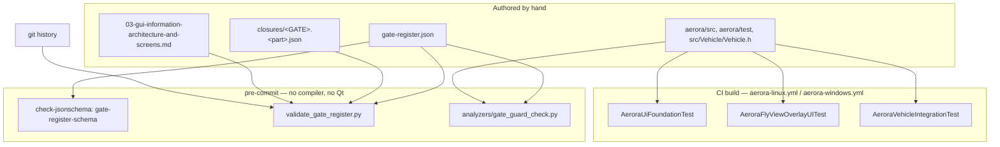

# Design Document

## Overview

The requirements define a decision-closure process. This design settles where that process lives in
this repository, in what format, and which of its rules a machine enforces.

The whole design reduces to one choice made four times: **every fact that can be derived is recorded
and derived, and the two are compared.** The Gate_Register records a Release_Set, and the check
derives it from the blocking-entry classifications and compares. The register records a screen as
Released, and the check derives it from the Gate statuses and compares. The register records the
commit at which a Closure_Record entered, and the check derives it from git history and compares. The
register records a guard's value, and the check derives it from the declaring source and compares.
Disagreement fails.

That is not a new mechanism. `AeroraUiSafetyTest` holds a hand-maintained audited-type list *and*
walks the QML-reachable closure from the root, failing when the two disagree.
`aerora-manifest-check.ps1` walks declared sources against on-disk sources, and `add_qgc_test`
entries against manifest `_TEST_NAMES`, in both directions. A related discipline runs alongside it:
`AeroraUiFoundationTest` spells the override allow-list out as a set rather than counting it, because
a count is satisfied by swapping one member for another. The Gate_Review becomes executable by
applying the same shapes to the register.

### What this design adds

| Artifact | Path | Role |
| --- | --- | --- |
| Gate_Register | `.kiro/specs/aerora-decision-gate-closure/gate-register.json` | The single authoritative record of the ten Gate_Dossiers, the per-screen blocking-entry classifications, the guard registry and the read-only exception |
| Register schema | `.kiro/specs/aerora-decision-gate-closure/gate-register.schema.json` | Makes the shape rules — ten Gates, exactly one classification per entry, exactly one read-only exception — unrepresentable rather than merely rejected |
| Closure_Record | `.kiro/specs/aerora-decision-gate-closure/closures/<GATE>.<part>.json` | One file per part of a Gate's Decision_Content, carrying the settled entries, the signatures and the entry commit |
| Register check | `tools/validate_gate_register.py` | The data half of the Gate_Review: register ↔ screen inventory ↔ git consistency |
| Guard check | `tools/analyzers/gate_guard_check.py` | The source half: guard values, the ADR-016 pair, MAVLink identifier literals, actionable controls in Aerora QML |
| Shared model | `tools/common/gate_register.py` | Pure model and derivation, imported by both entry points and by the property tests |

No new C++ component, no new CTest target, no new QML. The runtime assertions extend three existing
Aerora suites.

### What this design does not add

It introduces **no Contract_Value**: no fact name, unit, value range, enumeration member, freshness
threshold, role name, permission, payload, tether or consumable item, fleet identifier format,
proposal schema element, or MAVLink message, command or enumeration identifier. The register records
*element names* and *owner labels*, both taken verbatim from requirements.md.

It introduces no operator action control, no outbound command path, no mission upload, start or resume
path, and no call to `AeroraMissionObserver::verify()`. The read-only ratchet of Requirement 5 *walks
for* controls; it does not add one. Every proposed test reads a tree or compares two sets.

It proposes **no QGroundControl core edit.** One core edit is already present and is discussed under
[Finding 1](#finding-1--the-adr-016-core-edit-is-applied-and-its-guard-disagrees-with-the-register).

### Two findings at branch tip `e7b38eef1`

Both were found by doing by hand what this design automates, which is the argument for automating it.

#### Finding 1 — the ADR-016 core edit is applied, and its guard disagrees with the register

Requirement 4 criterion 5 records `AeroraVehicleFactGroupRegistrar::isRegistrationAvailable()` at
`false`, and Requirement 7 criterion 18 records that value as the guard holding `DG-TLM` visible.
Requirement 7 criterion 17 requires the Gate_Review to reject a change that adds the
`friend class AeroraVehicleFactGroupRegistrar` declaration to `src/Vehicle/Vehicle.h` or defines
`AERORA_VEHICLE_FACTGROUP_FRIENDSHIP` while the `ADR-016` core-edit part holds no accepted
Closure_Record.

Both halves are already applied:

| Half | State at `e7b38eef1` | Evidence |
| --- | --- | --- |
| `friend class AeroraVehicleFactGroupRegistrar;` | Present | `src/Vehicle/Vehicle.h:123` |
| `AERORA_VEHICLE_FACTGROUP_FRIENDSHIP` | Defined | `aerora/CMakeLists.txt` `CUSTOM_DEFINITIONS`; both `aerora-linux.yml` and `aerora-windows.yml` fail the job if the define is absent from the generated build |

`AeroraVehicleFactGroupRegistrar.cc` returns `true` from `isRegistrationAvailable()` under that
define, so the guard holds the opposite of its recorded value. `aerora/src/Vehicle/README.md` and
`32-integration-adrs.md` also disagree with each other: the ADR records the define as `NOT DEFINED`
while the module README records both halves as applied.

The design does not resolve this, and it does not hide it either. The register carries a
[recorded disagreement](#the-recorded-disagreement-and-why-it-is-not-a-suppression-list) for this one
guard: both values pinned, the criteria the gap is against, an owner, and the two remedies. The hook
prints the finding on every run and still exits zero, because the alternative — a gating check that
fails every commit touching the overlay until an unrelated core-edit authorisation lands — would be
removed within a week rather than obeyed. A third value, or any other guard moving, fails. Two
remedies exist and both belong to a named owner:

- Tab 1 signs the `ADR-016` core-edit part of the `DG-TLM` Closure_Record (Requirement 7 criteria 3
  and 15), after which the register records the guard's permitted value as `true`; or
- the define is removed from `CUSTOM_DEFINITIONS` and from the two CI assertion lists, returning the
  guard to `false`.

Until one of them lands, the guard carries a recorded disagreement and the C++ assertion for this one
guard is **not** written — asserting `false` today would fail CI, and asserting `true` would launder
an unauthorised core edit into a passing test. The Python check carries the finding instead, because a
text comparison can fail loudly without being the thing that decides the answer.

This is the one place the design touches core: it does not propose the edit, it names the
authorisation the existing edit still needs.

#### Finding 2 — the screen inventory's row count and its declared total disagree

The inventory's §8 heading and totals table state 45 screens across 12 areas, 14 `VERIFIED`, 1
`SUPERSEDED`, 30 not delivered. requirements.md carries the same figures.

Counted from the rows at `e7b38eef1`: **52** distinct screen IDs across **13** area tables. Each area
table's own heading agrees with its row count (`Shell — 4`, `Live operations — 9`, `Mission Studio — 9`,
`Vehicle — 6`, `Telemetry — 3`, `AI supervision — 3`, `Fleet & profiles — 3`, `Video — 1`,
`Review & export — 2`, `Security — 4`, `Settings — 4`, `Simulation — 1`, `Help & diagnostics — 3`),
and those sum to 52. The 14 `VERIFIED` screens and the 1 `SUPERSEDED` screen are the rows the totals
table lists, so the undelivered set is 52 − 15 = **37**.

The Release_Sets the requirements enumerate are consistent with 37, not with 30. Taking them as
written — Requirement 6 criterion 6, 7.8, 8.6, 9.7, 10.8, 10.9, 11.7, 11.8, 12.7, 12.8, 13.6, 14.7,
15.7 — and adding the five screens Requirement 2 criterion 8 records as Released with no Gate, the
union is exactly the 37 undelivered rows, with no screen in both groups and with `SCR-LIV-05`,
`SCR-AIS-03`, `SCR-MIS-05` and `SCR-MIS-06` the only screens in two Release_Sets:

| Gate | Release_Set size | Screens |
| --- | --- | --- |
| `DG-MIS` | 9 | `SCR-MIS-01`..`SCR-MIS-04`, `SCR-MIS-07`, `SCR-MIS-08`, `SCR-MIS-09` (screen half), `SCR-MIS-05`, `SCR-MIS-06` |
| `DG-TLM` | 2 | `SCR-TEL-01`, `SCR-LIV-02` |
| `DG-FRS` | 2 | `SCR-TEL-03`, `SCR-SET-02` |
| `DG-ROL` | 3 | `SCR-SEC-02`, `SCR-VEH-05` (calibration display), `SCR-LIV-05` |
| `DG-PAY` | 5 | `SCR-LIV-03`, `SCR-LIV-04`, `SCR-SHL-02` (per-vehicle half), `SCR-MIS-05`, `SCR-MIS-06` |
| `DG-AUT` | 4 | `SCR-AIS-01`, `SCR-AIS-02`, `SCR-AIS-03`, `SCR-LIV-05` (proposal half) |
| `DG-STO` | 6 | `SCR-SEC-03`, `SCR-SEC-04`, `SCR-LOG-01`, `SCR-LOG-02`, `SCR-TEL-02`, `SCR-AIS-03` |
| `DG-FLT` | 3 | `SCR-FLT-01`, `SCR-FLT-02`, `SCR-FLT-03` |
| `DG-VID` | 1 | `SCR-VID-01` |
| `DG-SIM` | 1 | `SCR-SIM-01` |
| *(no Gate)* | 5 | `SCR-LIV-08`, `SCR-LIV-09`, `SCR-SET-01`, `SCR-SET-03`, `SCR-SET-04` |

Distinct union: 37. So the evidence is that the headline totals are stale and the rows are current.

The design does not decide that either. The register records **no screen count at all**: the check
derives the screen set from the inventory's table rows, derives the undelivered set by removing the
rows whose status is `VERIFIED` or `SUPERSEDED`, and reports the inventory's self-declared totals
against its own rows as a separate finding for the inventory's owner, Tab 7. Encoding 30 or 45
anywhere in the register would make the register the second place the number can be wrong.

## Architecture

### Authority map

Requirement 1 criteria 6, 7 and 11 are consistency rules *between* the Gate_Register and the screen
inventory, so each fact needs exactly one owner. Nothing below is recorded twice.

The reason for being strict about this is in the inventory itself. `SCR-HLP-01` was retired rather
than deferred, and the recorded reason is that building it would have put the same readings on two
screens: *"the two would drift, and an operator finding them disagreeing would have no way to tell
which was stale."* A Gate_Register that restated each screen's delivery status would be the same
mistake one level up — two documents carrying the same column, no rule for which one wins, and a
reviewer left to guess. So the register restates nothing from the inventory. It references screen IDs,
adds the axes the inventory has no column for, and the check compares the two documents rather than
letting either shadow the other.

| Fact | Authority | The other document |
| --- | --- | --- |
| The screen set, and each screen's name, delivery class, seam and owner | Screen inventory | The register references screen IDs and never restates a name or a class |
| Each screen's delivery status from the status vocabulary | Screen inventory | The register records no delivery status; `Released` is a different axis (below) |
| The text of each blocking-list entry | Screen inventory | The register keys entries by ID and records the matching inventory substring for entries that carry no ID |
| The classification of each blocking entry as Gate or Acceptance_Criterion | Gate_Register | The inventory's "Blocked by" column stops being the place a classification is implied |
| The ten Gates, their status, Decision_Content, owners, Sign_Off_Conditions and excluded Acceptance_Criteria | Gate_Register | — |
| Release_Set membership | Gate_Register, recorded **and** derived from the classifications | — |
| `Released` per screen | Gate_Register, recorded **and** derived from the Gate statuses | — |
| The observation that makes a screen `VERIFIED` | Gate_Register, naming the test suite and slot | The inventory's status claim is checked against it |
| The value each mechanical guard holds | The declaring C++ source | The register records the value and the check compares |
| The commit at which a Closure_Record entered | Git history | The record carries the field and the check compares |

`Released` and `VERIFIED` stay distinct because they answer different questions and live in different
documents. `Released` means a screen's remaining work may start; it is a function of Gate statuses and
is computed. `VERIFIED` means the screen was navigated to and drawn in a booted application window;
it is an evidence claim and requires a recorded observation. A Gate closing changes `Released` for
its Release_Set and changes nothing else — Requirement 3 criterion 8 requires the delivery status of
every screen in the Release_Set to be left unchanged, so no Gate closure writes to the inventory's
status column. What a Gate closure *does* make stale is the inventory's "Blocked by" cell, and the
check names each released screen whose cell still carries an entry classified as a Gate.

### Derivation rules

Five equations. Everything the check compares comes from these.

```text
gateOpen(g)     ⟺ ∃ part p of g : ¬accepted(p)
releaseSet(g)    = { s : ∃ e ∈ blocking(s) : class(e) = Gate ∧ gate(e) = g }
released(s)     ⟺ ∀ e ∈ blocking(s) : class(e) = Acceptance_Criterion ∨ ¬gateOpen(gate(e))
twoGateScreens   = { s : |{ gate(e) : e ∈ blocking(s), class(e) = Gate }| = 2 }
undelivered      = rows(inventory) \ { s : status(s) ∈ { VERIFIED, SUPERSEDED } }
```

The third equation is the one that earns its place. It derives Requirement 1 criteria 3, 4, 10 and 12,
Requirement 2 criterion 5, and Requirement 3 criteria 8 and 10 uniformly, and the Two_Gate_Screen rule
falls out of it rather than being a special case: a screen with two Gate-classified entries is
Released when both of those Gates are `CLOSED`, which is exactly Requirement 1 criterion 4. Requirement
1 criterion 3's "in the repository change that records the Gate as `CLOSED`" becomes mechanical, not
procedural: flipping a Gate's parts to accepted without flipping the `released` flags of its
Release_Set in the same commit makes the recorded and derived values disagree, and the check fails.

### Where each check runs



Pre-commit is where the register checks belong, for a reason specific to this repository: there is no
local compiler or Qt on the authoring host, so all build and test evidence comes from CI. A check that
needs only bytes runs on the host that authors the change and again in `pre-commit.yml`, which checks
out with `fetch-depth: 0` and runs `tools/pre_commit.py --ci --changed`. The three C++ ratchets run
where the Aerora suites already run: `^Aerora` with label `Unit`, then label `Integration`.

The `.kiro/tools/*.ps1` checks are deliberately **not** extended for this. They are developer-run,
invoked from no workflow, and PowerShell is covered by no pre-commit hook, so a rule placed there
would be enforced only by whoever remembers to run it — which is the reviewer-dependence the spec
exists to remove. `aerora-ui-static-check.ps1`'s existing MAVLink-identifier check is the one rule
being moved rather than duplicated: it keeps working where it is, and the authoritative copy becomes
the pre-commit hook, which sees `aerora/src/**` rather than only `aerora/src/UI`.

### Gating, not advisory — and the one thing that makes that affordable

Requirement 4 criterion 2 and Requirement 5 criterion 2 both say *reject the change before the change
enters the repository.* An advisory check does not reject anything, so advisory is not a reading of
those criteria — it is a different design. Both new hooks are therefore **gating**: non-zero exit,
in the `pre-commit.yml` leg, which is the leg that runs on every pull request and needs no compiler,
no Qt and no build directory. They are not in `aerora-linux.yml` or `aerora-windows.yml`, because
those legs exist to build and run tests and would report a register inconsistency several minutes
later than the leg that can report it in seconds.

`tools/analyze.py` already carries the vocabulary for the alternative — `--advisory` reports warnings
without failing, and errors fail regardless — and the three repo-local ratchets nearest to this work
(`vehicle-null-check`, `check-no-qassert`, `check-no-qtest-ignore-message`) all decline it. So does
this.

| Option | Verdict |
| --- | --- |
| Advisory everywhere until the register settles | **Rejected.** "Reject the change before it enters the repository" is the criterion. An advisory check also stops being read: the whole point of mechanising the Gate_Review is that it does not depend on someone noticing |
| Gating, with `--advisory` available for a local pre-push loop | **Partially adopted.** The flag exists on the analyzer base and costs nothing; CI never passes it |
| Gating, and a guard whose recorded and observed values disagree fails the hook | **Rejected.** [Finding 1](#finding-1--the-adr-016-core-edit-is-applied-and-its-guard-disagrees-with-the-register) is true at branch tip, so this fails every commit touching `aerora/src/**` until an unrelated core-edit authorisation lands. A gate that blocks all work is removed, not obeyed |
| Gating, with a recorded disagreement that is reported on every run and pins both values | **Adopted** |

#### The recorded disagreement, and why it is not a suppression list

A guard may carry a `disagreement` record: the value the register says it should hold, the value the
source actually holds, the requirement criteria the gap is against, the owner, and the two remedies.
The hook passes while that record matches reality and **prints the finding on every run**, so it is
visible rather than silenced. Four constraints keep it from becoming the place inconvenient failures
go:

- it pins *both* values, so a guard moving to a third value is still a failure — the record excuses
  one known state, not the guard;
- it requires an `owner` and at least one named remedy, so it cannot be added without saying who
  resolves it;
- the schema permits it only on a guard, never on a Release_Set, a classification, a signature or a
  `released` flag — the derivations have no escape hatch at all;
- it carries a `handOnRow` identifier, and the check fails when that field is absent or empty, so a
  disagreement cannot be added without pointing at the row that tracks it in
  [Open items this design hands on](#open-items-this-design-hands-on). Whether the row says the right
  thing is a reviewer's call; whether one was named is not.

Today exactly one exists, for `AeroraVehicleFactGroupRegistrar::isRegistrationAvailable()`. Zero is
the target, the same way zero is the target for `Tier::PopulatedFile` entries.

## Components and Interfaces

### 1. The Gate_Register — one machine-readable authority, no markdown twin

A JSON document with a JSON Schema sibling, following the `.github/build-config.json` /
`.github/build-config.schema.json` precedent and wired into the existing `check-jsonschema` hook block.
A markdown table was considered and rejected: the register's load-bearing content is sets and
cross-references — ten Release_Sets, 37 undelivered screens with a classification per blocking entry,
nine guards with a Gate mapping each — and every rule in Requirements 1 through 5 is a predicate over
those sets. Parsing them back out of a markdown table to check them would make the table a format and
the parser the authority.

Three shape rules move into the schema, where a violation is unrepresentable rather than reported:

| Schema constraint | Discharges |
| --- | --- |
| `gates`: exactly 10 items, `id` an enum of the ten identifiers, `uniqueItems` on `id` | Requirement 1 criterion 1 |
| `blockingEntries[].classification`: enum of `Gate`, `Acceptance_Criterion`, required | Requirement 2 criterion 1 ("exactly one of") |
| `readOnly.exceptions`: `minItems: 1`, `maxItems: 1`, `items.screen: {"const": "SCR-HLP-03"}` | Requirement 5 criteria 1 and 11 — a second exception cannot be written down |

No generated markdown twin. A generated file is a second copy that drifts unless something regenerates
and diffs it, and the narrative that a reader wants — why `DG-VID` exists, why both video precedents
are instantiated inside a populated upstream file — already exists in the Phase 7 documents. Each
Gate_Dossier therefore carries a `rationale` reference (document plus anchor) instead of a copy.

### 2. The Closure_Record — one file per part, with the entry commit derived from git

Requirement 3 criterion 6 gives parts separate owners, separate Sign_Off_Conditions and separate
acceptance, and Requirements 7, 9, 10, 11, 12 and 15 all split their Decision_Content into parts that
can be accepted independently. The unit of signature is therefore the part, and the unit of file is
the part.

Requirement 3 criterion 1 requires the record to carry the commit at which it enters the repository,
which a file cannot contain about itself. Git already knows it:

```text
git log --diff-filter=A --format=%H -- closures/<GATE>.<part>.json
```

So `entryCommit` is a recorded field with a derived counterpart, like everything else here. It is
`null` while the part's `state` is `submitted`, and the schema requires a 40-character hex string once
`state` is `accepted`. The check resolves the add-commit and fails on disagreement. If git history
cannot answer — no `.git`, or a shallow clone — the check fails naming that reason rather than
skipping, following the discipline `aerora-manifest-check.ps1` states for its own `ASSUMED` rows: an
unresolved premise is not a pass. `pre-commit.yml` already checks out full history, so CI can answer.

Signatures are the part of this design with the least available machinery, and the design says so
rather than inventing a mechanism. There is no PKI here, and `.github/CODEOWNERS` exists but every rule
in it is commented out, so it routes no review today. A signature is therefore:

- a row in the record naming the owner **label the Gate_Dossier records** — `Product`, `Firmware`,
  `Architecture`, `operations`, `security architecture`, `the external interface authority`,
  `the process owner`, `Tab 1`..`Tab 8`, all verbatim from requirements.md — with the sign-off date;
- the git identity that authored the commit adding the record, recorded as a commit trailer on that
  commit (`Gate-Signed-By:`), which `git log --format=%(trailers)` can read back;
- optionally a GPG-signed commit, recorded as `signatureVerified` when `git verify-commit` succeeds.

The check asserts set equality, which is what Requirement 3 criterion 4 actually asks for in both
directions: every owner the dossier records for the part appears in the record, and no signature comes
from a party the dossier does not record as an owner of that part. What it cannot assert is that the
named human agreed; `AeroraSecurityStatus` is the honest precedent here — the station reports *not
enforced* rather than claiming a boundary it does not evaluate, and this register reports *recorded
identity*, not cryptographic authorship. Making that stronger needs a repository setting (branch
protection requiring code-owner review on the register path), which is outside the repository and is
named as such rather than assumed.

### 3. `tools/validate_gate_register.py` — the data half of the Gate_Review

Entry point at `tools/` root, `pass_filenames: false`, following `tools/validate_configs.py`, which is
the existing hook for "relationships a JSON Schema cannot express". Invoked exactly as that hook is:

```yaml
- id: gate-register
  name: Validate the Aerora Gate_Register against the screen inventory
  entry: uv run --frozen --project tools --group lint python tools/validate_gate_register.py
  language: system
  files: ^(\.kiro/specs/aerora-decision-gate-closure/.*\.json|\.kiro/specs/05-product-completion/03-gui-information-architecture-and-screens\.md|tools/(validate_gate_register\.py|common/gate_register\.py))$
  pass_filenames: false
```

The `lint` dependency group already carries `jsonschema>=4.23`, so no new runtime dependency.

| Check | Asserts | Discharges |
| --- | --- | --- |
| `partition` | The ten recorded Release_Sets plus the Released-with-no-Gate set partition the derived undelivered set exactly | 1.6, 2.8 |
| `release-set-derivation` | Each recorded Release_Set equals the set derived from the classifications | 1.2, 1.12, 6.6, 7.8, 8.6, 9.7, 10.8, 10.9, 11.7, 11.8, 12.7, 12.8, 13.6, 14.7, 15.7 |
| `two-gate` | Exactly `SCR-LIV-05`, `SCR-AIS-03`, `SCR-MIS-05`, `SCR-MIS-06` carry two Gate-classified entries, and no screen carries three | 1.5 |
| `released-derivation` | Recorded `released` equals derived `released`, with the open Gate named for each disagreement | 1.3, 1.4, 1.10, 2.5, 3.8, 3.10, 5.7 |
| `delivered-outside` | No Release_Set contains a screen the inventory reports `VERIFIED` or `SUPERSEDED` | 1.7, 1.11, 10.9, 13.14 |
| `inventory-coverage` | Every inventory row appears once in the register's screen list; every register screen ID is an inventory row | 1.7 |
| `entry-classification` | The ID tokens in each inventory "Blocked by" cell equal the register's classified-entry set for that screen | 2.1, 2.10 |
| `reclassifications` | The five recorded misreads are present with their reclassification, and the retained-Gate statement holds | 2.7, 2.11 |
| `closure-completeness` | Every Decision_Content element the dossier records has a settled entry in the accepted record, by `settlementShape` | 3.3, 3.11, 7.12, 8.11, 9.11, 10.12, 11.12, 12.12, 13.10 |
| `closure-signatures` | Owner sets match in both directions; `signOffDate` present; trailer set matches | 3.1, 3.4, 14.11, 15.18 |
| `closure-entry-commit` | `entryCommit` equals the git add-commit of the record file | 3.1 |
| `gate-status-derivation` | A Gate is `CLOSED` exactly when every part is accepted | 3.7, 7.15, 9.14, 11.15, 12.17, 15.13 |
| `signoff-verdicts` | Every Sign_Off_Condition the dossier records for an accepted part carries a verdict and a reviewer | 3.2, 3.5 |
| `verified-observation` | Every inventory `VERIFIED` row has a register observation naming a suite and slot that exist in `aerora/test/**` and are registered with `add_qgc_test` | 3.9 |
| `guard-registry` | The guard registry covers at least the nine guards Requirement 4 criterion 5 names, every Gate records its guards or records that it has none, and every accepted part carries a permit verdict for each guard mapped to it | 4.5, 4.6, 4.8, 6.17, 7.18, 8.15, 9.17, 11.19, 12.20, 13.16, 14.16, 15.16 |
| `forbidden-until` | `P7-FLY-004` is recorded `FORBIDDEN-UNTIL` `DG-ROL`, and the two pre-approved seams are recorded as waiting on it | 5.8, 9.16 |
| `inventory-totals` | The inventory's declared totals agree with its own rows | — (reports [Finding 2](#finding-2--the-screen-inventorys-row-count-and-its-declared-total-disagree)) |

### 4. `tools/analyzers/gate_guard_check.py` — the source half

An `AnalyzerBase` subclass in `tools/analyzers/`, `pass_filenames: true`, following
`tools/analyzers/vehicle_null_check.py` exactly: `name`, `run(files, fix=False) -> AnalysisResult`, a
`main()` that takes paths or stdin, exit 1 on findings, and `find_cpp_files` from
`common.file_traversal` for directory arguments. `fix` is accepted and discarded — there is no
auto-fix here, because the only thing to "fix" would be a recorded value a reviewer did not sign.

| Check | Asserts | Discharges |
| --- | --- | --- |
| `guard-value` | Each recorded guard's declaration in `aerora/src/**` carries its recorded literal, or its recorded `disagreement.observedValue`; a third value fails | 4.6, 4.7 |
| `guard-assertion` | Each recorded guard still appears in at least one recorded assertion site under `aerora/test/**` | 4.9 |
| `adr-016-pair` | The friend declaration in `src/Vehicle/Vehicle.h` and the `AERORA_VEHICLE_FACTGROUP_FRIENDSHIP` definition match the register's recorded authorisation state | 7.17 |
| `mavlink-identifier` | No `MAV_CMD_`, `MAVLINK_MSG_ID_`, `MAV_COMP_ID_` or `MAV_FRAME_` token appears in `aerora/**` outside the recorded allow-list | 4.2, 6.14 (identifier class only) |
| `populated-file-override` | No `Tier::PopulatedFile` entry appears in `AeroraQmlOverrides::overrideEntries()` while `DG-VID` is `OPEN` | 14.13 |
| `action-seam` | Neither `CustomGuidedActionsController.qml` nor `FlyViewAdditionalCustomActionsList.qml` appears in the override allow-list while `DG-ROL` is `OPEN` | 5.4 |
| `freshness-threshold` | `kDefinedThresholdCount` holds its recorded literal and no `setThreshold(` call site exists in `aerora/src/**` | 8.13, 8.16 |
| `payload-command-sink` | No implementation of `AeroraPayloadCommandSink` exists in `aerora/src/**` | 10.18 |
| `actionable-control` | No `QGCButton`, `MouseArea`, `TapHandler` or other actionable type is written into an Aerora QML document outside the single recorded read-only exception | 5.1, 5.2 |
| `contract-surface` | The enumerators, declared constants and registry string keys in `aerora/src/**` match the recorded contract surface | 3.12, 4.2 (approximation — see below) |

The `mavlink-identifier` allow-list is recorded **by site, never by identifier.** Each entry is a file
path and a reason — the mission validator and snapshot, which read upstream frame and command values
they do not author; the calibration authorization gate, which names the one command class it
evaluates; and the Aerora suites' own fixtures. Listing the tokens themselves in the register, or in
this document, would put MAVLink identifiers in two more places and make the artifact that exists to
stop Contract_Values entering the repository the thing that carries them. The check therefore reads
the allow-listed files, takes the identifiers it finds there as the current baseline, and fails on an
identifier appearing in any file the register does not allow-list — naming the file and `DG-MIS`. That
makes it a ratchet rather than a cliff without the register holding a single identifier of its own.

#### How a closing Gate relaxes a guard check

Requirement 4 criterion 6 is the part of the mechanism that is easy to leave out, because every other
criterion in Requirement 4 is about holding a guard still. Criterion 6 is about letting one move, and
it requires the permission to be *recorded at acceptance* rather than inferred afterwards. Three
states, and the third is the one that matters:

| Guard against an accepting part | Register state | Check behaviour |
| --- | --- | --- |
| Every part in `permittedToChangeBy` unaccepted | `recordedValue` frozen | Both a source change and a `recordedValue` edit fail, naming the guard and each open Gate (4.7, 4.9) |
| A part in `permittedToChangeBy` accepted, and that part's acceptance records `permits: true` for this guard | `recordedValue` may move | The source value and the new `recordedValue` must agree, and both must move in the commit that accepts the part |
| A part accepted, and its acceptance records `permits: false` for this guard | `recordedValue` frozen | Unchanged. Closing the Gate did not unlock this guard |

The third row is not hypothetical. Requirement 6 criterion 17 records
`kGcsPayloadStateReplayImplemented` at false as a guard that holds at false **after** `DG-MIS` is
recorded `CLOSED`, so `DG-MIS` closing must not relax it. An implementation that treated "the Gate
closed" as "its guards are free" would let that one go, and nothing else would notice.

Two further shapes fall out of the same field rather than needing their own rule:

- A guard held open by two Gates relaxes only when both permit it.
  `kGroundStationActuatorPathImplemented` and `kAutonomousPayloadActionImplemented` are mapped to
  both `DG-PAY` and `DG-ROL` (Requirement 10 criteria 17 and 18, Requirement 9 criterion 17), so
  `permittedToChangeBy` names a part of each and the conjunction is the check.
- Acceptance is not silently permissive. A part whose acceptance records no verdict for a guard the
  dossier maps to it fails the `guard-registry` check, which is Requirement 4 criterion 6 read as
  totality: *for each* guard, whether the record permits it. Omission is a finding, not a default.

#### The contract-surface ratchet, and what it honestly does

"Reject a change that introduces a Contract_Value" appears in Requirement 3 criterion 12, Requirement
4 criterion 2, and once per Gate — 6.14, 7.16, 8.13, 9.15, 10.16, 11.17, 12.19, 13.12, 15.14. As
written it is undecidable: no checker can look at a new string key appearing in a fact group and know
whether it is an Aerora fact name that `DG-TLM` settles or an identifier with no contract behind it.
Naming an example here would be worse than leaving the point abstract — an illustrative fact name in a
design document is the placeholder `P7-NOINV-002` warns outlives the decision it stood in for.

What *is* decidable is whether the contract surface grew. The register records an inventory of the
enumerators, `static constexpr` declarations and registry string-literal keys in `aerora/src/**`, each
mapped either to the Gate whose Decision_Content would record it or to `none` with a reason. The check
compares the source against that inventory:

- an element present in source and absent from the inventory fails, naming the symbol and asking for a
  mapping — which is Requirement 4 criterion 2's "name the element as unassigned Decision_Content";
- an element mapped to a Gate that is `OPEN` fails, naming the element and the Gate;
- an element in the inventory and absent from source fails, so the surface cannot shrink silently
  either.

This converts an undecidable question ("is this value invented?") into a decidable one ("did the
surface change?"), which is exactly the move `AeroraUiSafetyTest` makes for the QML surface: it cannot
judge whether a new method is safe, so it fails on *any* change to the reachable method set and makes
a human record the judgement once. The limitation is real and is stated rather than papered over: the
ratchet cannot see a *value* changing inside an element it already knows, and it cannot classify. A
reviewer classifies once, in the register.

### 5. Runtime assertions — three existing suites extended

No new test target. The manifest check requires every `add_qgc_test` entry to be declared in a
manifest `_TEST_NAMES` and vice versa, so a new suite is four coordinated edits across two owners'
files; extending a suite that already owns the assertion is one.

| Suite | Label | Extension | Discharges |
| --- | --- | --- | --- |
| `AeroraUiFoundationTest` | `Unit` | Data-driven read-only walk over every discovered Aerora screen QML document, plus the single exception asserted positively | 5.1 |
| `AeroraFlyViewOverlayUITest` | `Integration`, `Vehicle` | `hasActionableControl()` extended to find pointer handlers | 5.1 |
| `AeroraVehicleIntegrationTest` | `Integration`, `Vehicle` | The guard pins not yet asserted at the composition root | 4.7 |

#### Generalising the read-only ratchet

The read-only rule is checked twice on purpose, and the two halves catch different things. The
`actionable-control` hook reads QML text, so it fires on the authoring host before any build and
rejects the declaration — which is what Requirement 5 criterion 2 asks for — but it can only see types
spelled out in a document. The C++ walk sees the *instantiated* tree, so it catches a control arriving
through a composed control, a `Loader`, or a type whose name nobody thought to pattern-match. Source
inspection is the gate; the walk is the thing that is actually true.

`AeroraFlyViewOverlayUITest::_overlayCarriesNoActionableControl` already asserts structurally, over the
whole overlay subtree, that no `QQuickAbstractButton` and no `QQuickMouseArea` exists. It generalises
in two directions, and the first one closes a gap in the existing test.

**The predicate is incomplete.** `hasActionableControl()` recurses through `QQuickItem::childItems()`.
A `TapHandler`, `DragHandler` or `HoverHandler` derives from `QQuickPointerHandler`, which is not a
`QQuickItem` — it is a plain `QObject` child of the item it handles, so a `childItems()` walk never
sees it. A tap handler on a panel would therefore pass the current assertion while being exactly the
thing Requirement 5 criterion 1 forbids. The fix keeps the `QObject::inherits()` approach, which is
what makes the test catch a control added through any route rather than only the types the test
thought to name, and widens the walk to the object tree as well as the item tree.

The predicate also changes shape, from "is there one" to "which ones", because the exception
assertion needs to say *exactly one, and this one*. The overlay test's existing call site keeps its
boolean by asking whether the list is empty:

```cpp
/// Those of @a root's reachable objects an operator could press, named by objectName where one is
/// set and by class name otherwise.
///
/// \c reachableObjects() walks the union of the visual tree (\c QQuickItem::childItems) and the
/// object tree (\c QObject::children), deduplicated by pointer. Neither subsumes the other: a
/// TapHandler is a \c QQuickPointerHandler, a QObject child of the item it handles and therefore
/// invisible to a childItems() walk, while a visually reparented item keeps its QObject parent
/// elsewhere and is invisible to a children() walk.
QStringList actionableControls(QQuickItem *root)
{
    QStringList found;

    for (const QObject *const object : reachableObjects(root)) {
        if (object->inherits("QQuickAbstractButton") || object->inherits("QQuickMouseArea")
            || object->inherits("QQuickPointerHandler")) {
            found.append(object->objectName().isEmpty()
                             ? QString::fromUtf8(object->metaObject()->className())
                             : object->objectName());
        }
    }

    return found;
}
```

Deduplication is load-bearing rather than tidy: a control reachable through both trees would
otherwise be counted twice, and the exception assertion counts.

**The screen set is discovered, not listed.** `aerora-ui-static-check.ps1` records the lesson:
a hand-maintained target list silently skipped `AeroraEnforcementIndicator.qml` for an entire pass, so
that checker discovers its targets by walking the tree. The read-only walk does the same. The data
table comes from the Aerora QML documents under `aerora/src/UI/Screens/` and
`aerora/src/UI/Controls/`, which is the set `AERORA_UI_QML_FILES` declares and the manifest check
already proves is complete in both directions. A new screen joins the walk by existing.

Each row instantiates its document with `QQmlComponent` against the engine
`QGCCorePlugin::instance()->createQmlApplicationEngine()` returns — the pattern
`AeroraScreenMetricsTest` uses, which is also the only way the `qrc:/qml` import path the
`QGroundControl.Controls` module resolves from gets added. A document that does not instantiate is a
failure, not a skip, so the walk cannot pass vacuously over a screen that fails to load.

**The walk must resolve the content root, or it is vacuous for every screen.** All ten Aerora screen
documents root on `AnalyzePage` or `SetupPage` and assign `pageComponent: pageComponent`, putting
their entire tree inside a `Component` that the upstream page instantiates into a `Loader` when it is
shown. `FlyViewCustomLayer.qml` is the only Aerora document with inline visual children. So walking
the instantiated root would find nothing on any page — including the one document that is *supposed*
to carry a control, which would fail the positive half of the exception assertion and make the
negative half meaningless.

The content root is therefore resolved before walking:

- if the root declares a `pageComponent` property holding a `QQmlComponent *`, create it in the
  root's own `QQmlContext` and walk that tree;
- otherwise walk the root itself;
- a declared `pageComponent` that does not instantiate is a failure, naming the component error.

Walking the created content rather than the page root is also the correct *scope*, not just the
reachable one. `AnalyzePage` carries upstream's own chrome — `allowPopout: true` on
`AeroraErrorReportPage.qml` and `AeroraOperationsHub.qml` gives the page a popout control that
belongs to upstream and is not an Aerora operator action. A walk from the page root would fail on
upstream's button and tell the reader nothing about Aerora's content.

**The exception is asserted in both directions, and by identity.** Requirement 5 criterion 1 records
the clipboard copy on `SCR-HLP-03` as the single exception, and criterion 11 forbids a second. The
control exists today: one `QGCButton` in `AeroraErrorReportPage.qml`'s `pageComponent`, with
`objectName: "aeroraErrorReport_copyButton"`, whose `onClicked` calls upstream's
`QGroundControl.copyToClipboard()`. Four things make the exception mechanical rather than remembered:

- the schema cannot represent a second exception (`maxItems: 1`, and `screen` is `const`);
- the walk requires that document's content to carry **exactly one** actionable control, so a second
  control on the same screen fails as loudly as one on another screen;
- it requires that control's `objectName` to equal the one the register records, so the exception
  cannot drift onto a different control in the same file;
- every other document must have none.

That is the `AeroraUiFoundationTest::_exactlyOnePurposeBuiltSeamIsDeclared` shape — the set spelled
out rather than counted, because a count is satisfied by swapping one member for another.

### 6. What stays human review

Claiming automation for a judgement would be worse than leaving it to a reviewer, because a check that
appears to cover a criterion stops anyone looking at it. These criteria are not automated, and the
register records a reviewer and a date for each instead.

| Criteria | Why no check can decide it |
| --- | --- |
| 2.2, 2.3, 2.9 — the classification itself | Criterion 3 turns on "no construction of the screen satisfies the entry while that absence stands", which is a claim about every possible implementation of a screen that does not exist yet |
| 1.9, 2.6 — an element already supplied by Verified_Infrastructure; a condition a released screen satisfies once built | Both require judging whether two differently worded statements describe the same thing |
| 3.2, 3.5 — checking a record against a Sign_Off_Condition, and accepting it | Most conditions are semantic: "traceable to an issued dialect or interface control document" (6.3), "cites an issued GPU-to-flight-controller interface control document" (11.4), "every item is a vehicle-reported item" (10.6). The check asserts a verdict and a reviewer are *recorded* for each; the verdict is the reviewer's |
| "element names rather than element values" (6.1, 7.1, 8.1, 9.1, 10.1, 11.1, 13.1, 14.1, 15.1) | A schema cannot tell a name from a value. The contract-surface ratchet catches a value only once it reaches source, which is a backstop and not a substitute |
| 4.1, 4.3, 4.10 — what an open Gate's screens display | Obligations on screens not yet built. The register records the reading each open Gate requires, and the per-screen test asserts it when the screen exists |
| 5.10 — a change that leaves undetermined whether it adds a forbidden element | "Undetermined" is the reviewer's state of knowledge, not a property of the diff |
| 6.11, 6.12, 6.13, 7.13, 7.14, 8.10, 8.12, 9.12, 9.13, 10.7, 10.13, 10.14, 11.11, 11.13, 11.14, 12.14, 12.15, 12.16, 13.9, 13.11, 14.10, 14.12, 15.10, 15.11, 15.12 — content checks on a Closure_Record | Structurally checkable once the record is machine-readable (presence, cardinality, totality, platform coverage), which `closure-completeness` does. What remains human is whether the content is *true*: that a cited document is issued, that a discriminator survives a release configuration, that a model is approved |

## Data Models

### Gate_Register

```jsonc
{
  "$schema": "./gate-register.schema.json",
  "inventory": {
    "path": ".kiro/specs/05-product-completion/03-gui-information-architecture-and-screens.md",
    "authoritativeFor": ["screenSet", "deliveryStatus", "blockingEntryText", "class", "seam", "owner"]
  },
  "gates": [
    {
      "id": "DG-MIS",
      "status": "OPEN",
      "implementingOwner": "Tab 5",
      "rationale": { "document": "05-product-completion/03-gui...md", "anchor": "#8-screen-inventory" },
      "parts": [
        {
          "id": "mission-command-set",
          "signingOwners": ["Product"],
          "state": "open",
          "closureRecord": null,
          "elements": [
            {
              "name": "each mission command the Aerora mission set uses, with its issued MAVLink command identifier or its existing upstream command",
              "source": "Q-021",
              "settlementShape": "keyed",
              "requiredAttributes": ["commandIdentifierOrUpstreamCommand", "stationMayEmit"]
            },
            {
              "name": "the Aerora complex-item type name as complexMissionItemNames() reports it",
              "source": "Q-023",
              "settlementShape": "single"
            }
          ],
          "signOffConditions": [
            { "id": "DG-MIS-SOC-01", "requirement": "6.3", "text": "...", "verification": "review" },
            { "id": "DG-MIS-SOC-03", "requirement": "6.5", "text": "...", "verification": "review" }
          ]
        }
      ],
      "releaseSet": [
        { "screen": "SCR-MIS-01" },
        { "screen": "SCR-MIS-09", "part": "screen" }
      ],
      "excludedAcceptanceCriteria": [
        { "id": "P7-CHK-002", "screen": "SCR-MIS-07", "requirement": "6.9" }
      ],
      "openStateReading": { "class": "<the one State_Vocabulary class this Gate's criteria require>",
                            "reportsGateIdentifier": true }
    }
  ],
  "screens": [
    {
      "id": "SCR-VID-01",
      "released": false,
      "observation": null,
      "blockingEntries": [
        { "id": "P7-VID-004", "classification": "Acceptance_Criterion", "reclassifiedFrom": "Gate", "requirement": "2.7" },
        { "id": "seam:fullscreen-video-overlay", "classification": "Gate", "gate": "DG-VID", "inventoryText": "no video overlay seam" }
      ]
    },
    {
      "id": "SCR-SHL-03",
      "released": true,
      "observation": {
        "suite": "AeroraFlyViewOverlayUITest",
        "slot": "_enforcementIndicatorReachesTheToolbarAndReportsNotEnforced"
      },
      "blockingEntries": []
    }
  ],
  "guards": [
    {
      "symbol": "AeroraPowerModel::kDefinedThresholdCount",
      "declaredIn": "aerora/src/Power/AeroraPowerModel.h",
      "recordedValue": "0",
      "assertedIn": [
        "aerora/test/Power/AeroraPowerModelTest.cc",
        "aerora/test/Vehicle/AeroraVehicleIntegrationTest.cc"
      ],
      "holdsOpen": ["DG-PAY"],
      "permittedToChangeBy": ["DG-PAY:power"]
    },
    {
      "symbol": "AeroraVehicleFactGroupRegistrar::isRegistrationAvailable()",
      "declaredIn": "aerora/src/Telemetry/AeroraVehicleFactGroupRegistrar.cc",
      "recordedValue": "false",
      "assertedIn": [],
      "holdsOpen": ["DG-TLM"],
      "permittedToChangeBy": ["DG-TLM:adr-016-core-edit"],
      "disagreement": {
        "observedValue": "true",
        "against": ["4.5", "7.17", "7.18"],
        "owner": "Tab 1",
        "remedies": [
          "Tab 1 signs the ADR-016 core-edit part of the DG-TLM Closure_Record",
          "AERORA_VEHICLE_FACTGROUP_FRIENDSHIP is withdrawn from CUSTOM_DEFINITIONS and from the two CI assertion lists"
        ],
        "handOnRow": "finding-1"
      }
    }
  ],
  "readOnly": {
    "gate": "DG-ROL",
    "exceptions": [
      {
        "screen": "SCR-HLP-03",
        "file": "aerora/src/UI/Screens/AeroraErrorReportPage.qml",
        "control": "aeroraErrorReport_copyButton",
        "reason": "acts on the Aerora_Station's own clipboard and requires no authority",
        "requirement": "5.1"
      }
    ],
    "forbiddenUntil": [{ "id": "P7-FLY-004", "gate": "DG-ROL", "requirement": "5.8" }],
    "preApprovedUndeclaredSeams": [
      "/qml/QGroundControl/FlyView/CustomGuidedActionsController.qml",
      "/qml/QGroundControl/FlyView/FlyViewAdditionalCustomActionsList.qml"
    ]
  },
  "contractSurface": [
    { "symbol": "AeroraTelemetryState::Class", "kind": "enum", "gate": "none", "reason": "State_Vocabulary; Verified_Infrastructure" }
  ]
}
```

Notes on the shape:

- `parts` is always a list, even for a Gate whose Decision_Content does not divide. `DG-MIS` has one
  part signed by `Product` for the whole of its Decision_Content (6.2); `DG-TLM` has two, with Tab 1
  signing only the `ADR-016` core edit (7.3); `DG-PAY` has four (10.5). A one-part Gate and a
  four-part Gate then read the same way to the checker, and `gateOpen` is one equation.
- `holdsOpen` is a list because Requirement 4 criterion 5 asks which Gate *or Gates* a value holds
  open: `kGroundStationActuatorPathImplemented` and `kAutonomousPayloadActionImplemented` hold both
  `DG-PAY` and `DG-ROL` (10.17, 10.18, 9.17).
- A Gate with no guard records `"guards": []` **and** an explicit `restsOnReviewAlone: true`, because
  Requirement 4 criterion 8 requires the absence to be recorded rather than inferred from an empty
  list. `DG-FRS`, `DG-AUT`, `DG-STO`, `DG-FLT` and `DG-SIM` each record every guard of Requirement 4
  criterion 5 as outside the Gate (8.15, 11.19, 12.20, 13.16, 15.16), with their own named guard
  instead — the three-outcome freshness evaluation, the `UNKNOWN` autonomy source status, the audit
  sink's reported durability and lost-record count, the `UNKNOWN` fleet identifier field.
- `Release_Set` entries carry an optional `part`, because six screens are released in halves:
  `SCR-MIS-09` (screen half, 6.10), `SCR-SHL-02` (per-vehicle half, 10.9), `SCR-LIV-05` (proposal
  half and approval half, 9.7 and 11.7), `SCR-VEH-05` (calibration display, 9.7). `released` stays a
  per-screen boolean, because Requirement 1 criterion 6 partitions screens, not halves.
- The guard registry is the **only** place the guard-to-Gate mapping is recorded. The C++ suites assert
  values, not mappings, so there is no second copy to keep in step and no C++ table for the Python
  check to parse. That answers Requirement 4 criteria 6 through 9 with one authority: the register maps
  and permits, the source declares, the tests assert, the check compares.
- `permittedToChangeBy` names Gate *parts*, not Gates, and the Closure_Record's `guardPermissions`
  carries the verdict for each guard the dossier maps to the part it settles. The register says which
  signature *could* unlock a guard; the record says whether it *did*. Separating them is what makes
  Requirement 6 criterion 17 representable — `DG-MIS` closing while
  `kGcsPayloadStateReplayImplemented` stays pinned at false.
- `disagreement` is the only optional escape in the document and it is confined to a guard. It pins
  the recorded value *and* the observed one, so it excuses one known state rather than the guard, and
  the hook prints it on every run. No equivalent field exists on a Release_Set, a classification, a
  signature or a `released` flag: the derivations have no escape hatch, because an excused derivation
  is the reviewer-dependence this design exists to remove.

### Closure_Record

```jsonc
{
  "$schema": "../closure-record.schema.json",
  "gate": "DG-FRS",
  "part": "thresholds",
  "state": "accepted",
  "signOffDate": "<ISO-8601 date>",
  "entryCommit": "<40-character hex>",
  "signatures": [
    { "owner": "Product", "date": "<ISO-8601 date>", "trailer": "Gate-Signed-By: Product", "signatureVerified": false }
  ],
  "signOffConditionVerdicts": [
    { "id": "DG-FRS-SOC-01", "satisfied": true, "reviewer": "Tab 4", "date": "<ISO-8601 date>", "note": "..." }
  ],
  "guardPermissions": [
    { "symbol": "<a guard the Gate_Dossier maps to this part>", "permits": false, "reason": "..." }
  ],
  "settled": [
    { "element": "...", "shape": "keyed", "entries": [{ "key": "...", "value": "...", "source": "..." }] }
  ],
  "amendments": [
    { "key": "...", "signOffDate": "...", "signatures": [], "entryCommit": "..." }
  ]
}
```

Every value in that example that a signature would settle is elided. Writing an illustrative
threshold, key or source here would be the invention the specification exists to prevent, and an
example in a design document outlives the example it was meant to be.

`amendments` exists because Requirement 8 criteria 5 and 14 require a freshness class settled later to
carry its own signatures and date against that class alone, while the classes already signed keep
their recorded acceptance. Requirement 3 criterion 11 needs the same shape for a different reason: an
accepted record later found to omit an element returns the Gate to `OPEN` and names the amendment
required, while the elements the record does settle keep their accepted status. One `amendments` list
serves both, keyed by element key.

### The three settlement shapes

Twenty-odd per-Gate criteria are completeness checks on a Closure_Record. Rather than ten per-Gate
schemas, each Decision_Content element declares one of three shapes, and the checker implements three
rules:

| Shape | Rule | Criteria it discharges |
| --- | --- | --- |
| `single` | Exactly one settled entry, carrying every name in `requiredAttributes` | 7.12 (seven attributes per fact), 10.12 (five per reported item), 13.10 (issuing authority, uniqueness scope, lifetime), 6.13, 11.12, 12.14 |
| `keyed` | Exactly one entry per key, with the key set either enumerated in the record or named by `keySource`; a missing key and a duplicate key are distinct failures | 8.3 and 8.11 (one threshold per freshness class), 12.5 and 12.12 (one anchor backend per target platform, or an explicit exception) |
| `mapping` | A total relation between two named key sets, checked in both directions | 9.4, 9.5 and 9.11 (each role to at least one command class, each command class to at least one role) |

`keyed` with an `exception` flag per entry is what lets Requirement 12 criterion 5's "or records an
explicit exception for a platform with no backend" be a pass rather than a gap, and Requirement 12
criterion 13's consequence — the Aerora_Station reports tamper-evidence as absent on that platform —
be derivable from the record instead of remembered.

### Blocking entries that carry no identifier

`entry-classification` compares ID tokens in the inventory cell against the register. Three of the 37
undelivered screens have a blocking entry with no ID — `SCR-VID-01`'s absent video overlay seam,
`SCR-SET-01`'s accessor naming constraint, `SCR-SHL-01`'s deferred navigation half. Each gets a
register-assigned key with the `seam:` or `note:` prefix plus an `inventoryText` substring that must
appear in the cell. The key is stable under rewording of the cell only if `inventoryText` is updated
with it, which is the intent: rewording a blocking entry is a change to a classified entry and should
require the classification to be re-read.

## Correctness Properties

*A property is a characteristic or behavior that should hold true across all valid executions of a
system-essentially, a formal statement about what the system should do. Properties serve as the bridge
between human-readable specifications and machine-verifiable correctness guarantees.*

These are the invariants the Gate_Register and its checks must uphold. Most are written against the
pure model in `tools/common/gate_register.py`, so the generated input is a register model plus an
inventory model rather than a file on disk. Three reach outside it and say so where they do: Property
12 needs git history, Property 24 needs a QML engine, and Properties 28 and 29 are the parser
round-trips the cross-document properties rest on.

Two things these properties deliberately do **not** claim. They do not decide whether a blocking entry
*should* be classified as a Gate, and they do not decide whether a recorded element is a name rather
than a value; both are judgements, and
[what stays human review](#6-what-stays-human-review) lists them with the reason. A property that
appeared to cover a judgement would stop anyone making it.

### Property 1: Released is exactly the absence of an open Gate-classified entry

*For any* Gate_Register and screen inventory, a screen is Released if and only if every entry in its
blocking list is classified as an Acceptance_Criterion or is classified as a Gate whose Gate is
recorded `CLOSED`.

**Validates: Requirements 1.3, 1.4, 2.5, 3.8, 3.10**.

### Property 2: Releasing one Gate's screens is independent of the other nine

*For any* Gate_Register and *any* pair of distinct Gates, changing the acceptance state of one Gate's
parts leaves the Released value of every screen that carries no Gate-classified entry pointing at that
Gate unchanged.

**Validates: Requirements 1.3, 5.9, 7.10, 9.8, 11.18**.

### Property 3: A Two_Gate_Screen's release does not depend on the order its Gates close

*For any* screen carrying two Gate-classified entries, closing the two Gates in either order yields
Released false after the first closure and Released true after the second.

**Validates: Requirements 1.4, 10.19, 11.16, 12.18**.

### Property 4: A recorded Release_Set equals the set derived from the classifications

*For any* Gate_Register, each Gate's recorded Release_Set equals the set of screens carrying a
blocking entry classified as a Gate and mapped to that Gate, and a disagreement names the screen and
the Gate.

**Validates: Requirements 1.2, 1.12, 6.6, 7.8, 8.6, 9.7, 10.8, 11.7, 12.7, 13.6, 14.7, 15.7**.

### Property 5: The Release_Sets and the Released-with-no-Gate set partition the undelivered screens

*For any* Gate_Register and screen inventory, the union of the ten Release_Sets and the set of
undelivered screens carrying no Gate-classified entry equals the inventory's undelivered screen set,
and those two groups are disjoint.

**Validates: Requirements 1.6, 2.8**.

### Property 6: No Release_Set contains a Delivered_Screen

*For any* Gate_Register and screen inventory, no Gate's Release_Set contains a screen whose inventory
status is `VERIFIED` or `SUPERSEDED`, and the delivered and undelivered sets partition the inventory's
rows with no row in both and none in neither.

**Validates: Requirements 1.7, 1.11, 10.9, 13.14**.

### Property 7: A Gate is open exactly when some part of it is unaccepted

*For any* Gate with one or more parts, the Gate derives as `OPEN` if and only if at least one part is
unaccepted, with no special case at one part, and the reported finding names every unaccepted part.

**Validates: Requirements 3.6, 3.7, 7.15, 9.14, 10.15, 11.15, 12.17, 15.13**.

### Property 8: Acceptance_Criterion entries never affect Released

*For any* screen, adding, removing or reordering entries classified as Acceptance_Criterion leaves
that screen's Released value unchanged.

**Validates: Requirements 2.4, 2.5**.

### Property 9: The Two_Gate_Screen set is exactly the screens with two Gate-classified entries

*For any* Gate_Register, the set of screens appearing in two Release_Sets equals the set of screens
carrying exactly two distinct Gate-classified entries, and no screen carries more than two.

**Validates: Requirements 1.5**.

### Property 10: The inventory's blocking-entry tokens and the register's classified entries agree

*For any* screen inventory cell and *any* register screen record, the check accepts if and only if the
set of entry keys the register classifies for that screen equals the set of entry tokens the inventory
cell carries, and a rejection names the symmetric difference.

**Validates: Requirements 2.1, 2.10**.

### Property 11: A Gate closure leaves every recorded delivery status unchanged

*For any* Gate_Register and *any* Gate whose parts all become accepted, the recorded delivery status
of every screen is pointwise unchanged, including every screen in that Gate's Release_Set.

This is the frame condition Requirement 3 criterion 8 states and the one a closure is most likely to
violate by accident: `Released` and the inventory's delivery status are different axes, and a Gate
closing moves only the first.

**Validates: Requirements 3.8, 9.18**.

### Property 12: A Closure_Record's entry commit round-trips against git history

*For any* Closure_Record whose part is recorded accepted, the recorded `entryCommit` equals the commit
that added the record file, and a record whose state is `submitted` carries no commit.

**Validates: Requirements 3.1**.

### Property 13: A part is accepted only when its signature set equals its recorded owner set

*For any* part and *any* set of signatures, the check accepts if and only if every owner the
Gate_Dossier records for that part has signed and no signature comes from a party the dossier does not
record as an owner of that part, with missing owners and unrecognised signatories reported separately.

**Validates: Requirements 3.4, 14.11**.

### Property 14: A part recording no owner is a named failure, not a vacuous pass

*For any* part whose recorded owner set is empty, the check rejects and names the part as carrying no
recorded owner, rather than accepting because an empty set equals an empty set.

**Validates: Requirements 15.17, 15.18**.

### Property 15: Every Sign_Off_Condition of an accepted part carries a verdict and a reviewer

*For any* Gate_Dossier and *any* Closure_Record recorded accepted, the set of Sign_Off_Conditions
carrying a recorded verdict and a named reviewer equals the set of Sign_Off_Conditions the dossier
records for the Decision_Content that record settles, and a part accepted with any condition
unanswered is rejected naming the condition.

The verdict's *value* is a reviewer's judgement and the check never evaluates it. What the check
establishes is totality: no condition is accepted by going unmentioned.

**Validates: Requirements 3.2, 3.5**.

### Property 16: A `single`-shaped element is settled by exactly one entry carrying every required attribute

*For any* Decision_Content element of shape `single` and *any* candidate entry, the part stays `OPEN`
unless exactly one entry exists and it carries every name in the element's required attribute list,
and the finding names the element together with each omitted attribute.

**Validates: Requirements 3.3, 3.11, 6.11, 6.13, 6.18, 7.12, 10.12, 11.12, 11.13, 12.14, 13.10, 15.10**.

### Property 17: A `keyed`-shaped element is settled by exactly one entry per key

*For any* Decision_Content element of shape `keyed` and *any* set of entries, the part stays `OPEN`
unless every key in the key set has exactly one entry or an explicit exception, with a missing key and
a duplicated key reported as distinct findings naming the key.

**Validates: Requirements 8.3, 8.10, 8.11, 12.5, 12.12, 12.13**.

### Property 18: A `mapping`-shaped element is settled only by a relation total in both directions

*For any* Decision_Content element of shape `mapping` and *any* relation between its two key sets, the
part stays `OPEN` unless every member of each set relates to at least one member of the other, and the
finding names the unmapped member and the set it came from.

**Validates: Requirements 9.4, 9.5, 9.11**.

### Property 19: An element whose declared source is the excluded source is rejected

*For any* Decision_Content element recording an excluded source, a settled entry declaring that source
holds the part `OPEN` and names the excluded source, and any other declared source is accepted.

**Validates: Requirements 13.4, 13.9, 15.10**.

### Property 20: A lifecycle state or transition resolves only against defined members

*For any* set of lifecycle states and transitions, the part stays `OPEN` unless every state maps to one
of the seven State_Vocabulary classes and every transition's source and target is a defined state, and
the finding names the unmapped state or the undefined endpoint.

**Validates: Requirements 11.5, 11.11, 11.12**.

### Property 21: An amendment settles its own key and retains every acceptance already recorded

*For any* accepted Closure_Record and *any* amendment adding or re-settling one key, the amendment's
signatures and sign-off date attach to that key alone and every other key keeps its recorded
acceptance, signatures and date.

**Validates: Requirements 3.11, 8.5, 8.14**.

### Property 22: A Decision_Content element and an excluded Acceptance_Criterion are never the same item

*For any* Gate_Dossier, no Decision_Content element shares an identifier with an entry in that Gate's
excluded Acceptance_Criteria, and a collision names the item and the Gate.

**Validates: Requirements 1.9, 2.6, 6.16, 13.15**.

### Property 23: The contract surface in source and in the register agree in both directions

*For any* recorded contract-surface inventory and *any* source surface, the check accepts if and only
if the two are equal; an element in source and absent from the inventory is reported as unassigned
Decision_Content naming the symbol, an element mapped to a Gate that is `OPEN` is reported naming both
the element and the Gate, and an element in the inventory and absent from source is reported as a
removal, so the surface can grow and shrink only deliberately.

This is the decidable substitution for an undecidable criterion, and the properties it validates are
validated in that weaker sense: the check establishes that the surface did not change, not that no
value was invented. See
[the contract-surface ratchet](#the-contract-surface-ratchet-and-what-it-honestly-does).

**Validates: Requirements 3.12, 4.2, 6.14, 7.16, 8.13, 9.15, 10.16, 11.17, 12.19, 13.12, 15.14**.

### Property 24: No Aerora screen document carries an actionable control except the one recorded exception

*For any* Aerora screen QML document discovered under the overlay's UI tree, the instantiated content
root carries no object inheriting `QQuickAbstractButton`, `QQuickMouseArea` or
`QQuickPointerHandler`, except for the single document the register records as the `SCR-HLP-03`
clipboard-copy exception, which carries exactly one and whose `objectName` is the one the register
records.

**Validates: Requirements 5.1, 5.2, 5.11**.

### Property 25: The read-only posture reads `DG-ROL` and nothing else

*For any* Gate_Register, the read-only posture of every screen is unchanged by the status of any Gate
other than `DG-ROL`, and is lifted exactly when `DG-ROL` is recorded `CLOSED`.

**Validates: Requirements 5.7, 9.18, 11.18**.

### Property 26: Every guard carries a Gate mapping, and a guard is free exactly when every part permitting it has permitted it

*For any* guard registry and *any* set of part acceptance states: each guard either names at least one
Gate it holds open or carries the explicit record that no Gate rests on it; a Gate with an empty guard
list is rejected unless it carries the explicit record that it rests on the Gate_Review alone; every
change permission resolves to a part that exists; and a guard's recorded value may differ from the
value the register previously held if and only if every part naming that guard is accepted *and* each
of those parts records a permitting verdict for it — so a part accepted with no verdict for a guard
mapped to it is rejected, and a part accepted with a non-permitting verdict leaves the guard pinned.

**Validates: Requirements 4.5, 4.6, 4.8, 6.17, 9.17, 10.18**.

### Property 27: A `VERIFIED` status requires a recorded observation of a registered test

*For any* screen inventory, every row whose status is `VERIFIED` has a register observation naming a
test suite and slot that exist under `aerora/test/`, and every recorded delivery status is a member of
the inventory's status vocabulary.

**Validates: Requirements 3.9**.

### Property 28: The register model round-trips through its JSON form

*For any* Gate_Register model, serialising to JSON and parsing back produces an equivalent model, and
the serialised form validates against `gate-register.schema.json`.

**Validates: Requirements 1.1, 1.2, 2.1**.

### Property 29: The inventory row parser round-trips through the markdown table form

*For any* set of screen inventory rows, rendering them as the inventory's markdown table and parsing
that table back produces the same rows, including the blocking-entry token set of each cell.

**Validates: Requirements 1.7, 2.10**.

## Error Handling

The governing rule is the one `aerora-manifest-check.ps1` states for its own `ASSUMED` rows and the
one CI already applies by passing `--no-tests=error`: **an unresolved premise is a failure, never a
pass.** A check that cannot answer must say which question it could not answer.

A recorded `disagreement` is not an exception to that rule. It is the opposite of an unresolved
premise: the gap is written down, both values are pinned, an owner is named, and the finding prints on
every run. What it is not is a *blocking* failure, and the reasoning for that one concession is in
[Gating, not advisory](#gating-not-advisory--and-the-one-thing-that-makes-that-affordable).

| Condition | Behaviour | Why not the alternative |
| --- | --- | --- |
| `gate-register.json` absent or unparsable | Fail, naming the path and the parse error | A missing register would otherwise make every derived check vacuous |
| Schema validation fails | Fail with the JSON pointer and the message, and run no derived check | A derived check over a malformed model reports noise that hides the real error |
| The screen inventory's table cannot be parsed | Fail, naming the line | A parser that silently finds zero rows satisfies the partition property trivially |
| Zero screen rows found | Fail | Same vacuity. The row count is also compared against the inventory's declared totals |
| A guard's declaration is not found in its recorded `declaredIn` file | Fail, naming the symbol and the file | Treating "not found" as "unchanged" is how a renamed guard stops being guarded |
| A guard's recorded assertion site no longer names the symbol | Fail, naming the guard and the site | Requirement 4 criterion 9 — removing the assertion is as serious as removing the guard |
| A guard's source value disagrees with its recorded value, with no `disagreement` record | Fail, naming the guard and each Gate it holds open, and report the Gate as held `OPEN` | This is the rejection Requirement 4 criterion 7 asks for |
| A guard's source value disagrees with its recorded value, matching a `disagreement` record | Report the finding, name the owner and the remedies, exit zero | [Finding 1](#finding-1--the-adr-016-core-edit-is-applied-and-its-guard-disagrees-with-the-register) is true today; a hook that blocks every commit until an unrelated authorisation lands gets removed rather than obeyed |
| A guard's source value matches neither its recorded value nor its `disagreement` record | Fail, naming all three values | The record excuses one known state, not the guard |
| Git history cannot resolve a Closure_Record's add-commit | Fail, naming the record and the reason | `pre-commit.yml` checks out with `fetch-depth: 0`, so an unanswerable history is a real problem, not an environment quirk |
| A register screen ID is absent from the inventory, or vice versa | Fail, listing both directions of the difference | A one-directional check passes when the register quietly drops a screen |
| An entry key classified in the register appears in no inventory cell | Fail, naming the key | A classification with nothing to classify is a stale record |
| The contract surface in source and in the register differ in either direction | Fail, listing additions and removals separately | A shrinking surface is as much a change as a growing one, and a removal can mask an addition |
| A screen QML document does not instantiate during the read-only walk | Fail, naming the document and the component error | A document that fails to load has no tree, and a walk over nothing finds no control |
| The read-only exception document carries no actionable control | Fail | Otherwise the exception rots into a vacuous pass once the control is renamed |
| Any finding other than a matched `disagreement` | Report and exit non-zero; never rewrite the register | An auto-fix would write a Released flag or a guard value that no owner signed |

Both Python checks accept a `fix` argument because `AnalyzerBase.run()` declares one, and both discard
it — stated in the code with `del fix`, as `vehicle_null_check.py` does, so the discard is visible
rather than implied.

## Testing Strategy

### Dual approach

Property tests cover the pure derivation layer, where behaviour varies meaningfully with input and a
hundred generated registers reach combinations no fixture would. Example and edge-case tests cover the
source scanners and the named facts, where behaviour varies with the spelling of a declaration rather
than with input volume and a hundred iterations would find nothing a fixture does not. Integration
tests — the three extended Aerora suites — cover what needs a booted window.

### Property tests

- Library: **Hypothesis**, added to the `test` dependency group in `tools/pyproject.toml`. That is the
  one new dependency this design asks for, and it brings `uv.lock` regeneration with it through the
  existing `uv-lock` hook. No property-based framework is written here.
- Location: `tools/tests/test_gate_register.py`, picked up by `[tool.pytest.ini_options] testpaths`
  and by the `ci-scripts.yml` pytest jobs on Python 3.10 and 3.12.
- Each property test runs a minimum of 100 iterations: `@settings(max_examples=100)`.
- Each test carries a comment naming the design property it implements, in the form
  **`Feature: aerora-decision-gate-closure, Property <n>: <property text>`**.
- One property, one test. Properties 1 through 23 and 25 through 29 are implemented against the pure
  model; Property 24 is the one property implemented as a C++ data-driven test, because it needs a QML
  engine.
- Property 12 is the one property with a cost worth stating: the pure half — a commit recorded exactly
  when the state is accepted — runs at the full iteration count, while the half that resolves an
  add-commit needs a temporary repository per example and runs at a reduced count declared on the
  test. The reduction is on the expensive half only, and is recorded in the test rather than applied
  silently to the property.
- Generators: a composite strategy builds an inventory of screens with statuses drawn from the status
  vocabulary, a register with ten Gates of one to four parts, and blocking lists mixing both
  classifications. The generator deliberately produces registers that violate the invariants, because
  most of these properties are two-sided — the check must accept exactly the valid inputs, and a
  check that accepts everything passes a one-sided test.
- Edge cases the generators must reach, from the prework: an empty owner set (Property 14), an empty
  blocking list, a Gate with one part, a screen with two Gate-classified entries pointing at the same
  Gate, a keyed element with a duplicated key, a `mapping` relation total in one direction only, an
  accepted part with a Sign_Off_Condition left unanswered, an accepted part carrying no permit verdict
  for a guard mapped to it, and an inventory row with no blocking entry at all.

### Example and edge-case tests

- `tools/tests/test_gate_register.py` also carries the fixture-driven cases: a register with nine
  Gates, eleven Gates, a duplicate Gate identifier, two read-only exceptions and an exception naming
  a screen other than `SCR-HLP-03`. The last two assert the schema rejects them, which is what makes
  "it cannot silently become two" a property of the format rather than of the reviewer.
- `tools/tests/test_gate_guard_check.py` carries the source fixtures: a header flipping each recorded
  guard, a test file with an assertion site removed, a `MAV_CMD_` token added outside the allow-list,
  a `Tier::PopulatedFile` entry, an action seam added to the override allow-list, a
  `setThreshold(` call site, an implementation of `AeroraPayloadCommandSink`, and QML adding a
  `QGCButton`, a `MouseArea` and a `TapHandler`. Each asserts both the rejection and the Gate named in
  the finding, because a check that rejects without naming the Gate leaves the reviewer to work out
  which decision is being protected.
- The five named-fact groups — the reclassifications of Requirement 2 criterion 7, the
  Released-with-no-Gate screens of criterion 8, the retained-entry counts of criterion 11, the nine
  guards of Requirement 4 criterion 5, and the `FORBIDDEN-UNTIL` rows — are asserted against the real
  register in one data-driven test each, rather than as separate methods.

### C++ ratchets

All three are extensions of existing suites, so no `add_qgc_test` line and no manifest `_TEST_NAMES`
entry changes, and `aerora-manifest-check.ps1` keeps passing for the reason it passes now.

| Suite | New slot | Shape |
| --- | --- | --- |
| `AeroraUiFoundationTest` | `_noAeroraScreenCarriesAnActionableControl` plus `_data()` | Data-driven over discovered Aerora QML documents; instantiates each with `QQmlComponent` against the engine `QGCCorePlugin::instance()->createQmlApplicationEngine()` returns, walks the root, and asserts the recorded exception document carries exactly one control |
| `AeroraFlyViewOverlayUITest` | none — `hasActionableControl()` extended | Adds the pointer-handler branch, closing the `TapHandler` gap in the existing assertion |
| `AeroraVehicleIntegrationTest` | existing guard slot extended | Adds the composition-root assertions for the guards it does not yet pin |

Style obligations these inherit, all already enforced by hooks: no `Q_ASSERT`, no
`QTest::ignoreMessage` — use `expectLogMessage`/`verifyExpectedLogMessage` or `ignoreLogMessage` as
the existing Aerora suites do for the three latched `AeroraCorePlugin` warnings — no fixed-delay
`QTest::qWait`, and `TestTimeout::*` rather than literal milliseconds wherever the walk has to wait
for a binding to settle. The read-only walk needs no wait: `QQmlComponent::create()` returns a
constructed tree, and the overlay suite's existing `waitForCondition` on panel visibility stays where
it is.

### The guard whose assertion is deliberately not written

`AeroraVehicleFactGroupRegistrar::isRegistrationAvailable()` gets no C++ assertion in this change.
Asserting `false` would fail CI, because the `ADR-016` pair is applied; asserting `true` would record
an unauthorised core edit as the expected state. The Python guard check carries the finding until
either Tab 1 signs the core-edit part of the `DG-TLM` Closure_Record or the definition is withdrawn,
and the register records the guard with its recorded value, its observed value and the requirement
criteria the disagreement is against. A test is added in the same change as whichever remedy lands.

### What is not tested, and why

- The acceptance of a Closure_Record against a semantic Sign_Off_Condition. The check asserts a
  verdict and a reviewer exist for every condition; the verdict is a judgement and a test asserting
  one would be asserting the fixture.
- Whether a recorded Decision_Content element is a name rather than a value. No schema decides it.
  The contract-surface ratchet catches a value once it reaches source, which is a backstop and is
  described as one.
- Whether a named owner agreed. There is no PKI here and `.github/CODEOWNERS` routes no review today,
  so the recorded identity is what the check compares. Strengthening it needs a repository setting
  outside this repository.
- Pixel appearance of any screen, and the behaviour of any screen that does not exist yet.

### CI placement

| Check | Workflow | Trigger |
| --- | --- | --- |
| `gate-register-schema`, `gate-register`, `gate-guards` | `pre-commit.yml` | `tools/pre_commit.py --ci --changed`; the hooks' `files` patterns cover the register, its schema, the closure directory, the screen inventory, `aerora/src/**`, `aerora/test/**`, `src/Vehicle/Vehicle.h` and `aerora/CMakeLists.txt` |
| `tools/tests/test_gate_register.py`, `test_gate_guard_check.py` | `ci-scripts.yml` | Changes under `tools/`; `uv run --project tools --group scripts --group test pytest -q tools/tests` |
| `AeroraUiFoundationTest` | `aerora-linux.yml`, `aerora-windows.yml` | Existing `^Aerora` selection with label `Unit` |
| `AeroraFlyViewOverlayUITest`, `AeroraVehicleIntegrationTest` | `aerora-linux.yml`, `aerora-windows.yml` | Existing `^Aerora` selection with label `Integration` |

No workflow file changes. Every check lands in a job that already exists and already fails the build
on a non-zero exit.

## Design decisions and alternatives considered

### The Gate_Register's format

| Option | Cost | Verdict |
| --- | --- | --- |
| Markdown tables in a new spec document | Every rule in Requirements 1 to 5 is a predicate over sets; checking them means parsing the tables back out, which makes the parser the authority and the table a format | **Rejected** |
| JSON plus a JSON Schema, no twin | One authority. Three shape rules become unrepresentable. Precedent: `.github/build-config.json` with `check-jsonschema` | **Adopted** |
| JSON authoritative plus a generated markdown twin | A second copy that drifts unless something regenerates and diffs it; the narrative a reader wants already exists in the Phase 7 documents | **Rejected** — each dossier references its rationale instead |
| A C++ header generated from the JSON, so the tests read the same data | A build-system dependency, which `D-UI-07` already records as a cost this repository declined for the same reason | **Rejected** |

### How an open Gate becomes mechanically detectable

| Option | Verdict |
| --- | --- |
| Record the register's conclusions and review them | **Rejected** — this is the reviewer-dependence the spec exists to remove, and it is how five blockers stayed misclassified |
| Derive everything and record nothing | **Rejected** — Requirements 1.2, 1.3 and 3.8 require the Gate_Register to *record* Release_Sets and Released, and a derivation with no recorded counterpart leaves nothing for a reviewer to sign |
| Record and derive, then compare | **Adopted** — the pattern `AeroraUiSafetyTest` and `aerora-manifest-check.ps1` already use. It makes "in the repository change that records the Gate as `CLOSED`" mechanical: the recorded and derived values disagree until both move in the same commit |

`AeroraSecurityStatus` is the shape this borrows: a prohibition expressed as a value a binding can
read, rather than as a rule a reviewer remembers. A Gate's `status` and a screen's `released` are
values a check reads, and the guard registry's `recordedValue` is a prohibition written down where a
text comparison can reach it.

### Where the checks run

| Option | Verdict |
| --- | --- |
| Extend `.kiro/tools/aerora-*.ps1` | **Rejected** — those are developer-run, invoked from no workflow, and PowerShell is covered by no pre-commit hook. A rule placed there is enforced by whoever remembers to run it |
| A new CI workflow for gate checks | **Rejected** — `pre-commit.yml` already runs changed-file hooks with full history, and `ci-scripts.yml` already runs the `tools/` pytest suite. A new workflow adds a runner setup and a second place for the trigger to be wrong |
| Python hooks in `.pre-commit-config.yaml`, plus three extended Aerora suites | **Adopted** — no workflow file changes, and the register checks need only bytes, which matters because there is no local compiler or Qt on the authoring host |

Both hooks are **gating, not advisory**, and the one concession that makes that affordable is a
recorded per-guard disagreement rather than a blanket advisory mode. The options and the reasoning are
in [Gating, not advisory](#gating-not-advisory--and-the-one-thing-that-makes-that-affordable).

### The unit of signature

| Option | Verdict |
| --- | --- |
| One Closure_Record per Gate | **Rejected** — six Gates split their Decision_Content into parts with separate owners and separate acceptance, and Requirement 3 criterion 6 requires per-part acceptance to be recorded |
| One per part, prose with a structured block | **Rejected** — a prose file with an embedded block has two parsers and one of them is a markdown convention |
| One JSON per part, with three declared settlement shapes | **Adopted** — turns roughly twenty per-Gate completeness criteria into three generic rules, with no per-Gate schema |

### Core edits

This design proposes none. It names one that is already applied and still unauthorised — the
`ADR-016` pair, needing Tab 1's signature on the `DG-TLM` core-edit part under Requirement 7
criteria 3 and 17 — and it keeps every new mechanism on the overlay side: the register lives under
`.kiro/`, the checks live under `tools/`, and the three runtime assertions extend suites under
`aerora/test/`. Nothing under `src/` is touched. The guard check *reads* `src/Vehicle/Vehicle.h`; it
does not change it.

## Open items this design hands on

| Item | Owner | What it needs |
| --- | --- | --- |
| The `ADR-016` pair is applied while its guard is recorded at `false` ([Finding 1](#finding-1--the-adr-016-core-edit-is-applied-and-its-guard-disagrees-with-the-register)) — the one recorded disagreement in the register, and the target for that count is zero | Tab 1 | Either a signature on the `DG-TLM` core-edit part, or withdrawal of `AERORA_VEHICLE_FACTGROUP_FRIENDSHIP` from `CUSTOM_DEFINITIONS` and from the two CI assertion lists. Three documents also disagree with each other about the define's state: `src/Vehicle/Vehicle.h`'s own comment records it as "deliberately NOT defined yet", `32-integration-adrs.md` records it as `NOT DEFINED`, and `aerora/src/Vehicle/README.md` records both halves as applied |
| The inventory's declared totals disagree with its own rows: 45 screens across 12 areas against 52 rows across 13 area tables, and 30 undelivered against 37 ([Finding 2](#finding-2--the-screen-inventorys-row-count-and-its-declared-total-disagree)) | Tab 7 | Correct the totals, or correct the rows. The register records no count and the check reports the disagreement either way. The Release_Sets the requirements enumerate are consistent with 37 |
| requirements.md carries the same 45/30 figures | Tab 1 | Follows whichever way Finding 2 resolves |
| `hypothesis` added to the `test` dependency group | Tab 1 | One new test-only dependency, with `tools/uv.lock` regenerated through the existing `uv-lock` hook |
| Signatures are recorded identities, not cryptographic ones | Tab 1 | `.github/CODEOWNERS` exists with every rule commented out, so it routes no review. Requiring code-owner review on the register path needs a branch-protection setting outside this repository |
| Three blocking entries carry no identifier | Tab 7 | `SCR-VID-01`'s absent video overlay seam, `SCR-SET-01`'s accessor naming constraint and `SCR-SHL-01`'s deferred navigation half each need a register key and a matching inventory substring before `entry-classification` can compare the two documents for them |
